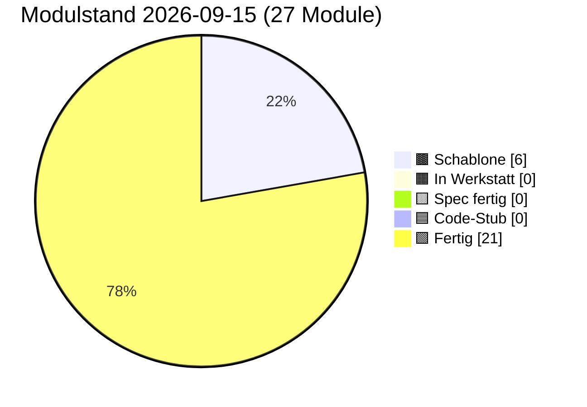

# PULS — lebender Status

**Format:** Jede Sitzung trägt unten einen Eintrag ein (neueste oben).
**Pflichtfelder pro Eintrag:** Datum · Sitzungs-Rolle · was getan · was offen · nächster sinnvoller Schritt.
**Begrenzung:** Diese Datei darf 3000 Zeilen nicht überschreiten. Älteres ins
`docs/sessions/archiv/`-Verzeichnis als Übergabeprotokoll auslagern.
**Schutz-Klausel (2026-05-17):** Die 3000-Zeilen-Grenze wurde bewusst hochgesetzt
(vorher 400) — Pflege-Sitzungen werden umfangreicher dokumentiert, weil
Architekturfunde und Diagnose-Routinen Platz brauchen. **Diese Grenze NICHT
wieder herabsetzen, auch nicht zum Token-Sparen.** Wenn 3000 Zeilen nahen,
auslagern statt kürzen.

---

## Modulstand heute

<!-- Pie-Block ab hier wird automatisch aus status.json generiert.
     Nicht von Hand bearbeiten. Erzeugen mit:
     python3 scripts/update_puls_pie.py
     Aufruf-Pflicht: nach jeder status.json-Änderung. Siehe CLAUDE.md. -->


Farb-Mapping verbindlich in [INTERFACES.md §5](INTERFACES.md). Live-Bau-Puls
auf der [Sage-Page](../index.html) (Karte "Bau-Puls").

## 2026-10-18 · Installieren: Manifest-id, Rat, Kontrast, Knopf in jede App (Hauptsitzung)

Manifest-`id` absolut im eigenen Ordner (Chrome rechnet vom Ursprung, `./` kollidierte), Rat ohne
„Websitedaten löschen" (#1151), Kontrast-Sicherung der Meldung (#1152), `data-in` für den Knopf in den
Einstellungen (#1153, #1154) — und der Knopf in jeder installierbaren App (rund 50 PRs, je im Browser
gemessen). Papas Aktenschrank installierbar, kim-hub-company auf Kimhub-Stand. Offen: Workfloh-PDF-Page
räumt fremde Vorräte weg → `docs/sessions/BRIEF_2026-10-18_workfloh-pdf-page-vorraete.md`.
Danach (19:20–20:28 UTC) der Knopf **zusätzlich oben in der Kopfleiste** jeder App mit Einstellungen, als App
weg (Bericht § 4). Benannt: der Kanon-Knopf verschwindet nach `appinstalled` erst beim nächsten Öffnen.
Übergabe: `docs/sessions/archiv/2026-10-18_installieren-knopf.md`. ⚠ Am Tablet nur die Manifest-id bestätigt.

## 2026-10-16 · Überblick „Mit dem Mycel verbinden“ und Siegel: sicherheit.html neu, DE/EN, in 27 Träger (Hauptsitzung)
- **Startprüfung:** frisch von `origin/main`; Auftrag `sessions/BRIEF_2026-10-17_ueberblick_mycel_siegel.md`.
- **Klaus' Antworten:** `sicherheit.html` **erweitern** (keine neue Seite) · **Deutsch und Englisch**. Mitten in der Sitzung dazu: die neuen Schutzschichten müssen hinein; **Wort-Links** („auf ein Hauptwort klicken, hinspringen, und wieder zurück“); **warum Schutz nötig ist** aus den Papers.
- **Gebaut (Sage):** `sicherheit.html` als Überblick in Stichworten, 14 Abschnitte (Mycel, Nutzen, Fenster, Karten, Siegel, Lampen, **Warum es Schutz braucht**, Schichten S1–S5b samt Prüfliste und eigenem Netz, eigenes Netz einrichten, Empfehlen und Sperren, Regel, Grenzen aus Paper S § 12, Mehr lesen, Wörterbuch). Zwei Sprachblöcke `#de`/`#en`; Sprache: `?lang=` · `data-sprache-schluessel` · Seite drumherum · Browser. Jedes unterstrichene Wort springt; „↩ zurück“ schwebend und am Ziel, zweiter Tipp aufs Wort oder Tipp aufs erklärte Wort führt zurück; ohne Skript gehen die Sprünge trotzdem. Knopf- und Lampennamen aus dem Code gelesen (Modul 16, 16b, 17, 23-UI, 23b), nicht aus dem Gedächtnis.
- **Befund aus dem Code, gegen den Brief:** im Raum gibt es kein Abzeichen „echt“ und keins „Namensvetter“. Eine gefälschte Karte wird verworfen; bei gleichem Namen steht „⚠ Derselbe Name noch …“. Die Seite nennt, was wirklich angezeigt wird. Die VERKEHR-Lampe ist gold, ihr Hinweistext sagt „grün“ (Modul 17, nicht geändert).
- **Proben:** `tests/smoke_sicherheit_seite.mjs` 28 grün (Datei und echter Browser), Gegenprobe 23/23 · `tests/smoke_sicherheit_verteilen.mjs` 17 grün, Gegenprobe 11/11 (zuerst 1 blind: der gestellte Titel endete schon mit dem Namen, nachgestellt am echten Fall Mein-Rezeptbuch „· SBKIM“).
- **Verteilen:** neues `tools/sicherheit-verteilen.mjs` (Liste gefunden; Akzent, Rückweg, Titel, Sprach-Schlüssel, canonical und die Marken `APP-EIGEN-DE/-EN/-KOPF/-FUSS` bleiben; Cache-Bump über `tools/lib/cache-bump.mjs`, Kopie aus dem Kanon-Verteiler, Pflege § 36). 27 Träger, drei davon hatten **gar keine** Seite (Workflow-Calculate, -Needs, -PDF: 404 hinter „Ausführlich erklärt“). Kimboard behält „Melden“ und „Private Nachrichten“ (jetzt auch englisch). family-project: indexierbar, Sprachriegel, `fp_lang`; dessen Übersetzungs-Probe auf zwei Sprachblöcke umgestellt (Tafel-Evolution, benannt), 55 grün, Gegenprobe 25 gefangen · 1 toter Anker in `assets/app.js` (nicht von hier). Zwölf Träger hatten kein `noindex`, jetzt ja (außer family-project).
- **Eigener Fehler, benannt:** der zweite Lauf des Werkzeugs überschrieb family-projects Sprachriegel, weil das Erkennungsmerkmal `data-i18n` nach dem ersten Lauf weg war. Aus Git zurückgeholt, seitdem die Marken `APP-EIGEN-KOPF/-FUSS`.
- **PRs (alle gemergt):** Alis-Moderaum #81 · Auslieferung-Pruefer #62 · Jasons-Tresor #195 · Kim-Bell #81 · Kim-sync #28 · Kimboard #161 · Kimseek #101 · Kuechenzettel #17 · Mein-In-and-Out-Book #17 · Mein-Mixarium #258 · Mein-Rezeptbuch #447 · Mein-Tresor #143 · Mein-WorkFloh #276 · Mein-Workfloh-Page #44 · Muttis-Rezeptbuch #252 · PWA-Toolpoint #177 · Perfect-Skin-Beauty #81 · Perfect-Skin-Fashion #53 · Privat-Brain #114 · SB-KIMTool-Point #195 · Sende-Pruefer #89 · Tomys-Hub #255 · Workflow-Calculate #30 · Workflow-Needs #27 · Workflow-PDF #125 · kim-hub-company #85 · family-project #369. Eigene Proben je Träger grün (`npm test` rc=0; Mixarium, Muttis, Tomys-Hub ohne `package.json`, dort kennt keine Probe die Seite). **Auf `main` nachgezählt: 27/27.**
- **Nicht gemessen:** Tablet (Sprünge mit dem Finger, iframe im Siegel am Gerät). Vier Träger verlieren ihr eigenes Aussehen der Seite (Pflege § 37). Die russische Oberfläche des Auslieferungsprüfers bekommt die Seite auf Deutsch oder Englisch (die Seite kennt nur zwei Sprachen). Nach den Merges am Gerät ⟳ / Hard-Reload. SIGNAL `seq` 99.
- **Offen:** Klaus' Sichttest; Paper S weiter im Gegenlesen; Pflege § 36/37.
- **Datum berichtigt (eigener Fehler):** zuerst stand überall 2026-10-17 (der Name des Briefs), gearbeitet wurde am 2026-10-16. In Sage nachgezogen (Sage #1149); in den 27 Kopien steht das falsche Datum nur im Kopf-Kommentar von `sicherheit.html` und in einem Kommentar der family-project-Probe, es kommt mit dem nächsten Verteilen mit.

## 2026-10-16 abends · Sammel-Brief: Schritt 6 wartet auf Klaus (Hauptsitzung)
- **Startprüfung:** Sitzungsliste: nur diese Sitzung lief (zwei weitere untätig seit 13:58 und 16:33); kein offener PR in Sage. Erster offener Schritt: 6. Alle übrigen Schritte stehen auf `main` als erledigt.
- **11.4 erneut versucht:** `family-projekt.de`, `pwa-toolpoint.de`, `…github.io/Perfect-Skin-Beauty/` antworten aus dem Container mit HTTP 000 (dritter Versuch nach 2026-10-15 und dem Mittag des 2026-10-16).
- **Nicht gebaut:** nichts. Paper S nicht verändert (Gegenlesen steht bei Klaus).
- **Danach auf Klaus' Wort:** Abschnitt 11.4 aus Paper S herausgenommen, Absatz zur Content-Security-Policy in 11.3 (Quelltext von Sage, PWA-Toolpoint, family-project, Perfect-Skin-Beauty, Auslieferung-Pruefer: keine CSP, nicht abgerufen). Klaus bekam eine PDF-Lesefassung (nicht im Depot).
- **Gegenlesen, erste Runde (Klaus):** zwölf Stellen in Paper S geändert (Liste in `PLAN_PAPER_KNOTENNETZ.md`); die Membran-Aussage im Code von Modul 15 nachgesehen (zeigt und weist Zugriffe über Nachrichten ab, sieht das Lesen der Seite nicht); CSP-Absatz als Pflege-Liste § 34.
- **Zweite Runde:** Stil wie im SBKIM-Paper („wir“, neutral; 6.4 ohne Person, Tafel-Evolution im Plan benannt), Abschirmung des Sende-Prüfers in 2.1, S2-Messung vom Tablet als Tabelle in 7.2 (2026-10-16: 9/11 Sporen 1,0000, Schnipsel ab 0,9949; SB-KIMTool-Point 0,8879 und BookLedgerPro 0,9020 passen nicht → Pflege-Liste § 35).
- **Offen:** weitere Runden Gegenlesen · danach HTML und EN. Die Termux-Prüfung der drei Seiten ist jetzt Klaus' eigene Sache, nicht mehr Teil des Papers.
- **Abschluss:** Übergabe `sessions/archiv/2026-10-16_paper-s-gegenlesen-abschluss.md`; neuer Auftrag `sessions/BRIEF_2026-10-17_ueberblick_mycel_siegel.md` (Überblick in Stichworten zu „Mit dem Mycel verbinden“ und Siegel; `sicherheit.html` stammt vom 2026-10-13 und kennt S1–S5b nicht). Forschungseintrag in Kimhub nachgetragen; offene Einträge früherer Sitzungen: keine mit Commits in den sieben hier geprüften Depots.

## 2026-10-16 · Paper S Fassung 2 · Bestand: drei Knoten in beide Märkte, neun in die Mycel-Karte (Hauptsitzung)
- **Startprüfung:** Sitzungsliste: nur diese Sitzung lief; kein offener PR in Sage. Erster offener Schritt: 6.
- **Paper S Fassung 2 (Sage #1140):** S3/S4/S5 standen als „geplant“ → gebaut, 29 Träger; S5b in Abschnitt 8 (Empfehlen, Haftung je App, 180 Tage, Widerruf mit Grund). Proben-Tabelle 9.1, an dem Tag neu gelaufen (Proben 13/27/19/33/70/44/42/13/11, Gegenproben 7/14/14/15/31/24/31/10). Abschnitt 3 nannte S3 „am Tablet gemessen“ — berichtigt. DOI Greshake, SybilGuard, Ozata über Suchauszüge. 11.4 weiter nicht abgerufen (Proxy und WebFetch gesperrt).
- **Gegenprobe S3:** auf `main` 2 tote Anker seit #1136 (Frage-Weg umgebaut); nachgezogen, 14/14, P2/P3 mit Namen.
- **Klaus mitten in der Sitzung:** „ich habe nicht nur 14“. Bestand gegen Kataloge und Karte abgeglichen: In-and-Out-Book, Workflow Calculate, Workflow Bedarfsanalyse fehlten in beiden Märkten → Klaus: alle drei. family-project #368, PWA-Toolpoint #176 (je drei Einträge, Detailseiten, Sitemap, Cache-Bump; keine Messwerte erfunden; Klaus: „nichts von Geld“, der Stufe-1-Wächter fing ein „Preis“). Mycel-Karte: neun Knoten fehlten im Adressbuch (mycel-karte #33, Sage-Kopie hier); `kuechenzettel` traf „Küchenzettel“ nie (Umlaut fällt im Schlüssel weg), ergänzt.
- **Auf `main` nachgezählt:** Sage #1140 (Fassung 2, Anker, DOI) · mycel-karte #33 (Schlüssel, v30) · PWA-Toolpoint #176 (3 Einträge, v100, 3 Detailseiten) · family-project #368.
- **Eigener Fehler, benannt:** die family-project-Gegenproben liefen über ungesicherter Arbeit; danach waren `listings.js` und vier Seiten zurückgesetzt und eine Sabotage lag liegen (`sh_h1_AUS`). Wiederhergestellt, jede fremde Datei gegen `main` verglichen, erst dann committet (Pflege-Liste § 31).
- **Rot und auf `main` genauso:** PWA-Toolpoint Detailseiten „Tablet quer“ (deshalb bricht `gegenprobe.sh` ab); family-project `smoke_kein_sprung`, Gegenproben `angleichen`, `detail_gestalt`, `fremdmarkt` (Pflege § 31).
- **Nicht gemessen:** Tablet. Nach den Merges am Gerät ⟳ / Hard-Reload. SIGNAL `seq` 98.
- **Offen:** Schritt 6 (Klaus' Gegenlesen; 11.4 von Klaus' Gerät; HTML und EN). Sporen für zehn Träger (Pflege § 32). Pflege § 33.

## 2026-10-16 · S5b Teil 2: Netz-Verwaltung, „Empfehlen“, Empfehlung kommt von selbst an — gebaut und in 29 Träger ausgerollt (Hauptsitzung)
- **Startprüfung:** Sitzungsliste: die vorige Sammel-Brief-Sitzung war beendet (Übergabe #1137 gemergt, danach „Prompt is too long“), ihr Zweig ohne eigene Commits; kein offener PR in Sage. Erster offener Schritt: 5b (Teil 2).
- **Klaus mitten in der Sitzung (2026-10-16):** (1) die Listen auf eine **eigene Seite**, nicht ins Studio („vom Umfang viel zu groß“), mit Klicks für Widerruf, Widerruf rückgängig, Bürgschaft erteilen; klar machen, wie andere Nutzer aus ihrer App bürgen. (2) Wort: gefragt mit vier Vorschlägen → **„Empfehlen“**. (3) Übergabe gefragt → **„Von selbst über den Raum“**.
- **Gebaut (Sage #1138):** INTERFACES § Modul 23 „S5b Teil 2“ und § Modul 23b zuerst. Neu `src/modules/23b_netzverwaltung.js` (vier Listen mit Suche; Empfehlen/Verlängern/Widerrufen mit Grund/Widerruf zurücknehmen; Sperren und Lösen nur Netzadmin, widerruft zuerst; Spore-Prüfung für die Freigabe; `page()` für die eigene Seite). Sage: `netz-verwaltung.html`, langer Druck aufs © (`assets/studio-sage.js`, selber Tab). Modul 23: Vorrat `issued`, Karte trägt ≤ 8, `discover()` holt Empfehlungen für die eigene Kennung ab (nur von Ausstellern, die zählen; Unterschrift geprüft), `picked`. 23-UI und Siegel: „Empfehlen“ statt „Bürgen“ (DE/EN), Siegel-Aspekt „Empfehlungen kommen von selbst an (S5b Teil 2)“. Anleitung `docs/ANLEITUNG_EMPFEHLEN.md`.
- **Gemessen:** 23b Kern 42 grün, Browser 13 grün, Gegenprobe 31/31 · Übergabe 11 grün, Gegenprobe 10/10 · S5 70, S5b 44, `netz_eigen` 69, 23-UI 102, Bündel nachgezogen. Probe fand zwei echte Fehler in 23b (gleiche Sekunde → falsche Fassung; untergeschobener Zettel stellte das Ablaufdatum), beide behoben. Drei blinde Wächter beim ersten Gegenprobe-Lauf, nachgezogen.
- **Rollout:** `kanon-verteilen --nur 16_siegel,23_rendezvous,23_rendezvous_ui --schreiben`, 84 Dateien, keine Handarbeit, je Träger genau eine Fassung zurück. Sechs Hilfs-Sitzungen (vier für 27 Apps, je eine für die Märkte). Märkte zusätzlich: `sbkim/23b_netzverwaltung.js`, `netz-verwaltung.html`, Studio-Feld `nodeId` (in `normEntry`), „🧬 Spore prüfen“, „🕸 Netz-Verwaltung öffnen“; je eigene Probe + Gegenprobe (PWA Toolpoint 23 grün, family-project 16 grün / Gegenprobe 10/10). Rot und auf `main` genauso: BookLedgerPro `smoke_a5_antwortpfad`, Perfect-Skin-Beauty `smoke_sprachen`, family-project `smoke_kein_sprung`. Sage: `smoke_service_worker_parst` rot nur mit zwei Nachbar-Klonen (Pflege #26).
- **PRs:** Alis-Moderaum #80 · Auslieferung-Pruefer #61 · BookLedgerPro #342 · Company-Brain #32 · Jasons-Tresor #194 · Kim-Bell #80 · Kim-sync #27 · Kimboard #160 · Kimseek #100 · Kuechenzettel #16 · Mein-In-and-Out-Book #16 · Mein-Mixarium #257 · Mein-Rezeptbuch #446 · Mein-Tresor #142 · Mein-WorkFloh #275 · Mein-Workfloh-Page #43 · Muttis-Rezeptbuch #251 · PWA-Toolpoint #175 · Perfect-Skin-Beauty #80 · Perfect-Skin-Fashion #52 · Privat-Brain #113 · SB-KIMTool-Point #194 · Sende-Pruefer #88 · Tomys-Hub #254 · Workflow-Calculate #29 · Workflow-Needs #26 · Workflow-PDF #124 · family-project #367 · kim-hub-company #84. Auf `main` nachgezählt (selbst, nicht nur die Helfer): 29/29 mit `RDV_ISSUED_PER_CARD_MAX = 8`, 28 mit Siegel-Aspekt (Company-Brain ohne Siegel), beide Märkte mit 23b und Seite.
- **Nicht gemessen:** Tablet; zwei echte Geräte, zwischen denen eine Empfehlung von selbst ankommt; die echte Identität der Märkte auf der neuen Seite. Nach dem Merge am Gerät ⟳ / Hard-Reload. SIGNAL `seq` 97.
- **Offen:** Kennungen (`nodeId`) der Markt-Einträge eintragen (Klaus, im Studio); Hinweis vor dem Ablauf im Siegel der App; Paper S (Schritt 6). Funde: Pflege-Liste #25–#30.

## 2026-10-16 · S5b Teil 1 gebaut und in 29 Träger ausgerollt (Hauptsitzung)
- **Startprüfung:** Sitzungsliste: nur diese Sitzung lief; kein offener PR in Sage. Erster offener Schritt: 5b.
- **Gebaut (Sage #1136):** INTERFACES § Modul 23 S5b zuerst (Tafel-Evolution S5 benannt). Haftung je App · Frist 180 Tage (`RDV_VOUCH_TTL_SEC`) · `vouchExpiring` (30 Tage) · Widerruf mit Pflichtfeld `reason` (≤ 200) · gesehene Widerrufe gespeichert (`sbkim_widerrufe_<suffix>`, ≤ 256, beim Lesen neu geprüft, eigenes Budget) · „antworte nur Verbürgten“ (`setAnswerOnlyVouched`, Vorgabe aus; Frage trägt ≤ 4 Bürgschaften). 23-UI: Grund-Feld, Ablauf-Hinweis, Schalter. Siegel-Aspekt S5b; S5-Aspekt berichtigt („ein Jahr“, „verliert alle“). Bündel-Kopien nachgezogen.
- **Gemessen:** `smoke_s5b_buergen_maerkte` 44 grün, Gegenprobe 24/24. S5 70 grün / 31/31, S4 33 / 15/15, `smoke_netz_eigen` 69. `run_alle` 4 rot vor dem Bündel-Nachzug, danach bleiben `geraetename_netzweit` und `service_worker_parst` (keine Nachbar-Klone im Behälter).
- **Eigener Fehler, benannt:** E1 war zweimal ein blinder Wächter (fremde Bürgschaft vom selben Bürgen wie eine eigene, „neueste je Bürge“ verdeckte sie); erst die Gegenprobe zeigte es. Gegenprobe kopierte `docs/` nicht (Z3 stürzte ab), nachgezogen.
- **Rollout:** `kanon-verteilen --nur 16_siegel,23_rendezvous --schreiben`, 84 Dateien in 29 Trägern, keine Handarbeit, je Träger eine Fassung (die aus S4). BookLedgerPro fehlte zuerst (Klon auf altem Zweig, § 17); danach meldet der Verteiler dort „1 Commit hinter origin“ — Vergleich gegen `origin/HEAD`, der auf den alten Zweig zeigt (Fehlalarm, § 17). Proben je Repo grün; rot und auf `main` genauso: PWA-Toolpoint `smoke_detail` (Tablet quer), BookLedgerPro `smoke_a5_antwortpfad`. Unter Parallel-Last je 1 rot, einzeln grün: Sende-Pruefer, Mixarium `smoke_bildausschnitt`. Nicht lauffähig, bis Links `/home/user/Workflow-PDF` und `/home/user/Auslieferung-Pruefer` (Großschreibung) gesetzt waren, danach grün: Company-/Privat-Brain, Reinigungs-Proben, Tomys `browser_eingang`/`browser_halt`.
- **PRs:** Alis-Moderaum #79 · Auslieferung-Pruefer #60 · BookLedgerPro #341 · Company-Brain #31 · Jasons-Tresor #193 · Kim-Bell #79 · Kim-sync #26 · Kimboard #159 · Kimseek #99 · Kuechenzettel #15 · Mein-In-and-Out-Book #15 · Mein-Mixarium #256 · Mein-Rezeptbuch #445 · Mein-Tresor #141 · Mein-WorkFloh #274 · Mein-Workfloh-Page #42 · Muttis-Rezeptbuch #250 · PWA-Toolpoint #174 · Perfect-Skin-Beauty #79 · Perfect-Skin-Fashion #51 · Privat-Brain #112 · SB-KIMTool-Point #193 · Sende-Pruefer #87 · Tomys-Hub #253 · Workflow-Calculate #28 · Workflow-Needs #25 · Workflow-PDF #123 · family-project #366 · kim-hub-company #83. Auf `main` 29/29 mit S5b-Code, 28 mit Siegel-Aspekt; Verteiler danach „0 hängen zurück“.
- **Nicht gemessen:** Tablet. Nach dem Merge am Gerät ⟳ / Hard-Reload. SIGNAL `seq` 96.
- **Offen:** S5b Netz-Verwaltung als Kanon in Sage, dann Studio in PWA Toolpoint und family-project; Ablauf-Hinweis im Siegel der App; Paper S (Schritt 6).

## 2026-10-16 · S5b geplant: Bürgen für fremde Apps in den Märkten (Hauptsitzung)

- **Getan:** Klaus' Entscheide zu Bürgschaften in PWA Toolpoint und family-projekt.de als
  Planpunkt S5b in `docs/PLAN_MYCEL_SCHICHTEN.md` eingetragen. Kein Code.
- **Entschieden:** Bürge haftet nur für die eine App (ersetzt „verliert alle", Tafel-Evolution
  benannt) · Ablauf höchstens 180 Tage · Hinweis 30 Tage vorher · Widerruf nur mit Grund ·
  Leser speichert Widerrufe · Widerruf reist nicht mit der Sperrliste (zurückgestellt).
- **Dazu (Sage #1132–#1134):** Netz-Verwaltung als eigener Bereich im Studio (vier Listen mit
  Suche, an drei Orten, Rechte nach Identität der Seite) · Firmennetz mitbedacht (Sperre und
  Bürgschaft regeln Antworten, nicht das Lesen am Relais; „antworte nur Verbürgten") · Name
  „Studio", Zugang über langen Druck auf das ©.
- **Offen:** Bau als Schritt 5b im Sammel-Brief, zuerst INTERFACES. Übergabe:
  `docs/sessions/archiv/2026-10-16_s5b-plan.md`.

## 2026-10-16 · S4 Sperrliste gebaut und in 29 Träger ausgerollt (Hauptsitzung)
- **Startprüfung:** kein offener PR in Sage; erster offener Schritt: 5 (S4, Klaus' Entscheid fehlte). **Zwei Sitzungen am selben Brief, 53 s nacheinander gestartet** („Sage-Protokol 1/2 Abarbeitung“); die zweite fand die erste nur über die Sitzungsliste, nicht über PRs/Zweige (nichts gepusht), und brach ohne Bau ab (Kimhub #394). Diese Sitzung bestätigte sich danach über `list_sessions` als einzige laufende. Schritt 0 im Brief nennt jetzt die Sitzungsliste.
- **Entscheid (Klaus 2026-10-16):** öffentlich und signiert; liegt in Sage, Sage-Protokol unterschreibt (auf Nachfrage bestätigt: dieselbe Kennung wie beim Bürgen, die Offenheit des Repos ändert nichts). Tafel-Widerspruch zu Karte 12 aufgelöst, Karte 12 benannt.
- **Gebaut (Sage #1129):** INTERFACES § Modul 23 S4 zuerst. Zettel `sbkim-blocklist` (admin, ts, ≤ 256 ids, spore, sig), gültig nur vom Netzadmin des Lesers; reist auf den Karten mit (kein Abruf), Speicher `sbkim_sperre_<suffix>` beim Lesen neu geprüft. Gesperrte Karten fallen aus `discover()` (`gesperrt`), ihre Fragen werden nicht beantwortet, Antworten verworfen (auch `fetchAnswers`), für S5 „aufgefallen“. 23-UI: Kasten „⛔ Sperrliste“, Knopf „⛔ Sperren“ nur beim Netzadmin. Siegel-Aspekt S4 DE/EN.
- **Gemessen:** `smoke_s4_sperrliste` 33 grün (Oberfläche im Chromium DE/EN, 360 px), Gegenprobe 15/15, jede erste rote Zeile mit dem Namen der Zusicherung; F7 war zuerst blind (prüfte nur das Wort „Netzadmin“, das auch in einer anderen Meldung steht), vor dem Lauf geschärft. S5-Gegenprobe: 2 tote Anker aus dem eigenen Bau (wortgleiche Prüfzeilen), nachgezogen → 31/31. `smoke_netz_eigen` (neues Feld) 69 grün, Gegenprobe 14/14. `run_alle` 126 grün · 1 rot (eben diese, behoben) · 1 nicht lauffähig (`vorrat_wirkung`, mycel-karte nicht geklont); Baum vor/nach gleich.
- **Eigene Fehler, benannt:** `git stash` während eines laufenden Probenlaufs (Lauf verworfen, neu gefahren); `pkill -f` traf die eigene Shell (Falle aus Kimhubs Verfassung); ein Python-Ersatz in Karte 12 griff nicht und ging ohne Abbruch durch (zweiter Commit).
- **Rollout:** `kanon-verteilen --nur 16_siegel,23_rendezvous --schreiben`, 84 Dateien in 29 Trägern, keine Handarbeit. BookLedgerPro fehlte zuerst wieder (`origin/HEAD` auf altem Zweig, § 17). Proben je Repo grün; PWA-Toolpoint `smoke_detail` 1 rot und auf `main` gleich (Layout „Kopf 100 px, Überschrift bei 95“); Sende-Pruefer unter paralleler Last 1 rot, allein 682 grün.
- **PRs:** Alis-Moderaum #78 · Auslieferung-Pruefer #59 · BookLedgerPro #340 · Company-Brain #30 · Jasons-Tresor #192 · Kim-Bell #78 · Kim-sync #25 · Kimboard #158 · Kimseek #98 · Kuechenzettel #14 · Mein-In-and-Out-Book #14 · Mein-Mixarium #255 · Mein-Rezeptbuch #444 · Mein-Tresor #140 · Mein-WorkFloh #273 · Mein-Workfloh-Page #41 · Muttis-Rezeptbuch #249 · PWA-Toolpoint #173 · Perfect-Skin-Beauty #78 · Perfect-Skin-Fashion #50 · Privat-Brain #111 · SB-KIMTool-Point #192 · Sende-Pruefer #86 · Tomys-Hub #252 · Workflow-Calculate #27 · Workflow-Needs #24 · Workflow-PDF #122 · family-project #365 · kim-hub-company #82. Auf `main` 29/29 mit `RDV_BLOCK_KIND`, 28 mit Siegel-Aspekt S4 (Company-Brain ohne Siegel); Verteiler danach „84 schon gleich · 0 hängen zurück“. Zweige danach gehoben (per `ls-remote` = `main`).
- **Nicht gemessen:** Tablet; eine echte, von Sage-Protokol unterschriebene Liste (das kann nur Klaus am Gerät, im Sage-Mycel-Fenster: an der Karte „⛔ Sperren“); `sbkim/sperrliste.json` gibt es deshalb noch nicht. Nach dem Merge am Gerät ⟳ / Hard-Reload. SIGNAL `seq` 95.
- **Offen:** Sammel-Brief Schritt 6 (Paper S: Gegenlesen, nennt S3/S4/S5 noch „geplant“); Pflege-Liste § 22–24; Privat-Brains Mycel-Fenster ohne Sperrlisten-Kasten (wie § 19).

## 2026-10-16 · S3 Rechenaufwand gebaut und in 29 Träger ausgerollt (Hauptsitzung)
- **Startprüfung:** kein offener PR in Sage; erster offener Schritt im Sammel-Brief: 5 (S3). Parallel lief die Sitzung „Pflege-Liste § 18“ (#1126, anderes Thema); vor dem PR zusammengeführt, ihre § 22 behalten, meine Funde als § 23/§ 24.
- **Entscheid (Klaus 2026-10-16):** 12 Stufen, Karten + Fragen, „Vorrang bei Enge“. Meine erste Zeitangabe (0,2 s / 40 s für 200 Karten) kam aus `crypto.subtle` und war falsch; vor dem Bau richtiggestellt (reines JS ~0,03 s, Rechner-Code ~0,01 s je Zettel). Klaus fragte, ob mehr Aufwand besser wäre, und blieb bei 12.
- **Gebaut (Sage #1127):** INTERFACES § Modul 23 S3 zuerst. Feld `pow` in Karte und Frage (synchrones SHA-256 im Modul, Nonce ohne Zufall), Frage: erst Aufwand, dann Unterschrift. Voller Raum → Karte mit Aufwand verdrängt die zuletzt gekommene ohne; Fragen ohne Aufwand ≤ 4 von 6 je Minute (Setzung dieser Sitzung). `_meta` und `discover().verdraengt`. Siegel-Aspekt S3 DE/EN.
- **Gemessen:** `smoke_s3_aufwand` 19 grün (nachgerechnet mit Node-crypto), Gegenprobe 14/14. `smoke_netz_eigen` war rot (Nonce-Suche verbrauchte `Math.random`, die qid verschob sich) → Suche ab 0, neue Felder benannt, 68 grün, Gegenprobe 14/14. `gegenprobe_s1_fragen` Anker nachgezogen 7/7. `run_alle` 124 grün · 1 rot (§ 24) · 1 nicht lauffähig.
- **Rollout:** `kanon-verteilen --nur 16_siegel,23_rendezvous --schreiben`, 57 Dateien in 29 Trägern, keine Handarbeit; erster Rollout mit dem Verteiler aus #1126 (Manifest-`?v=` In-and-Out-Book, Proben-Pins, `cache-stand` Workflow-Calculate/-Needs mitgezogen). Proben je Repo grün; rot und auf `main` genauso: BookLedgerPro `smoke_a5_antwortpfad` (BLP_QUERY_SYNONYMS), family-project `smoke_stufe2_sporen` (8, § 20). Gemeinsamer Paket-Ordner `/home/user/_pakete` (playwright-core 1.56.1, pdf-lib, @pdf-lib/fontkit, fake-indexeddb). family-project: `main` bewegte sich (tägliche Aktualisierung 364cb50), vor dem PR hineingeführt.
- **PRs:** Alis-Moderaum #77 · Auslieferung-Pruefer #58 · BookLedgerPro #339 · Company-Brain #29 · Jasons-Tresor #191 · Kim-Bell #77 · Kim-sync #24 · Kimboard #157 · Kimseek #97 · Kuechenzettel #13 · Mein-In-and-Out-Book #13 · Mein-Mixarium #254 · Mein-Rezeptbuch #443 · Mein-Tresor #139 · Mein-WorkFloh #272 · Mein-Workfloh-Page #40 · Muttis-Rezeptbuch #248 · PWA-Toolpoint #172 · Perfect-Skin-Beauty #77 · Perfect-Skin-Fashion #49 · Privat-Brain #110 · SB-KIMTool-Point #191 · Sende-Pruefer #85 · Tomys-Hub #251 · Workflow-Calculate #26 · Workflow-Needs #23 · Workflow-PDF #121 · family-project #364 · kim-hub-company #81. Auf `main` 29/29 mit `RDV_POW_BITS = 12`, 28/28 mit Siegel-Aspekt S3; Verteiler danach „84 schon gleich · 0 hängen zurück“. Zweige danach gehoben.
- **Nicht gemessen:** Tablet (Zeit je Zettel, Bedienbarkeit während der Suche). Nach dem Merge am Gerät ⟳ / Hard-Reload. SIGNAL `seq` 94.
- **Offen:** S4 nach Klaus' Entscheid (Sperrliste öffentlich oder nicht); Pflege-Liste § 22–24; Paper S nennt S3 noch „geplant“ (nicht geändert).


## 2026-10-16 · Pflege-Liste § 18: Verteiler zieht Manifest und Proben-Pin mit (Hauptsitzung)
- **Startprüfung:** eine zweite Sitzung arbeitet an S3 (wartet auf Klaus' Antwort zur Stärke); die S5-Sitzung ist abgestürzt, ihre Arbeit liegt auf `main` (#1125, Kimhub #390/#391). Klaus: Punkt 4 der Übergabe übernehmen.
- **Gebaut:** `tools/kanon-verteilen.mjs` zieht beim Cache-Bump `?v=` auch in `manifest.json`/`*.webmanifest` mit und in `tests/`/`test/` die volle alte Cache-Kennung. Ausgenommen: kürzere/längere/fremde Kennungen, kurze Vorsilben, `tests/cache-stand.json`.
- **Gemessen:** `smoke_kanon_mitziehen` 16 grün (alter Verteiler: 4 ROT) · Gegenprobe 7/7 · `smoke_kanon_cachestand` 15 grün (hat die erste Fassung gefangen) · `gegenprobe_kanon_cachestand` 6/6 · `smoke_kanon_verteilen` 65/0. An Kopien von In-and-Out-Book und Kim-sync: alter Verteiler je 1 ROT in der App-Probe, neuer je 0 ROT. `run_alle` 122 grün · 2 rot · 2 nicht lauffähig — die zwei roten (`geraetename_netzweit`, `service_worker_parst`) fehlen die Nachbar-Klone in diesem Behälter.
- **Offen:** Pflege-Liste § 22 (toter Anker in `gegenprobe_kanon_verteilen.sh`, auf `main` schon tot). S3 (andere Sitzung), S4 (Klaus' Entscheid), Sichttest Bürgen.
- **Nicht gemessen:** an einem echten Rollout. Der nächste Rollout zeigt die Zeile `↳ Proben mitgezogen` oder nicht.

## 2026-10-15 · S5 Teil 2 gebaut und in 29 Träger ausgerollt (Hauptsitzung)
- **Startprüfung:** kein offener PR in Sage; erster offener Schritt im Sammel-Brief: 5 (S5 Teil 2). Während der Sitzung hat eine zweite Sitzung #1122 (Mein-Workfloh-Page nachgezogen) gemergt — anderes Thema, vor dem PR zusammengeführt; Mein-Workfloh-Page damit 29. Träger.
- **Gebaut (Sage #1123):** INTERFACES § Modul 23 S5 Teil 2 zuerst. `RDV_OPEN_MYCEL_ADMIN` (Sage-Protokol, nur im öffentlichen Netz) ersetzt `RDV_VOUCH_ANCHORS`; Netz-Einstellung mit optionalem `admin` (geprüft, reist im Netz-Link als `a`); `rankCardsByQuery` stellt Netzadmin, Kontakte, Verbürgte vor die übrigen (nur mit Frage-Vektor, „passt nicht“ bleibt am Ende); `vouchSafetyNumber` (wie B7, aus beiden `publicKey.x`), `vouchPassOn`, `currentNetAdmin`. 23-UI: je Karte „🤝 Bürgen“, Kasten „🤝 Bürgschaften“, Netzadmin-Feld; „🤝 Anker“ → „🤝 Netzadmin“. Siegel-Aspekt S5. Bündel-Kopien nachgezogen.
- **Gemessen:** `smoke_s5_buergen` 70 grün (Oberfläche im echten Chromium DE/EN, 360 px), Gegenprobe 31/31 gefangen, jede erste rote Zeile mit dem Namen ihrer Zusicherung (ein Fall traf zuerst den Nachbarn N4 statt N5, Sabotage geschärft). `run_alle` 123 grün · 0 rot · 2 nicht lauffähig. Erster Lauf der Sicherheitsnummer rot: `publicKey` ist ein JWK, kein Text — die Probe hat es gefunden.
- **Rollout:** `kanon-verteilen --nur 16_siegel,23_rendezvous --schreiben`, 84 Dateien in 29 Trägern, keine Handarbeit. Proben je Repo grün; von Hand nachgezogen: Kim-sync Cache-Pin, In-and-Out-Book Manifest `?v=` (PFLEGE § 18, vierter Treffer). PWA-Toolpoint `smoke_detail` einmal rot unter paralleler Last (144,7 von 180 s), beim Wiederholen 780 grün. Mehrere Proben brauchen Nachbar-Klone unter ihrem Großbuchstaben-Namen (`/home/user/Workflow-PDF`, `/home/user/Auslieferung-Pruefer`), sonst „nicht lauffähig“.
- **PRs:** Alis-Moderaum #76 · Auslieferung-Pruefer #57 · BookLedgerPro #338 · Company-Brain #28 · Jasons-Tresor #190 · Kim-Bell #76 · Kim-sync #23 · Kimboard #156 · Kimseek #96 · Kuechenzettel #12 · Mein-In-and-Out-Book #12 · Mein-Mixarium #253 · Mein-Rezeptbuch #442 · Mein-Tresor #138 · Mein-WorkFloh #271 · Mein-Workfloh-Page #39 · Muttis-Rezeptbuch #247 · PWA-Toolpoint #171 · Perfect-Skin-Beauty #76 · Perfect-Skin-Fashion #48 · Privat-Brain #109 · SB-KIMTool-Point #190 · Sende-Pruefer #84 · Tomys-Hub #250 · Workflow-Calculate #25 · Workflow-Needs #22 · Workflow-PDF #120 · family-project #363 · kim-hub-company #80. Auf `main` 29/29 23 `00f1f66eb6c8`, 23-UI 27/27 `af3385d97111`, 16 28/28 `5c8c2b89e86a`; Verteiler danach „84 schon gleich · 0 hängen zurück“. Zweige danach gehoben.
- **Nicht gemessen:** Tablet; zwei echte Geräte, die einander bürgen. Nach dem Merge am Gerät ⟳ / Hard-Reload. SIGNAL `seq` 93.
- **Offen:** S3; S4 nach Klaus' Entscheid (Sperrliste öffentlich oder nicht); Paper S nennt S5 noch „geplant“.

## 2026-10-15 · Mein-Workfloh-Page („Muster Werbetechnik") nachgezogen (Hauptsitzung, Nachtrag zu A4)

- **Klaus' Wort:** nachziehen. Damit gilt „NIE anfassen: *-Page" für dieses Repo nicht (Vorlage-PWA und arbeitender Knoten, Schublade `workflohpage`).
- **Getan:** `kanon-verteilen --nur 02_spore,05b_nostr_relay,16_siegel,23_rendezvous --schreiben`, ein Lauf, keine Handarbeit. Gleicher Stand wie die übrigen 28 Träger seit #1118 (S1, S2, S5 Teil 1): 02 `0cbf0664e2a7`, 05b `030aa2d26014` → `37eee5b196b3`, 16 `853e60807e14`, 23 `3caa0bb1fbe7` → `bc8cc295b449`, 23-UI `828855bbbc0e`. Cache `werbetechnik-page-v27` → `v28`. PR Mein-Workfloh-Page #38, gemergt, auf `main` nachgezählt (alle fünf = Kanon, `RDV_LABEL_MAX = 200`, `RDV_MEANING_MIN = 0.99`), Zweig danach gehoben.
- **Gemessen:** `npm test` rc 0 vorher wie nachher (13 byte-1:1 · 9 · 14 · 84 grün). Gegenprobe des Repos 18/18. Von Hand: alte 23 zurück → Drift-Guard rot (rc=1). `index.html` im Chromium bis zum Kettenende: 23, 23-UI, 05b, Siegel, Spore da, vorher wie nachher; `Unexpected token 'export'` (noble als klassisches Skript) auch auf `main`.
- **Benannt:** 03 und 04 hängen zurück. Tablet nicht gemessen; am Gerät ⟳ / Hard-Reload.

## 2026-10-15 · Sitzungsende S5-Sitzung: Übergabe und Forschungseintrag (Hauptsitzung)
- **Diese Sitzung insgesamt:** S5 Teil 1 (#1116), Leitlinie Netzadmin und Zuordnung Module 10–12 (#1119), Netzadmin = Sage-Protokol, verbürgte Karten nach vorne (#1120). Alle auf `main` nachgezählt. Übergabe: `docs/sessions/archiv/2026-10-15_s5_buergen_teil1.md` (Nachtrag am Ende). Forschungseintrag in Kimhub.
- **Weiter:** Sammel-Brief Schritt 5, S5 Teil 2.

## 2026-10-15 · S5: Netzadmin ist Sage-Protokol, verbürgte Karten nach vorne (Hauptsitzung)
- **Klaus' Wort:** Er bürgt mit **Sage-Protokol** (Kennung `BgjXhSApoOrJ…`, `sbkim/spore.json`); verbürgte Karten rücken in der Frage-Rangfolge nach vorne. Das Wort „Netzadmin“ bleibt (Vorschlag „Netz-Ad-Mini“ verworfen: weniger verständlich, nicht übersetzbar). Eingetragen in `docs/PLAN_MYCEL_SCHICHTEN.md` S5 und im Sammel-Brief.
- **Offen:** S5 Teil 2 bauen (Oberfläche, Umbenennung, Kennung nur im offenen Mycel, Rangfolge), dann Rollout.

## 2026-10-15 · Schichten: Leitlinie Netzadmin, Zuordnung zu den Modulen 10–12 (Hauptsitzung)
- **Klaus' Wort:** Wer ein Netz betreibt, ist dort der **Netzadmin** (das Wort ersetzt „Anker“ in Doku und Oberfläche; im Code bleibt `anchor`). Bürgen, Melden und Sperrliste unterschreibt in jedem eigenen Netz dessen Netzadmin. Eingetragen in `docs/PLAN_MYCEL_SCHICHTEN.md`.
- **Gelesen:** Karten 10, 11, 12, 14 sind Pläne ohne Code. Zuordnung im Plan: Melden/Quorum = Modul 10, Rate-Limit = Modul 11 (+ S3), S4 = Modul 12, Modul 14 bleibt liegen.
- **Offen:** Sperrliste öffentlich (S4) oder nicht (Karte 12) — Klaus' Entscheid vor S4. Oberfläche zeigt noch „🤝 Anker“, umbenannt mit S5 Teil 2.

## 2026-10-15 · S5 Bürgen, Teil 1: Format, Prüfung, Anzeige in Sage (Hauptsitzung)
- **Startprüfung:** kein offener PR in Sage; erster offener Schritt im Sammel-Brief: 5. S2-Rollout wartet auf die Messung am Gerät. Klaus fragte, wie er misst — Anleitung im Chat gegeben (Seite `tools/s2-wiederholung.html`, Knopf „Messen", kleinster Wert).
- **Klaus' Wort zu S5:** Kette 2 Schritte, Anker „Klaus + eigene Kontakte", Ablauf 1 Jahr. Eingetragen in `docs/PLAN_MYCEL_SCHICHTEN.md`.
- **Gebaut:** INTERFACES § Modul 23 S5 zuerst, dann Modul 23: Bürgschaft und Widerruf als signierte Zettel (Modul 02 `signDetached`), reisen in der Raum-Karte mit (`vouches`, `revocations`); `vouchTrust` (Kette ≤ 2, Ablauf ≤ 1 Jahr und nicht still gekürzt, Zeit nicht in der Zukunft, Widerruf, „der Bürge haftet"); `createVouch`, `createRevocation`, `addCarried`, eigene Kontakte im Speicher `sbkim_buergen_<dbSuffix>`. Zettel werden aus ALLEN Karten-Ereignissen eines Laufs gesammelt, damit eine nachgemachte neuere Karte keinen Widerruf verdrängt. Anzeige an der Karte DE/EN, ein Name nur aus den eigenen Kontakten. Bündel-Kopien nachgezogen. Reine Anzeige, die Rangfolge ist unverändert.
- **Gemessen:** `smoke_s5_buergen` 41 grün (echtes Modul 01/02, drei Zeilen im echten Chromium bei 360 px), Gegenprobe 14 von 14 gefangen. Ein fünfzehnter Fall rutschte durch und war ein toter Anker: eine zweite Prüfung „Aufgefallener nie verbürgt" änderte nichts, weil dessen Bürge schon haftet. Die Zeile ist entfernt. `smoke_netz_eigen` verglich `discover` byte-gleich: wie bei S2 ohne das neue Feld `vouch`, das Feld selbst wird verlangt. `run_alle` danach: 2 rot (`smoke_geraetename_netzweit`, `smoke_service_worker_parst`, beide auch auf `main` rot) · 2 nicht lauffähig. `tests/manual_check.html` ungeprüft (kein Browser-Sichttest dieser Sitzung; die Browser-Zeilen der Probe laden 23 + 23-UI).
- **Nicht gemessen:** Tablet. **Offen:** Klaus' Bürgen-Identität (der feste Anker ist leer), Vorrang in der Frage-Rangfolge (Entscheid), Teil 2 (Oberfläche zum Ausstellen), Siegel-Aspekt und Rollout mit Teil 2.
- **Parallel:** Während dieser Sitzung hat eine zweite Sitzung am selben Sammel-Brief S2 mit Klaus gemessen (#1115) und Paper S Fassung 1 geschrieben (#1114). Kein Überschneiden mit S5; beim Zusammenführen bemerkt (Diff gegen `main` hätte 832 Zeilen fremder Arbeit zurückgedreht), vor dem PR zusammengeführt.

## 2026-10-15 · S2 in alle 28 Träger ausgerollt (Hauptsitzung)
- **Klaus' Wort:** „Du kannst S2 in alle Repos tragen … die 26, wo es Not tut oder wo es angedacht war.“ Dazu BookLedgerPro und Kuechenzettel, die Modul 23 ebenfalls tragen: 28.
- **Getan:** `kanon-verteilen --nur 16_siegel,23_rendezvous --schreiben`: 81 Dateien, eine ältere Fassung je Modul (S1-Stand), keine Handarbeit. S5 Teil 1 (#1116, parallele Sitzung, gemergt, kein offener PR) kam mit, im PR-Text genannt. Je Repo ein PR, gemergt. Privat-Brain: eigenes Mycel-Fenster zeigt jetzt die Bedeutungs-Prüfung, Auswahl beim Nachfragen beachtet sie (Probe ergänzt, Gegenprobe von Hand gefangen).
- **Gemessen:** auf `main` 28/28 mit `RDV_MEANING_MIN = 0.99`, 27 mit dem Siegel-Aspekt (Company-Brain ohne Siegel); Verteiler danach „81 schon gleich · 0 hängen zurück“. Proben je Repo grün, außer: Workflow-Needs `browser.mjs` 3 rot und family-project `smoke_stufe2_sporen`, beide auf `main` ebenso rot (Vergleichsordner neben den Klonen). Nachgezogen: Kim-sync Cache-Pin, In-and-Out-Book Manifest `?v=` (PFLEGE-LISTE § 18, dritter Treffer). Gemeinsamer Paket-Ordner brauchte `playwright-core@1.56.1` und `pdf-lib` (§ 20).
- **PRs:** Alis-Moderaum #75 · Auslieferung-Pruefer #56 · BookLedgerPro #337 · Company-Brain #27 · Jasons-Tresor #189 · Kim-Bell #75 · Kim-sync #22 · Kimboard #155 · Kimseek #95 · Kuechenzettel #11 · Mein-In-and-Out-Book #11 · Mein-Mixarium #252 · Mein-Rezeptbuch #441 · Mein-Tresor #137 · Mein-WorkFloh #270 · Muttis-Rezeptbuch #246 · PWA-Toolpoint #170 · Perfect-Skin-Beauty #75 · Perfect-Skin-Fashion #47 · Privat-Brain #108 · SB-KIMTool-Point #189 · Sende-Pruefer #83 · Tomys-Hub #249 · Workflow-Calculate #24 · Workflow-Needs #21 · Workflow-PDF #119 · family-project #362 · kim-hub-company #79.
- **Eingereiht:** PFLEGE-LISTE § 19 (eigene Mycel-Fenster), § 20 (Paket-Ordner), § 21 (Klaus' Idee BookLedgerPro im Firmennetz). SIGNAL `seq` 92.
- **Nicht gemessen:** Tablet nach dem Update (⟳ / Hard-Reload nötig).

## 2026-10-15 · S2 am Gerät gemessen: Schwelle 0,99 hält (Hauptsitzung)
- **Gemessen (Klaus, `tools/s2-wiederholung.html`, Chrome 154 am Tablet im DeX-Modus (Klaus' Auskunft; UA „X11; Linux x86_64“)):** Haupt-Vektor aus der Beschreibung bei 9 Sporen auf **1,0000** nachgerechnet. Satz-Schnipsel einzeln nachgerechnet **0,9949–0,9972** (40 aus 8 Sporen). SB-KIMTool-Point 0,8879 und BookLedgerPro 0,9020 passen nicht zur Beschreibung, beide ohne `embeddingSource` → S2 zeigt „nicht nachprüfbar“.
- **Gelesen daraus:** Wiederholgenauigkeit = Haupt-Vektor (exakt). Die Schnipsel-Abweichung kommt vermutlich vom Stapel beim Signieren (nicht gemessen); alle liegen über 0,99. Die Fazit-Zeile der Mess-Seite prüfte die Schnipsel gegen 0,995 und meldete deshalb fälschlich „zu prüfen“; jetzt: Haupt-Vektor exakt und Schnipsel ≥ 0,99.
- **Nächster Schritt:** S2 in alle Träger (`kanon-verteilen --nur 16_siegel,23_rendezvous`, dazu 23-UI).

## 2026-10-15 · Paper S: Fassung 1 (Entwurf) geschrieben (Hauptsitzung)
- **Getan:** `docs/papers/sicherer-umgang-im-knotennetz.md`, 14 Abschnitte nach der abgestimmten Gliederung; „Browser und Knotennetz“ als Abschnitt 11, damit die abgestimmten Nummern bleiben. Klaus' Lesart in 6.4 als seine gekennzeichnet. Die veröffentlichten Papers sind nicht geändert.
- **Quellen:** in derselben Sitzung nachgesehen, nicht aus dem Gedächtnis. Gelesen: Douceur, NIP-01/13, PGP-Handbuch 1994, OWASP Top 10 2025 und LLM 2026, Hashcash (Spiegel), GitHub-Diskussion #54257. Nur über Auszüge (der Abruf der meisten Verlags- und Blog-Seiten war im Container gesperrt): Biologie, Google-Blogs, W3C/WHATWG, Greshake, SybilGuard, SSB. Jeder Eintrag trägt seinen Prüfstand. Vier biologische Zuordnungen wurden korrigiert (mutS/RecA bei Bakterien, Schlüssel-Schloss nicht absolut, Handicap umstritten, virale Nachahmung). Ein Satz ohne Quelle (Web of Trust „gescheitert“) wurde gestrichen.
- **Nicht gemessen:** die drei Fallbeispiel-Seiten (11.4).
- **Offen:** Klaus' Gegenlesen; HTML erst danach mit DOI; englische Fassung.

## 2026-10-15 · Paper S: Gliederung abgestimmt (Hauptsitzung)
- **Klaus' Wort:** „Vorschlag ok“ zur Gliederung: die zwölf Abschnitte wie geplant, „Stand der Forschung“ als Abschnitt 3 hinter dem Bedrohungsmodell, Klaus' Lesart „Störungen als Prüfmechanismus“ als seine gekennzeichnet (jetzt Abschnitt 6). Nummern und Querverweise in `docs/papers/PLAN_PAPER_KNOTENNETZ.md` nachgezogen; Sammel-Brief Schritt 6: teilweise.
- **Offen:** Fassung 1 schreiben (Quellen vorher nachsehen, Klaus liest im Chat gegen). S2 steht dort als „in Sage gebaut, Rollout offen“, bis der Rollout auf `main` ist.

## 2026-10-15 · Sammel-Brief Schritt 7: Workflow-PDF-Probe hängt nicht mehr; Sitzungsende (Hauptsitzung)
- **Ursache gemessen:** Im hängenden Tab blieb `vendor/qrcode.js` liegen, weil `tab.route` erst am schon ladenden Tab einsetzte. Ein Fehler der Probe, nicht der App. Workflow-PDF #118: `ctx.route` vor dem Klick. Vorher 3/17 rot, danach 0/40; `npm test` 0. Auf `main` nachgezählt. PFLEGE-LISTE § 14 erledigt.
- **Diese Sitzung insgesamt:** S2-Entscheid (#1109), S2 gebaut (#1110), Küchenzettel im Mycel (#1111), Workflow-PDF #118. Übergabe: `docs/sessions/archiv/2026-10-15_s2_kuechenzettel_wpdf.md`.
- **Offen:** S2 am Gerät messen (`tools/s2-wiederholung.html`), dann S2-Rollout in alle Träger; Paper-S-Gliederung (Klaus); S5, S3, S4.

## 2026-10-15 · Küchenzettel im Mycel eingetragen (verified-match 0.897519) (Hauptsitzung)
- **Getan:** Klaus' Spore (am Gerät im Andock-Wizard erzeugt, 17:38:06Z) byte-gleich als `sbkim/kuechenzettel_inbox.json`; Prüf-Vermerk `sbkim/kuechenzettel_inbox.verify.md`; Zeile in `sbkim/NETZ-STAND.md`; Eintrag in `status.json`. Die Spore kam in `tools/s2-wiederholung.html` dazu.
- **Gemessen:** VALID (Modul-02-Pfad), id = SHA256(Pubkey) unabhängig nachgerechnet, Manipulationsprobe fällt durch, kein `d` im JWK, L2 = 1, 9 Schnipsel, `embeddingSource: "description"`. Sage-Cosinus **0.897519** (Depot-Maßstab) → `verified-match`. Keine personenbezogenen Daten in Beschreibung und Stichworten. Die Schnipsel enthalten die Stichworte, die Spore stammt also aus der Erst-Signatur („Beschreibung. Stichworte“), der zweiten Fassung, die S2 nachrechnet.
- **Nicht gemessen:** Raum-Beitritt, S2 mit dem echten Modell, Spore im App-Depot.

## 2026-10-15 · S2: Entscheid (Schwelle 0,99, Inhalts-Vektor „nicht nachprüfbar“) und Bau in Sage (Hauptsitzung)
- **Klaus' Wort:** Schwelle **0,99**; `embeddingSource: "content"` → Weg A (sichtbar, kein Abzug, kein „geprüft“, Schnipsel trotzdem nachrechnen). Eingetragen in `docs/PLAN_MYCEL_SCHICHTEN.md` S2 und im Sammel-Brief Schritt 5.
- **Gemessen:** 55 Paare der gespeicherten Vektoren in `sbkim/`: 0,780–0,983 (engstes Paar Jasons-Tresor ⟷ Mein-Tresor 0,983).
- **Nicht gemessen:** Wiederholgenauigkeit des Modells über Geräte (HuggingFace und family-projekt.de im Container gesperrt).
- **Fund:** Andock-Wizard bettet Erst-Signatur „Beschreibung. Stichworte“, Neu-Signieren nur die Beschreibung — der Empfänger muss beide nachrechnen.
- **Gebaut (gleiche Sitzung):** INTERFACES § Modul 23 S2 zuerst, dann Modul 23 `checkMeaning` (drei Text-Fassungen, dazu „Beschreibung Stichworte“ aus `tools/embed_helper.html`; nur mit geladenem Modell, sonst „nicht-geprueft“), `meaning` je Raum-Karte, „passt-nicht“ ohne Verwandtschafts- und Rang-Vorrang, bleibt sichtbar; Satz-Schnipsel gegen ihren eigenen Text (gekürzte „…“ übersprungen). Anzeige an der Karte DE/EN (fester Text). Siegel-Aspekt DE/EN. Bündel-Kopien nachgezogen.
- **Gemessen:** `smoke_s2_bedeutung` 27 grün (Modell als Attrappe; B1–B3 im echten Chromium, 360 px, fremder Name mit `` nur als Text), Gegenprobe 14/14 beim ersten Lauf. `run_alle` 120 grün · 2 rot (`smoke_geraetename_netzweit`, `smoke_service_worker_parst`, beide auch auf `main`) · 2 nicht lauffähig. `smoke_netz_eigen` verglich `discover` byte-gleich mit einer alten Fassung: wie bei `bestaetigt` (Bau 23.R) jetzt ohne das neue Feld `meaning`, das Feld selbst wird verlangt.
- **Werkzeug:** `tools/s2-wiederholung.html` misst am Gerät die Wiederholgenauigkeit an 33 Satz-Schnipseln aus 8 Depot-Sporen; lädt das Modell erst auf Knopfdruck. Im Chromium geladen: 320/412/1280 px ohne Überlauf, beim Laden kein Abruf außer Haus.
- **Nicht gemessen:** das echte Modell (Container gesperrt); Tablet. **Offen:** Messung am Gerät, Rollout in alle Träger.

## 2026-10-15 · Sammel-Brief Schritt 4, 4b, 5 (S1): Fragen unterschreiben netzweit, zwei Knoten angedockt (Hauptsitzung)
- **Schritt 4 (Klaus):** andocken Kuechenzettel und die Demo; nicht papas-aktenschrank, Kochfreunde. Für die Demo die öffentliche `sbkim-demo/` in Sage statt des privaten Repos semantic-match-demo.
- **S1 gebaut:** Sage #1106. INTERFACES Frage-Zettel v2 (spore + sig), Modul 23 prüft Fragen: bestätigt → 6/min, unbestätigt → höchstens 2 der 6 (Klaus' Wert), falsch → nicht beantwortet, sperrt die qid nicht. Siegel-Aspekt DE/EN. `smoke_s1_fragen_signiert` 13 grün, Gegenprobe 7/7.
- **S1 verteilt:** `kanon-verteilen --nur 16_siegel,23_rendezvous`, 26 Träger, 51 Dateien, je Repo eigene Proben, PR, Merge; auf `main` 26/26 nachgezählt, dann Zweige gehoben. Nebenfunde: Kim-sync-Probe nagelte `kimsync-v16`; In-and-Out-Book-Manifest `?v=` zog der Verteiler nicht mit.
- **Angedockt:** Kuechenzettel #10 (13 Module, feste Leiste, `kuechenzettel-v3`; Kopfleiste ragte auf `main` schon bei 360 px 33 px hinaus, jetzt passt sie bei 320/360/412). `sbkim-demo/` lädt den Kanon direkt aus `src/modules/`, Schublade `sbkimdemo`. Proben 54 bzw. 49 grün, Gegenproben 10/10 und 9/9.
- **Register:** `kuechenzettel`, `sbkimdemo`; kim-hub-company #78 (Kopie der Liste, dazu `inoutbook`, `kimsync`).
- **Paper S:** Klaus' Wünsche im Plan (Quellen mit „übernommen · vorgeschlagen · warum", drei Internetseiten ohne Alis, Browser und Knotennetz, Gegenlesen im Chat).
- **Wackel-Proben, nicht durch S1:** family-project `smoke_kein_sprung` (Zweig 42/42, `main` im selben Moment 41/42), Workflow-PDF `chrome.mjs` (Pflege-Liste #14; danach Zweig und `main` je 47/47).
- **Nicht gemessen:** Tablet; erste Sporen von Kuechenzettel und Demo.
- **Nachtrag BookLedgerPro:** fiel aus beiden Rollouts des Tages heraus (Vorgabe-Zweig auf GitHub ist nicht `main`, der Verteiler folgt `origin/HEAD`; PFLEGE-LISTE § 17). Modul 03, 16, 23 nachgeholt in BookLedgerPro #336, `tests/run.mjs` 2284 bestanden. Kimhub-Forschungseintrag #385.

## 2026-10-15 · Modul 03: Rückfall auf HuggingFace gebaut und netzweit verteilt (Hauptsitzung)
- **Anlass:** „Can't create a session“ in In-and-Out-Book, Kim-sync, Kimboard (Server-Modell); Alis (HuggingFace) ging. Server-Datei sha256 = HuggingFace; Inkognito lud; nach `caches.delete('transformers-cache')` lud es auch normal (PFLEGE-LISTE § 15).
- **Gebaut:** Sage #1103 — Rückfall in Modul 03 mit Leeren der Cache-Einträge der Wurzel und Rücksetzen von `env.localModelPath` (Haupt-Faden und Worker); `getModelFallback()`; INTERFACES §03 additiv. Probe `smoke_bau03_rueckfall` 33 grün, Gegenprobe 9/9 (erst 1 blind). Kopien in pinnwand/sbkim-bundle(-voll)/such-tool nachgezogen.
- **Verteilt:** `kanon-verteilen --nur 03_embedding --schreiben`: 26 Repos, 29 Kopien, zwei ältere Fassungen (`a6ac64d7536d` 21×, `e4bb8bd6a237` 8×). Je Repo eigene Proben, PR, Merge; alle 26 gemergt; auf `main` **29 von 29** Kopien byte-gleich mit dem Kanon `2e31baa09a29`, danach Zweige gehoben.
- **Unterwegs:** In-and-Out-Book neues Logo (Klaus) — Favicon-Ring mindestens 3 px, weil der helle Logo-Rand ihn bei 2 px einfärbte (Wächter war rot, Probe unverändert); Manifest und Gegenprobe-Anker auf `?v=9`. Kim-sync: Probe nagelte `kimsync-v15`. PWA-Toolpoint: eine Zeile in `smoke_detail` rot bei 151/180 s, einzeln auf Zweig und `main` je 780/0 — Ausreißer. Sage `smoke_service_worker_parst` rot, auf `main` ebenso.
- **Nicht gemessen:** Tablet; der Rückfall selbst im echten Browser.
- **Eingereiht:** PFLEGE-LISTE § 16 („~30 MB“ im Andock-Wizard, gemessen 118 MB).
- **Kim-sync bleibt privat** (Klaus): nicht im Mycel eintragen.

## 2026-10-15 · Mein In-and-Out-Book im Mycel eingetragen (Hauptsitzung)
- **Getan:** Klaus' Spore (am Tablet im Andock-Wizard erzeugt, 14:15:19Z) byte-gleich als `sbkim/inoutbook_inbox.json` abgelegt; Prüf-Vermerk `sbkim/inoutbook_inbox.verify.md`; Zeile in `sbkim/NETZ-STAND.md`; Eintrag in `status.json` (`endknoten`, 23. Eintrag).
- **Gemessen:** VALID (Modul-02-Pfad), id = SHA256(Pubkey), Manipulationsprobe fällt durch, kein `d` im JWK, L2 = 1, 11 Schnipsel. Sage-Cosinus **0.917311** (Depot-Maßstab) → `verified-match`.
- **Nicht gemessen:** Raum-Beitritt (`established`), Raum-Maßstab. Im App-Depot liegt keine `sbkim/spore.json` (`sporeUrl` leer).
- **Offen:** Kim-sync eintragen, sobald Klaus seine Spore schickt (Klaus: „erst einmal" nur das In-and-Out-Book).

## 2026-10-15 · Sammel-Brief Schritt 3: Mein-In-and-Out-Book und Kim-sync als SBKIM-Knoten angedockt (Hauptsitzung)

- **Getan:** zwei neue Knoten, Bauart Sende-Prüfer/Workflow-Needs (feste Leiste in der Kopfzeile, **kein Modul 17**): Mein-In-and-Out-Book #8 (Schublade `inoutbook`, Cache `inout-v8`, alle `?v=8`) und Kim-sync #19 (Schublade `kimsync`, Cache `kimsync-v15`). Je 13 Pflicht-Module byte-1:1 aus dem Kanon (23 `05a6eb42ec68`, 05b `37eee5b196b3`), in der App-Probe gepinnt; `window.SBKIM_DB_SUFFIX` im `<head>`; 05b als eigene `<script type="module">`-Zeile, nicht in der Nachlade-Kette; Identität `assets/siegel-inhalt.js` (Beschreibung ohne Post-Inhalt bzw. ohne Raum-Code); `sicherheit.html` daneben; alles im Vorrat. Kim-sync: noble ist die vorhandene Datei aus Kimboard (sha gleich Kanon), kein zweites Exemplar; `assets/pruefer-mail.js` byte-1:1 dazu. Register `sbkim/DB-SUFFIXE.md` um `inoutbook`, `kimsync` und das fehlende `workflowneeds` ergänzt.
- **Gemessen:** In-and-Out-Book `npm test` 158 → **231 grün · 0 ROT**; Kim-sync 249 → **336 grün · 0 ROT** (alle 249 alten Zeilen unverändert). Im Chromium je 4 Breiten: Kette bis zum Ende, alle Pflicht-Module da, Siegel stellt sich aus, Andock-Wizard öffnet, keine Seitenfehler, Kopfleiste ohne Überlauf, **keine WebSocket-Erzeugung und kein Abruf außer Haus beim Laden**. Gegenprobe: In-and-Out `KNOTEN:` 14/14 gefangen (6 nachgezogene Altfälle 6/6), Kim-sync neue `tests/gegenprobe-knoten.sh` 17/17. Erst 3 bzw. 1 Fall blind (Text-Wächter, WebSocket nur übers Netz-Ereignis gezählt, zweimal ein toter CSS-Eingriff) — geschärft. Verteiler `--nachbarn` ohne `--schreiben`: beide Träger gefunden, Knoten-Module gleich Kanon. Sage `run_alle` 117 grün · 1 rot (`smoke_service_worker_parst`, auch auf `main`) · 2 nicht lauffähig. Auf `main` nachgezählt, danach Zweige gehoben.
- **Benannt, nicht angefasst:** Datei-Post (kein Ja von Klaus). In-and-Out-Book `modules/25_pseudonym.js` hängt dem Kanon 86 Zeilen nach. Kim-sync: im frischen Gerät liegt das Willkommen-Fenster modal über der Leiste; bei 320 px bleibt dem Titel 0 px (main 18 px); Siegel/Verbinden-Fenster bleiben auf Russisch Deutsch. Register: Sende-Prüfer, Workflow-Calculate, Workflow-PDF fehlen dort, nicht gemessen.
- **Offen:** erste Spore je App am Gerät (Klaus, Siegel → Andock-Wizard), danach ⟳. Tablet nicht gemessen. Weiter mit Schritt 4.

## 2026-10-15 · Sammel-Brief Schritt 2, Paket A4: Bau 23.R in Alis-Moderaum, Perfect-Skin-Fashion, Perfect-Skin-Beauty — Schritt 2 erledigt (Hauptsitzung)

- **Getan:** `kanon-verteilen --schreiben --nur 02_spore,05b_nostr_relay,16_siegel,23_rendezvous` in einem Lauf. In allen drei: 02 `6789fe6e903a`, 16 `d84fa539e76e`, 23 `3caa0bb1fbe7` (549 Zeilen, Generationen-Sprung), 23-UI `fc47f16b24d5` → Kanon. 05b lag auf der Juni-Fassung `030aa2d26014` → mitgenommen (`37eee5b196b3`). Pins in `tools/drift-guard.mjs` nachgezogen; Alis-Moderaum Cache v24→v25, die beiden Perfect-Skin-Seiten haben keinen Service-Worker. Herkunfts-Riegel: keine Handarbeit. Keine in HTML eingebetteten Kopien. PRs Alis-Moderaum #72 · Perfect-Skin-Fashion #44 · Perfect-Skin-Beauty #72, gemergt; auf `main` nachgezählt (02 `0cbf0664e2a7`, 05b `37eee5b196b3`, 16 `7c12bc487d44`, 23 `05a6eb42ec68` mit `RDV_LABEL_MAX = 200`, 23-UI `efecd89ea80d`), danach Zweige gehoben.
- **Gemessen:** `npm test` je Rückgabewert 0 — Alis-Moderaum 55/55 (vorher 55/55), Perfect-Skin-Fashion 66 grün (vorher 66), Perfect-Skin-Beauty 18 + 25 (vorher 18 + 25). `npm run gegenprobe` 18/18 · 17/17 · 19/19 bemerkt. Gegenprobe von Hand (alte 23 zurück): je Drift-Guard `ABGEWICHEN: modules/23_rendezvous.js`, rc=1; danach wiederhergestellt. `index.html` je im Chromium bis zum Ende der Nachlade-Kette: Rendezvous, UI, Relais, Siegel, Spore da. Glue `assets/*.js` ohne `innerHTML` für fremden Text.
- **Benannt, nicht angefasst:** alle drei `index.html` werfen `Unexpected token 'export'` — die Nachlade-Kette lädt `modules/noble-secp256k1.js` (ES-Modul) als klassisches Skript; **auch auf `main`** so, 05b importiert noble selbst. 03 und 04 hängen weiter zurück (60 / 109 Zeilen).
- **Knoten „Muster Werbetechnik":** über den Mitschnitt `mycel-karte/mitschnitt/mycel-lauf-2026-09-10.json` (Spore `Gq_Mt8o_…`, Endpunkt `…github.io/Mein-Workfloh-Page/`) und die Spore im Repo (`sbkim/spore.json`, gleiche `id`) belegt: **Mein-Workfloh-Page**. Trägt dieselben alten Fassungen (23 `3caa0bb1fbe7`, 05b Juni). Nur gelesen — der Name fällt unter „NIE anfassen: *-Page", das Repo ist aber ein arbeitender Knoten mit eigener Schublade (`workflohpage`). Entscheid bei Klaus.
- **`docs/observatorium/tools/mycelknoten.html`:** bettet 01–05, 07, 15, 16, 17 ein, **kein 23**. 02 weicht 198 Zeilen, 16 581 Zeilen vom Kanon ab. Nach der Regel (Siegel-Ehrlichkeit) nicht nachgezogen. `innerHTML`-Stellen: fremde Werte über `textContent`/`escapeAttr`, sonst fester Text.
- **Offen:** Mein-Workfloh-Page (Klaus). Tablet nicht gemessen. Weiter mit Schritt 3.

## 2026-10-15 · Sammel-Brief Schritt 2, Paket A3: Bau 23.R in Mein-Tresor, Jasons-Tresor, Company-Brain (Hauptsitzung)

- **Getan:** `kanon-verteilen --schreiben --nur 02_spore,16_siegel,23_rendezvous` in einem Lauf (je Träger ein Bump). Mein-Tresor und Jasons-Tresor: 02 (auch `web/tools/sbkim-spore.js`), 16, 23, 23-UI (23 `9464fba75e5a` → `05a6eb42ec68`), Cache v26→v27. Company-Brain: 02 (`0dcde79489a5`, 53 Zeilen) und 23, Pins in `tools/drift-guard.mjs`, Cache `v0-9`→`v0-10`; trägt kein 16 und kein 23-UI (eigenes Panel). 05b war in allen dreien schon Kanon, also keine 05b-Ausnahme. Herkunfts-Riegel: keine Handarbeit. Keine in HTML eingebetteten Kopien von 02/16/23. PRs Mein-Tresor #134 · Jasons-Tresor #186 · Company-Brain #24, gemergt; auf `main` nachgezählt (23 = `05a6eb42ec68`, `RDV_LABEL_MAX = 200`, 02 = `0cbf0664e2a7`, 16 = `7c12bc487d44`), danach Zweige gehoben.
- **Gemessen:** Mein-Tresor `npm test` 53 grün · Jasons-Tresor 59 grün · je `tests/smoke_b3_safe_secret.mjs` Rückgabewert 0. Company-Brain: `drift-guard` grün, sieben e2e-Läufe 0 rot (8 · 3 · 10 · 14 · 7 · 10 · 9); `e2e-ki-reinigung` nicht lauffähig (Workflow-PDF-Klon fehlt, nicht 23.R). Beide Tresore im Chromium geladen (keine eigene Browser-Probe): 23, 23-UI, 05b, Siegel, Spore, Box „Netz" da, keine Seiten- und Konsolenfehler. Gegenprobe von Hand (alte 23 zurück): Company-Brain `drift-guard` rot (rc=1); die Tresore haben keinen eigenen Wächter, der Verteiler meldet „hängt zurück". Glue: Tresore ohne `innerHTML`, Company-Brain fremder Name über `esc()`.
- **Benannt, nicht nachgezogen:** beide Tresore 01 (`web/tools/sbkim-storage.js`, 159 Zeilen), 03 (60), 04 (264), 05 (255). `web/tools/sbkim-spore.js` wird von keiner Seite geladen und wurde trotzdem mitgezogen (der Verteiler zählt es als Träger von 02).
- **Offen:** Paket A4. Tablet nicht gemessen.

## 2026-10-15 · Sammel-Brief Schritt 2, Paket A2: Bau 23.R in Kim-Bell, kim-hub-company, family-project; Kimhub ohne Träger (Hauptsitzung)

- **Getan:** `kanon-verteilen --schreiben --nur …` in zwei Läufen (je Träger ein Bump). Kim-Bell und family-project: 02, 16, 23, 23-UI (23 `9464fba75e5a` → `05a6eb42ec68`). kim-hub-company: dazu **05b**, weil 23 zusammen mit 05b weitergebaut wurde (#1074, #1080) und dort noch die Fassung vom 2026-06-27 lag; 23 sprang dort von `3caa0bb1fbe7` (zwei Generationen). Cache Kim-Bell v52→v53, kim-hub-company v76→v77, family-project v152→v153 samt `ASSET_V` und 96 `?v=`. Herkunfts-Riegel: keine Handarbeit. Keine in HTML eingebetteten Kopien von 02/16/23 in den vier Repos. PRs Kim-Bell #72 · kim-hub-company #75 · family-project #359, gemergt; auf `main` nachgezählt (sha = Kanon, `RDV_LABEL_MAX = 200`, Verteiler für 02/05b/16/23: 0 hängen zurück).
- **Kimhub:** trägt keine Modul-Dateien (die Werkstatt ist kein Knoten, die Dateien liegen in kim-hub-company). Alte shas stehen dort nur in Forschungsaufzeichnungen. Kein Code-PR, nur der Forschungseintrag.
- **Gemessen:** Kim-Bell `npm test` 4/4 · kim-hub-company `npm test` 72 grün, `sbkim-drift` 13/13, `drift` 27/27 · family-project alle 48 `tests/smoke_*.mjs` mit Rückgabewert 0 (zwei melden je einen Teil ungemessen: Nachbar-Klon PWA-Toolpoint fehlt). Kim-Bell und kim-hub-company im Chromium geladen: 23, 23-UI, 05b, Siegel, Box „Netz" da, keine Skriptfehler. Gegenprobe von Hand (alte 23 zurück): Kim-Bell `not ok 1 - Drift-Guard`, kim-hub-company `ABGEWICHEN … rc=1`, family-project (kein eigener Wächter) Verteiler „hängt zurück". Glue: fremder Text nur über `esc()`/`textContent`.
- **Benannt, nicht nachgezogen:** Kim-Bell 01 (133 Zeilen), 04 (264, Bau 04.J mit Prüfliste), 20 (14); kim-hub-company 03 (60, Modell-Wurzel). Eigene Generationen, nicht Teil von 23.R.
- **Offen:** Pakete A3–A4. Tablet nicht gemessen.

## 2026-10-15 · Sammel-Brief Schritt 2, Paket A1: Bau 23.R in PWA-Toolpoint, SB-KIMTool-Point, Kimseek (Hauptsitzung)

- **Getan:** `kanon-verteilen --schreiben` über die drei Repos: Modul 02, 16, 23, 23-UI byte-1:1 (23 sha `05a6eb42ec68`), Pins, Cache-Bump (PWA-Toolpoint v90→v91 samt 244 `?v=`, SB-KIMTool-Point v10→v11, Kimseek v62→v63). Alle drei trugen dieselbe ältere Fassung je Modul; keine Handarbeit gemeldet. SB-KIMTool-Point: `jasons-bibliothek/index.html` trägt 02 eingebettet und ist neu eingebettet (Probe verlangt es byte-genau). PRs #167 · #186 · #92, gemergt, auf `main` nachgezählt (sha = Kanon, `RDV_LABEL_MAX = 200`, Verteiler: 0 hängen zurück).
- **Gemessen:** PWA-Toolpoint `npm test` 2425/2425 · SB-KIMTool-Point 140 bestanden · Kimseek 12 bestanden. Gegenprobe von Hand je Repo (alte 23-Fassung zurück): Drift-Guard rot. Glue nachgesehen (Knotenkarte, Briefkasten, brain.html): fremder Text nur über `esc`/`textContent`.
- **Benannt, nicht geändert:** SB-KIMTool-Point `web/tools/mycelknoten.html` trägt 02/16 eingebettet, aber kein 23 — 16 dort nachzuziehen ließe das Siegel eine 23.R-Prüfung behaupten. `sbkim/SIGNAL.json` dort steht seit 2026-08-15 still, nicht angefasst.
- **Offen:** Pakete A2–A4. Tablet nicht gemessen.

## 2026-10-15 · Schutzschichten freigegeben (Hauptsitzung)

- **Klaus' Wort:** „Ja, S1 → S2 → S5 → S3 → S4 freigegeben“. Eingetragen in `docs/PLAN_MYCEL_SCHICHTEN.md` (Legende und Reihenfolge) und in der Fortschritts-Tabelle des Sammel-Briefs (Schritt 5: teilweise).
- **Grenze:** die Freigabe gilt dem Bau; offene `Entscheid`-Werte je Schicht (Schwelle S2, Kettenlänge S5 …) fragt die Bau-Sitzung vorher ab. S6/S7 nicht freigegeben.
- **Nächster Schritt:** unverändert Schritt 2 (Bau 23.R, Paket A1); danach Schritt 5 ohne erneute Freigabe-Frage.

## 2026-10-15 · Sammel-Brief Schritt 1: `kanon-verteilen` zieht den Cache-Stand mit (Hauptsitzung)

- **Getan:** `tools/kanon-verteilen.mjs` ruft nach einem Cache-Bump `tools/cache-stand.mjs` des Trägers auf (einmal je Träger, nur bei `--schreiben`; Fehlschlag laut, Rückgabewert 1). Probe `smoke_kanon_cachestand.mjs` 15 grün, Gegenprobe 6 gefangen · 0 durch · 0 tot. Pflege-Liste #13 erledigt.
- **Gemessen:** Wegwerf-Klone von Workflow-Calculate/-Needs: alter Verteiler lässt `CACHE` rot, neuer → 305 · 0 ROT bzw. 283 · 0 ROT. Echte Repos unberührt. Tablet: nicht betroffen.
- **Nächster Schritt:** Sammel-Brief Schritt 2 (Gruppe A, Bau 23.R), in Paketen von 3–4 Repos.

## 2026-10-15 · Ein Sammel-Brief statt zwei (Hauptsitzung)

- **Klaus' Wort:** „Es gibt ein Problem mit den anderen Sitzungen. Mach bitte einen einzigen Sitzungsbrief …, der Reihe nach … und dann später weiterleiten.“
- **Getan:** `docs/sessions/BRIEF_2026-10-15_EIN_BRIEF_ALLE_ARBEITEN.md` — Schritte 0–7: Startprüfung gegen parallele Sitzungen · Werkzeug (Pflege-Liste #13) · Gruppe A nachziehen (jetzt mit Kimhub) · Gruppe B andocken · Gruppe C fragen · Schichten/S1 · Paper S · Pflege-Liste #14. Mit Fortschritts-Tabelle, die jede Sitzung auf `main` abhakt, und einem Codeblock zum Weiterleiten.
- Die zwei Briefe vom selben Tag tragen oben den Vermerk „ersetzt“.

## 2026-10-15 · Sitzungsende: Brief „Bau 23.R in alle Apps nachziehen" (Hauptsitzung)

- **Getan:** `docs/sessions/BRIEF_2026-10-15_nachziehen_alle_apps.md` — Klaus' Auftrag, Bau 23.R in alle Apps zu tragen, die das Mycel tragen, und die funktionsfähigen, nützlichen Apps ohne Mycel anzudocken. Gruppe A (nachziehen, 12 Repos + Kimhub nur auf Klaus' Wort), Gruppe B (andocken: In-and-Out-Book, Kim-sync, Datei-Post), Gruppe C (vorher klären), „nicht anfassen" (u. a. Prompt-Generator und Linksprüfer, Klaus).
- **Reihenfolge der Briefe:** erst Nachziehen, dann `BRIEF_2026-10-15_schutzschichten_und_paper_s.md` (S1).
- **Gemessen:** 13 Träger + Sage + Mycel-Karte auf main gleich; die übrigen Repos waren nicht im Sitzungs-Umfang, ihr Stand ist nicht nachgesehen.

## 2026-10-15 · Kimhub-Sperre aufgehoben (Hauptsitzung)

- **Klaus' Wort:** „Ja, nimm den Satz in Sage heraus.“ Die Sperre „Kimhub nicht anfassen, keine Forschungseinträge in Kimhub“ ist aus `docs/PLAN_MYCEL_SCHICHTEN.md`, `docs/papers/PLAN_PAPER_KNOTENNETZ.md` und dem PULS-Eintrag „Plan: Schutzschichten“ entfernt; an ihrer Stelle steht, dass Klaus sie aufgehoben hat.
- **Kimhub:** die Forschungseinträge der Prüf-Reihe Sitzung 6 stehen dort schon (#376, `2026-10-14-angriffsflaeche-mycel` und `2026-10-15-schutzschichten-paper-s`). Diese Sitzung hat in Kimhub nichts geändert.
- Die Sätze in den Einträgen vom 2026-10-14 bleiben als Verlauf stehen.

## 2026-10-15 · Abschluss Prüf-Reihe Sitzung 6 · Plan Paper S (Hauptsitzung)

- **Getan:** `docs/papers/PLAN_PAPER_KNOTENNETZ.md` (Paper S „Sicherer Umgang im Knotennetz", Ergänzung zum SBKIM-Paper; Natur als eigenes Kapitel, Klaus' Lesart „Störungen als Prüfmechanismus" gekennzeichnet), Zeiger in `PLAN_PAPERS.md`, Antragsmappe neu erzeugt. Abschluss `docs/sessions/archiv/2026-10-15_abschluss_pruef-reihe-sitzung6.md`, Folge-Brief `docs/sessions/BRIEF_2026-10-15_schutzschichten_und_paper_s.md`. Pflege-Liste #13, #14.
- **Kimhub:** Klaus meldet die Gegenprobe dort als durch und hat die Forschungseinträge freigegeben. Diese Sitzung konnte Kimhub nicht einbinden (Zugriff abgelehnt); die Einträge stehen als Material im Abschluss, Abschnitt 5.
- **Nächster Schritt:** Folge-Brief — Klaus' Freigabe der Schichten, dann S1 (Fragen unterschreiben) und die fünf noch offenen Träger.

## 2026-10-15 · Plan: Schutzschichten am Mycel-Eingang (Hauptsitzung)

- **Getan:** `docs/PLAN_MYCEL_SCHICHTEN.md` angelegt — Abhak-Liste S1–S7 nach Klaus' Frage, ob sich die mehrstufigen Artgrenzen der Natur aufs Mycel übertragen lassen. Kein Code.
- **Klaus' Wort:** „Bürgen mit in den Plan-Brief aufnehmen“ → S5. Sein Einwand „man kann sich selber einen Bürgen ausstellen“ steht als Regel darin: eine Bürgschaft zählt nur, wenn der Leser dem Bürgen schon traut; dazu kurze Kette, Haftung, Widerruf, Ablauf, Anker.
- **Stand Rollout Bau 23.R:** auf `main` von Sage und 13 Trägern nachgezählt (`RDV_LABEL_MAX = 200`), Mycel-Karte mit `sicher()`. Nicht ausgerollt: PWA-Toolpoint, Kimseek, SB-KIMTool-Point, family-project, Kim-Bell.
- **Offen:** alle Schichten außer dem Planpunkt S5 warten auf Klaus' Freigabe; Vorschlag S1 → S2 → S5 → S3 → S4.

## 2026-10-14 · Prüf-Reihe Sitzung 6 (Planmodus): Ist das Mycel ein Angriffspunkt?

⛔ Kimhub nicht angefasst, keine Forschungseinträge in Kimhub (Gegenprobe läuft dort). Satz weitergeben, bis Klaus ihn aufhebt.

**Befund:** [`sessions/archiv/2026-10-14_angriffsflaeche_mycel.md`](sessions/archiv/2026-10-14_angriffsflaeche_mycel.md), Proben daneben. Gemessen mit echten Modulen und frisch signierten Sporen:
- Modul 23 liest `verifyForeignSpore(...) !== false`, Modul 02 liefert `{valid,reason}` → **die Kartenechtheit im Raum wirkt nicht**. Die Probe dazu stellte einen Prüfer mit `true/false`.
- `collapseByName` vor der Prüfung → eine fremde Karte gleichen Namens verdrängt die echte.
- Antworten (`sbkim-query-res`) sind nicht an den gefragten Knoten gebunden; ein Mithörer antwortet in dessen Namen.
- Prüfliste vor dem Richter (04.J): klassisch DE/EN ausgeschlossen; umformuliert, Französisch, Homoglyph stehen im Prompt.
- `domainVector` nicht an den Text gebunden; Vektor-Kopie trifft den Andock-Riegel mit 1.0.
- Gelesen: `innerHTML` mit fremdem Namen in `mycel-karte/index.html` (Ereignis-Protokoll) und Kimboard („Kontakt senden").

**Klaus' Wahl:** Punkte 1–4 freigegeben (Echtheit `.valid`, Namen nach der Prüfung zusammenfassen, Antworten binden, die zwei HTML-Stellen escapen). Module 10/11/12 nach 1–3; 14 erst danach (vergrößert sonst die Fläche).

**Gebaut (Bau 23.R + 02.Z):** Echtheit liest `.valid`, Prüfung vor dem Zusammenfassen, `gleicherName`; Antworten mit Spore + Unterschrift, nur der gefragte Knoten, unbestätigte nicht an den Richter; Modul 02 `signDetached`/`verifyDetached`; Aspekt in Modul 16; INTERFACES zuerst. Mycel-Karte (#32 im Original, Kopie hier) und Kimboard „Kontakt senden“: fremder Name als Text — **in der alten Fassung lief in beiden ein Skript (gemessen)**. Proben: `smoke_bau23r` 18 grün · Gegenprobe 10/10 · `smoke_mycel_karte_log` alt 3 ROT/neu 4 grün. Voller Lauf: 117 grün, 1 rot (`smoke_geraetename_netzweit`: „keines der Knoten-Repos liegt neben Sage“, auch ohne diese Änderung), 1 nicht lauffähig.
**Offen:** Rollout 02/16/23/23-UI in alle Träger (`kanon-verteilen`), `mycelknoten.html` (02/16 eingebettet, kein 23) nicht nachgezogen. Nicht am Tablet gemessen.

## 2026-10-14 · Prüf-Reihe Sitzung 4: Kim-sync zeichnet empfangene Bilder neu, 04/22/24 in den letzten Trägern, Mycel-Knoten

**Gebaut (Kimhub nicht angefasst):**
- **Kim-sync #18:** jedes empfangene Bild wird neu gezeichnet, bevor es gespeichert, gezeigt oder heruntergeladen wird (EXIF/XMP/PNG-Text und Angehängtes weg). Nicht zeichenbar → nicht gezeigt, nie das Original. Probe 250 grün · Gegenprobe 7 gefangen · 0 durchgerutscht.
- **PWA-Toolpoint #166 · Kimseek #91 · SB-KIMTool-Point #184:** `kanon-verteilen --nur 04_match,24_ocr_eingabe` und danach `--nur 22_such_widget` (22 hing ebenfalls zurück und ruft 24 auf). Herkunfts-Riegel: alles Kanon. Prüfliste je Träger direkt nach 04, gepinnt, im Browser `prueflisteGeladen === true`, ohne die Zeile `false`. Kimseeks `brain.html` zeigt ausgeschlossene Kandidaten, nennt den Grund eines abgeschalteten Richters, hält bei verstecktem Text einmal an. SB-KIMTool-Point trägt die Liste auch inline in `such-werkzeug.html`.
- **`docs/observatorium/tools/mycelknoten.html`:** Modul 04 nachgezogen, Prüfliste direkt dahinter (gespiegelt nach SB-KIMTool-Point). Im Browser alt und neu gleich: Init-Kette fertig, Siegel zertifiziert, Andocken VALID; neu `prueflisteGeladen === true`.

**Offen:** die übrigen Module der Mycel-Knoten-Seite (01/02/03/05/15/16/17) stehen in einer älteren Generation — das heutige Siegel verlangt 05b, das sich nicht einbetten lässt (README dort) · BookLedgerPro-Arbeitsbaum 317 Commits hinter origin (Automat lässt ihn aus) · nichts am Tablet gemessen.

## 2026-10-14 · Prüfung vor dem KI-Richter (04.J), Reinigung vor der Texterkennung (24.R)

**Anlass:** Klaus' Brief für BookLedgerPro und seine Frage, wo „dieses Tool“ noch hinein muss. Die Bestandsaufnahme über rund 30 Repos ergab den Sage-Kanon als ersten Schritt. Klaus' drei Antworten: **Ausschließen und zeigen** · **Richter aus, wenn die Prüfliste fehlt (und ich verteile sie)** · **PDF wie die Rezeptbücher**. Dazu mitten in der Arbeit: *„Die Qualität muss 100 % stimmen“* und *„nur die Segmente … neu zeichnen und die anderen 1:1“*.

**Gebaut (INTERFACES zuerst):**
- `assets/pruefer-mail.js` byte-1:1 aus dem Auslieferungsprüfer (Pin in `smoke_bau04j`), auch in Pinnwand, Such-Tool und beiden Bundles; die Seiten laden sie, der Installer der Voll-Box nimmt sie mit.
- **Modul 04 · `hybridMatch`:** prüft Frage, Namen und jeden Kandidaten. Ohne Liste → Richter aus. Fund in der Frage → Richter aus. Fund in einem Kandidaten → geht nicht an die KI, steht mit `passt:false`, `sicherheit:"gefahr"`, `ausgeschlossen:"ki-anweisung"` im Urteil. Prompt nennt die Texte DATEN (Hürde, kein Schutz).
- **Modul 22:** ausgeschlossene Treffer stehen mit ⚠ am Ende, ohne Link; der Hinweis nennt die Zahl. Ein abgeschalteter Richter nennt seinen Grund.
- **Pinnwand:** derselbe Ausschluss an den Antworten (`richterAuswahl`), ohne Liste startet der Richter nicht; Cache v26.
- **Modul 24 · Reinigung:** nie das Original. JPEG → Bildpunkte 1:1, nur Metadaten und Angehängtes hinter dem Bildende weg. Andere Fotos → volle Größe neu gezeichnet (PNG bleibt PNG). PDF → Seiten mit **300 dpi** über pdf.js + `reinigung.js` von `/Workflow-PDF/`, versteckter Text zugedeckt, `isEvalSupported:false`. Geht das nicht: nichts senden. Erkannter Text geht durch die Liste; Aufrufer halten einmal an.

**Gemessen:** kleine blassgraue Schrift (20 Zeilen): 1400 px/JPEG 85 % → 9 falsch · 300 dpi/JPEG 92 % → 0; PNG ohne Gewinn. Die Browser-Probe las mit den alten Einstellungen die IBAN einer 5-pt-Zeile falsch, mit den neuen richtig. `run_alle` **115 grün · 1 rot** (`geraetename_netzweit`, auch auf main rot — Nachbar-Repos fehlen) · `smoke_bau04j` 30 · `smoke_bau24` 75 · `smoke_bau24r` 17 · `smoke_bau22` 278 · `pinnwand/_smoke` 86 · Gegenprobe `gegenprobe_bau04j_24r.mjs` **17 gefangen · 0 durchgerutscht · 0 gestolpert · 0 tote Anker** (erst 1 gestolpert: eine zu breite Sabotage, enger geschnitten und einzeln nachgefahren).

**Offen:** Verteilung an die Träger (Prüfliste + 04/22/24, Kimhub nie) · `docs/observatorium/tools/mycelknoten.html` trägt Modul 04 eingebettet und ist nicht nachgezogen · am Tablet und mit echtem Mistral/Google nicht gemessen · die Rezeptbücher und Mixarium öffnen PDFs ohne `isEvalSupported:false` und zeichnen mit 1400 px (Fund, gehört in deren Sitzung).


## 2026-10-14 · Die Antwort des Relais wird ausgewertet (05b und 23), in alle 21 Träger

**Brief:** [`docs/BRIEF_2026-10-15_relais-ok-antwort.md`](BRIEF_2026-10-15_relais-ok-antwort.md). Übergabe: [`sessions/archiv/2026-10-14_relais-antwort.md`](sessions/archiv/2026-10-14_relais-antwort.md). Nächster Brief: [`docs/BRIEF_2026-10-16_relais-antwort-sichttest.md`](BRIEF_2026-10-16_relais-antwort-sichttest.md).

**Gebaut (#1080, INTERFACES zuerst):**
- 05b liest die `["OK", id, bool, grund]`-Zeile je Relais. Drei Ausgänge: angenommen · abgelehnt mit Grund · keine Antwort binnen Frist. Keine Antwort heißt `unbekannt`, nie angenommen.
- `publish` gibt dafür `antwort` zurück (ein Versprechen); Frist `okFristMs` 5000, gewählt, nicht gemessen.
- 23 zeigt „✓ Du bist im Raum“ nur, wenn mindestens ein Relais `true` geantwortet hat. Eine Ablehnung nennt Relais und Grund; ohne Antwort steht „angemeldet, Bestätigung fehlt“.

**Verteilt** mit `kanon-verteilen --schreiben` (Herkunfts-Riegel ohne Befund) in **21 Träger**, alle gemergt, auf jedem `main` nachgezählt.

**Gemessen:**
- `smoke_relais_ok` 48 grün gegen ein gestelltes Relais.
- `gegenprobe_relais_ok` (Kopie) 12 gefangen · 0 blind · 0 aus falschem Grund · 0 tote Anker, darunter die zwei verlangten Fälle (Auswertung weg · fehlende Antwort zählt als angenommen).
- Sage `npm test` 115 Proben: 114 grün · 0 rot · 1 nicht lauffähig (`vorrat_wirkung`, Kuechenzettel-Klon fehlt).
- Die Proben der Träger sind grün. Sende-Prüfer war unter paralleler Last einmal 2 ROT, allein 675 grün. Workflow-Calculate/-Needs brauchten `tools/cache-stand.mjs`, das der Verteiler nicht ruft.

**Nicht gemessen:** echte OK-Antworten von `relay.family-projekt.de`, `relay-intern` und fremden Relais · das Tablet · Muttis-Rezeptbuch (keine Probe dort bewacht SBKIM).

## 2026-10-13 · Firmennetz am Tablet bestätigt, Workflow-PDF-Kopfzeile bei 481–499 px behoben

**Brief:** [`docs/BRIEF_2026-10-14_firmennetz-sichttest-2.md`](BRIEF_2026-10-14_firmennetz-sichttest-2.md). Übergabe: [`sessions/archiv/2026-10-13_firmennetz-sichttest-2.md`](sessions/archiv/2026-10-13_firmennetz-sichttest-2.md).

**Klaus' Sichttest im Firmennetz:**
- Am Anfang sah jedes Gerät nur sich selbst.
- Gemessen mit einem Skript in Termux (Tablet), das das eigene Relais nach Karten der eigenen Netz-Marke fragt: erst 1 Absender, danach 2.
- Die Ursache war, dass das zweite Gerät nicht im selben eigenen Netz stand. Am Relais lag es nicht.
- Danach sehen sich Handy (family-projekt.de) und Tablet (Sende-Prüfer) gegenseitig im Raum, „verbunden“ (Bilder von Klaus).
- Der Netz-Code steht in keinem Depot, keinem Commit und keinem Dokument.

**Gebaut:** Workflow-PDF #107 (Cache v82).
- Die 480er-Verdichtung der Kopfzeile gilt jetzt bis 520 px. Auf `main` schnitt sie bei 481 und 490 px ab: Schriftzug 133 px, Platz 120 px.
- `tests/bibliothek.mjs` misst 13 Breiten, auch 470/481/490/500/520.
- Ein neuer Gegenprobe-Fall prüft das; dazu kam der Filter `NUR_FALL`.

**Gemessen:**
- `bibliothek`: auf `main` 87 grün · 3 ROT, danach 90 grün · 0 ROT.
- Nachbarproben unverändert grün: knoten 126 · schieber 30 · sprache 49 · zuschneiden 17.
- Gegenprobe (Wegwerf-Kopie): 2 gefangen · 0 blind · `NUR_ANKER` 26 · 0 tot.

⚠ **Kanon-Befund, nicht gebaut:** 05b und 23 werten nur `EVENT` aus, nicht die Antwort `["OK", id, false, grund]` des Relais.
- „✓ Du bist im Raum“ belegt deshalb nur einen offenen Socket. Ob das Relais die Karte angenommen hat, belegt es nicht.
- Das ist der nächste Brief: [`BRIEF_2026-10-15_relais-ok-antwort.md`](BRIEF_2026-10-15_relais-ok-antwort.md).

⚠ **Nicht gemessen:** die Kopfzeile am Tablet · Fragen eines Firmennetzes in der Mycel-Karte am echten Relais.

⚠ **Sages `npm test` in diesem Behälter (ohne `npm install`): 87 grün · 2 ROT · 25 nicht lauffähig. Beide roten sind auch auf `main` ohne diese Doku-Änderung rot.**
- `smoke_netz_ui` meldet „⊘ nicht lauffähig: playwright-core fehlt“, zählt im Läufer aber als ROT. Die Probe gibt kein `stumm` zurück.
- `smoke_laeufer_nachbar` (7 grün · 4 ROT) misst die Lage „Nachbar fehlt“. Hier liegen die Nachbar-Klone daneben.
- Eingereiht, nicht nebenbei repariert.

## 2026-10-13 · Firmennetz: Fragen-Marke der Mycel-Karte, Privat-Brain-Siegelprobe grün

**Brief:** [`docs/BRIEF_2026-10-14_firmennetz-sichttest.md`](BRIEF_2026-10-14_firmennetz-sichttest.md). Übergabe: [`sessions/archiv/2026-10-13_firmennetz-fragenmarke-siegel.md`](sessions/archiv/2026-10-13_firmennetz-fragenmarke-siegel.md).

**Gebaut:**
- **Mycel-Karte hört Fragen über Modul 23** (mycel-karte #31, Cache v28): die Karte abonnierte nur `sbkim-query`/`-reply` (Modul 05). Modul 23 sendet unter **einer** Marke `sbkim-qry` und nennt die Art in `content.kind`. Die Karte abonniert jetzt beide und deutet `sbkim-qry` **vor** dem Mitschnitt um. Eine unbekannte Art wird verworfen, nicht geraten. Übernommen nach `mycel-karte/` in diesem Depot (`tools/mycelkarte-uebernehmen.mjs`, nur diese 12 Zeilen).
- **Privat-Brain `e2e-siegel` grün** (Privat-Brain #100): der Code war richtig. Die Probe suchte noch die alten Kennungen `pb-*`, seit A18 heißen sie `sbkim-si-*`. Damit laufen die drei Pinnwand-Proben dahinter wieder (57 · 21 · 15).

**Gemessen:**
- mycel-karte: `browser_netz` 32 grün · `gegenprobe_netz` 14 gefangen · 0 blind · 0 tot · `gegenprobe_wiedergabe` 40/40. Ihr Anker traf seit #30 die falsche Stelle (`handleRelayEvent({` steht zweimal) und ist eindeutig gemacht.
- Sage-Kopie: `smoke_mycelkarte_kopie` 32 grün · `gegenprobe_mycelkarte_kopie` 18 gefangen · 0 blind · 0 tot (Wegwerf-Kopie).
- Privat-Brain: `e2e-siegel` 16 grün · 0 rot · `npm test` Rückgabe 0. Von Hand gegengeprüft: ohne die Wizard-Zeile 4 rot.

⚠ **Nicht gemessen:** Klaus' Sichttest im Firmennetz am Tablet (seine Rückmeldung lag nicht vor) · echter Modul-23-Fragenverkehr in der Karte (gestellt) · das echte interne Relais.

⚠ **Weiter offen:** bei 481 px schneidet Workflow PDFs Kopfzeile „Workfloh PDF" ab, auch auf `main`.

**Nächster Schritt:** Klaus' Sichttest im Firmennetz. Danach die Fragen eines Firmennetzes in der Karte am echten Relais.

## 2026-10-13 · Eigenes Netz Schritt 4+5 · 17 Träger nachgezogen, 4 neue Knoten, Firmennetz-Knopf in der Mycel-Karte

**Brief:** [`docs/BRIEF_2026-10-13_eigenes-netz-schritt4.md`](BRIEF_2026-10-13_eigenes-netz-schritt4.md). Übergabe: [`sessions/archiv/2026-10-13_eigenes-netz-schritt4-5.md`](sessions/archiv/2026-10-13_eigenes-netz-schritt4-5.md).

**Gebaut:**
- **Schritt 4, Kanon 05b · 23 · 23-UI nachgezogen** per `kanon-verteilen --nur` (kann seit #1077 mehrere Teile mit Komma), je Pins und Cache-Bump, Proben im Ziel-Repo: Auslieferung-Pruefer #49 · Company-Brain #21 · PWA-Toolpoint #164 · SB-KIMTool-Point #182 · Kimboard #148 · Jasons-Tresor #184 · Kim-Bell #70 · Kimseek #89 · Mein-Rezeptbuch #432 · Mein-Tresor #132 · Mein-WorkFloh #262 · Privat-Brain #99 · Tomys-Hub #241 · BookLedgerPro #327 · Mein-Mixarium #244 · Muttis-Rezeptbuch #237 · family-project #356.
- **Neue SBKIM-Knoten** (Bauart Sende-Prüfer, kein Modul 17, feste Leiste, Box „Netz“): Workflow-Calculate #18 (Cache v37) · Workflow-Needs #15 (v21) · Workflow-PDF #106 (v81, Modul 03 bleibt hinter „Modell laden“, Leiste bis 600 px als Lasche).
- **Schritt 5, Firmennetz-Knopf in der Mycel-Karte** (mycel-karte #30, Cache v27): Beitritt nur per Link `#sbkim-netz=` nach Rückfrage (nennt Name und Relais, nie den Code), gemerkt nur unter `sbkim_netz_mycelkarte` auf diesem Rechner, nie im Depot, nie in einem Ereignis. Ungültig → kein Socket, rot benannt. Die Ableitung ist eine zweite Fassung von Modul 23 und wird gegen dieselben Zahlen geprüft. Übernommen nach `mycel-karte/` in diesem Depot.

**Gemessen:**
- Workflow-PDF: `npm test` 1235 grün · 0 ROT (`knoten.mjs` 126), Gegenprobe 13 gefangen · 0 blind · 0 tot; Pages-Lauf nach dem Merge erfolgreich.
- mycel-karte: `browser_netz` 28 grün, `gegenprobe_netz` 10 gefangen · 0 blind · 0 tot, Bestand unverändert grün.
- Die übrigen Träger: Proben je im Ziel-Repo, Angaben in den PRs.

⚠ **Benannt, nicht behoben:**
- Privat-Brain `e2e-siegel`: 4 rote Zeilen, gleich auf `main` (Andock-Wizard-Injektion), nicht von hier.
- Die Mycel-Karte lauscht öffentlich auf `sbkim-query`, Modul 23 sendet `sbkim-qry` — öffentliche Fragen sieht die Karte nicht.
- Bei 481 px schneidet Workflow PDFs Kopfzeile „Workfloh PDF“ ab, auch auf `main` ohne Knoten.

⚠ **Nicht gemessen:** der Beitritt per Link am Tablet in den einzelnen Apps · „Wer ist im Raum?“ über das echte interne Relais mit mehreren Apps zugleich.

**Nächster Schritt:** Klaus' Sichttest im Firmennetz (mehrere Apps über denselben Beitritts-Link). Danach die `sbkim-qry`-Marke in der Mycel-Karte.

## 2026-10-13 · Eigenes Netz Schritt 2+3 · Einstellung „Netz“ in 23-UI, internes Relais, erster Träger Sende-Prüfer

**Brief:** [`docs/BRIEF_2026-10-13_eigenes-netz-schritt2.md`](BRIEF_2026-10-13_eigenes-netz-schritt2.md).

**Gebaut:**
- **23-UI (#1075):** Box „Netz“ in der Mycel-Blase (`<details data-sbkim-netz-box>`, Knopf `data-sbkim-netz` = oeffentlich · eigen · ungueltig).
  - Ein Netz anlegen oder per Code beitreten.
  - **Beitritts-Link** `#sbkim-netz=` + base64url({v:1,n,r,c}): Die App fragt vor der Übernahme und nennt dabei Name und Relais; danach wird die Adresse geputzt. Daneben der Weg von Hand.
  - „Zurück zum öffentlichen Netz“ löscht die Einstellung.
  - Im eigenen Netz wird beim Öffnen automatisch verbunden.
  - Eine kaputte Einstellung verbindet nicht und fällt nicht still zurück.
  - INTERFACES ist zuerst geschrieben. Die Bündel sind nachgezogen; `smoke_vollbundle` prüft jetzt den Inhalt statt eines sha.
- **Internes Relais (family-project #355):** `server/relais-intern/` mit `einrichten.sh`, `config.toml`, Caddy-Block und `EINRICHTEN.md`.
  - Zweiter Container `relay-intern` neben `relay`; die Software ist abgelesen.
  - Flut-Grenzen gesetzt, **keine pubkey_whitelist** (Klaus: „jederzeit ein neues Tool hinzufügen“).
  - Caddy wird nur nach `validate` neu geladen; das Werkzeug ist wiederholbar.
- **Sende-Prüfer (#76):** 05b, 23 und 23-UI byte-1:1 per `kanon-verteilen` (die Nachbarn eingeengt auf einen Verweis), Pins nachgezogen, Cache v66.

**Gemessen:**
- `smoke_netz_ui` 44 grün; `gegenprobe_netz_ui` 9 gefangen · 0 blind · 0 tot.
- `smoke_relais_intern` 21 grün; `gegenprobe_relais_intern` 9 gefangen · 0 blind · 0 tot.
- Sende-Prüfer: `npm test` 675 grün. Im Browser steht die Netz-Box da, und beim Laden geht kein ws hinaus.

⚠ **Nicht gemessen:**
- das interne Relais am echten Server (Klaus: INWX-DNS, dann `einrichten.sh` auf dem Hetzner Cloud-Server)
- der Beitritt per Link am Tablet

⚠ **Offen:**
- 16 weitere Träger hängen bei Modul 23 nach, Modul 23-UI sogar in **zwei** älteren Fassungen (Jasons- und Mein-Tresor eigen). Das ist ein Generationssprung; die Proben laufen je im Ziel-Repo.
- Workflow PDF, Workflow-Needs und Workflow-Calculate sind noch nicht angedockt.
- Der Knopf in der Mycel-Karte fehlt noch.

**Nächster Schritt:** Klaus richtet das Relais ein und macht den Sichttest im Sende-Prüfer. Danach Schritt 4 (Träger nachziehen) und Schritt 5 (Mycel-Karte).

## 2026-10-13 · Eigenes Netz Schritt 1 · Relais und Netz-Code einstellbar (Kanon 05b + 23)

**Brief:** [`docs/BRIEF_2026-10-13_eigenes-netz.md`](BRIEF_2026-10-13_eigenes-netz.md), Schritt 1. INTERFACES zuerst (05b Relais-Einstellung, 23 „EIGENES NETZ“), dann Code.

**Gebaut:**
- **05b:** `configure({relays})` nimmt nur `wss://`; ein schlechter Eintrag weist die **ganze** Liste ab. `{reset:true}` holt die Vorgabe zurück, `_meta.defaultRelays` nennt sie. Verbindungen zu Relais, die nicht mehr in der Liste stehen, werden geschlossen.
- **23:** `setNetwork({code})` / `applyNetwork({relay, code})` / `checkNetSetting` / `newNetCode` / Speicher `sbkim_netz_<dbSuffix>` (ohne Suffix wird nichts gespeichert). Aus dem Code (normalisiert, mindestens 12 Zeichen): Raum-Marke `sbkim-netz-…`, Frage-Marke `sbkim-netzq-…` (SHA-256), Schlüssel PBKDF2-SHA256 150 000 → AES-GCM-256. Inhalt als Umschlag `{v:1, iv, ct}`, die Marke als AAD; was nicht aufgeht, fällt still weg. Lage `net.lage`: oeffentlich · eigen · raum · wird-abgeleitet · ungueltig. **Eine ungültige Einstellung fällt nie ins öffentliche Netz zurück**, der Code gewinnt über `roomTag`.
- **Ohne Einstellung byte-gleich:** gemessen gegen `origin/main` mit eingefrorener Uhr und eingefrorenem Zufall.

**Gemessen:** `tests/smoke_netz_eigen.mjs` **63 grün · 0 rot** · `tests/gegenprobe_netz_eigen.mjs` (Wegwerf-Kopie) **14 gefangen · 0 blind · 0 aus falschem Grund · 0 tote Anker**. Bündel (`sbkim-bundle`, `-voll`) nachgezogen, Pin 6c25b63b.

⚠ **Benannte Grenzen:** der Handschlag `sbkim-anastomosis` (Modul 05) bleibt Klartext · noch **keine App** trägt die neue Fassung (Verteilung ist Schritt 2) · das Relais „intern Family Project“ (`wss://relay-intern.family-projekt.de`) gibt es noch nicht — DNS, Container und Caddy sind Schritt 4 · Kartenechtheit (Stufe 2b) unverändert.
⚠ **Vorbestehend, nicht von hier:** `sbkim-bundle-voll` meldet `siegel-inhalt.js` als nicht byte-1:1 — auf `origin/main` genauso (Arbeitskopie nachgemessen).

**Entschieden mit Klaus:** Relais „intern Family Project“ unter **`relay-intern.family-projekt.de`** (Klaus 2026-10-13: „Dieser Name ist okay.“) · im eigenen Netz soll die App **beim Öffnen automatisch** verbinden · Mein Rezeptbuch lauscht im öffentlichen Netz weiter selbst · erster Träger: Sende-Prüfer.

**Nächster Schritt:** Schritt 2 — 23-UI: Einstellung „Netz“ (Relais + Code, Code erzeugen/zeigen), Auto-Verbinden im eigenen Netz, Verteilung an den Sende-Prüfer.

## 2026-10-13 · Mycel-Fenster netzweit · Plan „Eigenes Netz“

**Gemergt (Modul 23-UI aus #1067, a1bde67, `kanon-verteilen.mjs`):** Auslieferung-Pruefer #48 · BookLedgerPro #326 · Kim-Bell #69 · Kimboard #147 · Kimseek #88 · Mein-Mixarium #243 · Mein-Rezeptbuch #431 · Mein-WorkFloh #261 · Muttis-Rezeptbuch #236 · PWA-Toolpoint #163 · Sende-Pruefer #75 · Tomys-Hub #240 · family-project #354. Die gemerkte obere Lage rastet in den Leisten-Platz ein.

**Rote Proben geklärt:** Sende-Prüfer (23-UI-Pin; die Postfach-Probe lud neu, bevor IndexedDB gespeichert hatte — wartet jetzt im Browser) · SB-KIMTool-Point #180 (Probe 27 suchte den alten Link, die Karte trägt seit 2026-06-22 Knöpfe) · PWA-Toolpoint: frischere Messwerte im Nachbar-Klon, auf `main` ebenso rot, kein Code-Fehler.

✅ **Klaus' Sichttest (2026-10-13):** Tablet und Sage — „funktioniert … das Mycel-Fenster hakt sich wunderbar ein“.

**Befund im Gespräch (gemessen im Code):** jede heruntergeladene App landet über `relay.family-projekt.de` im **festen** Raum `sbkim-rdv` (23, Z. 113) — Fremde und Klaus' eigene Apps im selben Netz. Mein Rezeptbuch lauscht nach dem Laden selbst (antwortet nur), Sende-Prüfer erst auf Tipp.

**Entschieden mit Klaus, nicht gebaut:** Relais-Adresse und **Netz-Code** je Installation einstellbar (Raum-Marke und Schlüssel aus dem Code, Vorbild Kim-sync), öffentliches Relais bleibt Vorgabe, eigenes geschlossenes Firmen-Relais auf dem Hetzner Cloud-Server. Brief: [`docs/BRIEF_2026-10-13_eigenes-netz.md`](BRIEF_2026-10-13_eigenes-netz.md). Bezahlfunktion bewusst nicht Teil davon.

**Nächster Schritt:** Kanon 05b/23 nach dem Brief, INTERFACES zuerst.

## Zwei Sitzungen vom 2026-10-13 (Modul 03 netzweit verteilt; Modell vom eigenen Server) — ausgelagert am 2026-10-16

> **↓ Ausgelagert.** Die zwei Einträge stehen **wortwörtlich** in
> [`docs/sessions/archiv/2026-10_puls-auslagerung-26.md`](sessions/archiv/2026-10_puls-auslagerung-26.md)
> (24 Zeilen). Nichts gekürzt.

## Vier Sitzungen vom 2026-10-11 (Sitzungsabschluss, Kopfleiste, Mycel-Knopf, Truhe-Raster) — ausgelagert am 2026-10-16

> **↓ Ausgelagert.** Die vier Einträge stehen **wortwörtlich** in
> [`docs/sessions/archiv/2026-10_puls-auslagerung-25.md`](sessions/archiv/2026-10_puls-auslagerung-25.md)
> (77 Zeilen). Nichts gekürzt.

## Eine Sitzung vom 2026-10-07 (`vorrat_wirkung.mjs` steht im Läufer) — ausgelagert am 2026-10-16

> **↓ Ausgelagert.** Der Eintrag „`vorrat_wirkung.mjs` steht im Läufer (PFLEGE-LISTE § 11)“ steht **wortwörtlich** in
> [`docs/sessions/archiv/2026-10_puls-auslagerung-24.md`](sessions/archiv/2026-10_puls-auslagerung-24.md)
> (30 Zeilen). Nichts gekürzt.

## Eine Sitzung vom 2026-10-02 (Modul 25 verdeckt jetzt auch Daten (DATUM)) — ausgelagert am 2026-10-15

> **↓ Ausgelagert.** Der Eintrag „Modul 25 verdeckt jetzt auch Daten (DATUM)“ steht **wortwörtlich** in
> [`docs/sessions/archiv/2026-10_puls-auslagerung-23.md`](sessions/archiv/2026-10_puls-auslagerung-23.md)
> (32 Zeilen). Nichts gekürzt.

## Eine Sitzung vom 2026-09-28 (Modul 25, Generation 2) — ausgelagert am 2026-10-15

> **↓ Ausgelagert.** Der Eintrag „Modul 25, Generation 2 — der Kern des Sende-Prüfers zieht nach Sage“ steht **wortwörtlich** in
> [`docs/sessions/archiv/2026-10_puls-auslagerung-22.md`](sessions/archiv/2026-10_puls-auslagerung-22.md)
> (24 Zeilen). Nichts gekürzt.

## Eine Sitzung vom 2026-09-28 (Sechs Wartepunkte) — ausgelagert am 2026-10-15

> **↓ Ausgelagert.** Der Eintrag „Sechs Wartepunkte, die nie gewartet haben (`vorrat_wirkung.mjs`)“ steht **wortwörtlich** in
> [`docs/sessions/archiv/2026-10_puls-auslagerung-21.md`](sessions/archiv/2026-10_puls-auslagerung-21.md)
> (21 Zeilen). Nichts gekürzt.

## Eine Sitzung vom 2026-09-18 (Rollbalken-Rinne) — ausgelagert am 2026-10-14

> **↓ Ausgelagert.** Der Eintrag „Der Rand rechts war die Rollbalken-Rinne — und die Verläufe bekommen Korn“ steht **wortwörtlich** in
> [`docs/sessions/archiv/2026-10_puls-auslagerung-20.md`](sessions/archiv/2026-10_puls-auslagerung-20.md)
> (246 Zeilen). Nichts gekürzt.

## Eine Sitzung vom 2026-09-17 (gelbes Band) — ausgelagert am 2026-10-13

> **↓ Ausgelagert.** Der Eintrag „Das gelbe Band lag über der Knopfleiste — jetzt ist es eine Pille“ steht **wortwörtlich** in
> [`docs/sessions/archiv/2026-10_puls-auslagerung-19.md`](sessions/archiv/2026-10_puls-auslagerung-19.md)
> (56 Zeilen). Nichts gekürzt.

## Eine Sitzung vom 2026-09-17 (Demo ohne Aufzeichnung) — ausgelagert am 2026-10-13

> **↓ Ausgelagert.** Der Eintrag „Die Demo spielte nichts ab — die Aufzeichnung lag nicht neben der Kopie" steht **wortwörtlich** in
> [`docs/sessions/archiv/2026-10_puls-auslagerung-18.md`](sessions/archiv/2026-10_puls-auslagerung-18.md)
> (46 Zeilen). Nichts gekürzt.

## Eine Sitzung vom 2026-09-17 (Umlaute, Gedankenstriche) — ausgelagert am 2026-10-13

> **↓ Ausgelagert.** Der Eintrag „Umlaute, Gedankenstriche und eine Zahl, die sich selbst widersprach" steht **wortwörtlich** in
> [`docs/sessions/archiv/2026-10_puls-auslagerung-17.md`](sessions/archiv/2026-10_puls-auslagerung-17.md)
> (85 Zeilen). Nichts gekürzt.

## Eine Sitzung vom 2026-09-17 (KI-Schulung hinter dem Prüfer) — ausgelagert am 2026-10-02

> **↓ Ausgelagert.** Der Eintrag „Die KI-Schulung steht auf beiden Seiten — hinter dem Prüfer" steht **wortwörtlich** in
> [`docs/sessions/archiv/2026-10_puls-auslagerung-16.md`](sessions/archiv/2026-10_puls-auslagerung-16.md)
> (88 Zeilen). Nichts gekürzt — die Schutz-Klausel oben verlangt auslagern
> statt kürzen, und die Git-Historie trägt es ohnehin.

## Eine Sitzung vom 2026-09-17 (Brief ohne Chat-Anhang) — ausgelagert am 2026-09-28

> **↓ Ausgelagert.** Der Eintrag „Ein Brief, der nicht auf einen Chat-Anhang zeigt" steht **wortwörtlich** in
> [`docs/sessions/archiv/2026-09_puls-auslagerung-15.md`](sessions/archiv/2026-09_puls-auslagerung-15.md)
> (45 Zeilen). Nichts gekürzt — die Schutz-Klausel oben verlangt auslagern
> statt kürzen, und die Git-Historie trägt es ohnehin.

## Eine Sitzung vom 2026-09-16 (Einstellungs-Bildschirm) — ausgelagert am 2026-09-18

> Dieser Eintrag stand bis zum 2026-09-18 hier in voller Länge (74 Zeilen).
> Die Datei stand bei 3.033 von 3.000; **ausgelagert, nicht gekürzt** — der
> Wortlaut steht vollständig in [`sessions/archiv/2026-09-16_puls-eintrag-einstellungen-sprache.md`](sessions/archiv/2026-09-16_puls-eintrag-einstellungen-sprache.md).

| Sitzung | Wortlaut |
|---|---|
| 2026-09-16 — 🌐 Der Einstellungs-Bildschirm sprach stellenweise nur Deutsch | [→ Archiv](sessions/archiv/2026-09-16_puls-eintrag-einstellungen-sprache.md) |

---


## Zwei Sitzungen vom 2026-09-16 (Herkunft + Briefkasten) — ausgelagert am 2026-09-18

> Diese zwei Einträge standen bis zum 2026-09-18 hier in voller Länge (188 Zeilen).
> Die Datei stand bei 3.117 von 3.000; **ausgelagert, nicht gekürzt** — der Wortlaut
> steht vollständig in [`sessions/archiv/2026-09-16_puls-eintraege-zwei-sitzungen.md`](sessions/archiv/2026-09-16_puls-eintraege-zwei-sitzungen.md).

| Sitzung | Wortlaut |
|---|---|
| 2026-09-16 — 🧬 Die Spur bleibt am Rezept, und die Kennung überlebt das Umbenennen | [→ Archiv](sessions/archiv/2026-09-16_puls-eintraege-zwei-sitzungen.md) |
| 2026-09-16 — 📬 Vierzig Stände ungelesen, und keine einzige offene Bitte darin | [→ Archiv](sessions/archiv/2026-09-16_puls-eintraege-zwei-sitzungen.md) |

---


## Eine Sitzung vom 2026-09-16 (Wächter ohne Zutun) — ausgelagert am 2026-09-17

**Der Wächter, der den Fund von heute ohne Zutun gemeldet hätte.** Volltext:
[`docs/sessions/archiv/2026-09-17_puls-auslagerung-waechter-ohne-zutun.md`](sessions/archiv/2026-09-17_puls-auslagerung-waechter-ohne-zutun.md).

---


## Eine Sitzung vom 2026-09-16 (Zwanzig von zwanzig) — ausgelagert am 2026-09-17

**Modul 15 in allen zwanzig Trägern**, und Klaus' eigentliche Frage davor: *„warum
machen wir eine Sitzung nach der anderen, ohne dass ein Ergebnis zu sehen ist?"* —
beantwortet, denn es gab für ihn buchstäblich nichts zu sehen: die Übersetzung
zeigt sich nur auf einer Seite mit `lang="en"`. Dazu die vier Wortkarten, die
beinahe verschwunden wären. Volltext:
[`docs/sessions/archiv/2026-09-16_puls-eintrag-zwanzig-von-zwanzig.md`](sessions/archiv/2026-09-16_puls-eintrag-zwanzig-von-zwanzig.md).

---

## Eine Sitzung vom 2026-09-16 (Rollout mit Filter) — ausgelagert am 2026-09-16

**Modul 15 in acht von zwanzig Trägern**, gefiltert nach Generation — die übrigen
zwölf hingen weiter zurück und brauchten einen eigenen Gang. Daraus kam der
Verteiler-Schalter `--nur-generation`, und der Lauf meldete veraltete
Arbeitsbäume, statt sie still zu überschreiben. Volltext:
[`docs/sessions/archiv/2026-09-16_puls-eintrag-rollout-acht.md`](sessions/archiv/2026-09-16_puls-eintrag-rollout-acht.md).

---

## Eine Sitzung vom 2026-09-16 (Zweisprachigkeit) — ausgelagert am 2026-09-16

**Privat-Brain, Mycel-Fenster zweisprachig** (98 Einträge, schlüssellos — der deutsche
Satz IST der Schlüssel). Der Fund, auf den es ankam: das Panel wird beim **Laden**
gebaut, nicht beim Öffnen — mit `<html lang="en">` danach stand es vollständig auf
Deutsch, obwohl Tabelle und `T()` tadellos waren. Ein Wächter auf die Tabelle hätte das
nie gesehen; gefunden hat es die Browser-Hälfte der Probe. Volltext:
[`docs/sessions/archiv/2026-09-16_puls-eintrag-zweisprachig.md`](sessions/archiv/2026-09-16_puls-eintrag-zweisprachig.md).

---

## Eine Sitzung vom 2026-09-16 (Spore-Befunde) — ausgelagert am 2026-09-16

> Dieser Eintrag stand bis heute hier in voller Länge (119 Zeilen). Die Datei stand bei
> 2.964 von 3.000; **ausgelagert, nicht gekürzt** — der Wortlaut steht vollständig in
> [`sessions/archiv/2026-09-16_puls-eintrag-zaehler.md`](sessions/archiv/2026-09-16_puls-eintrag-zaehler.md).

| Sitzung | Wortlaut |
|---|---|
| 2026-09-16 (Bau) — 🔢 Der Zähler zählte nicht, und der Satz war halb wahr | [→ Archiv](sessions/archiv/2026-09-16_puls-eintrag-zaehler.md) |

---

---

## Zwei Sitzungen vom 2026-09-16 — ausgelagert am 2026-09-16

Die **eine Kennung, eine Spore** (das Siegel schrieb `embeddingVersion` nicht,
und die Zahl, die kein Vertrag war) und die **Ordner-Zählung samt zu engem
Bump** (ein Worker, der gleich-ursprüngliche GETs cache-first beantwortet,
legt die Datei selbst ab — gemessen an drei Repos). Beide vollständig und
wortgleich in
[`sessions/archiv/2026-09-16_puls-auslagerung-16-teil1.md`](sessions/archiv/2026-09-16_puls-auslagerung-16-teil1.md).

## Drei Sitzungen vom 2026-09-15 — ausgelagert am 2026-09-16

Der **Siegel-Weg, der den Inhalts-Vektor zerstörte** (`generateOwnSpore` ohne
`contentSamples` — die Beschreibung gewann still über die Rezepte), der
**vierte Identitäts-Wechsel eines Knotens** und das **fehlende Komma, das vier
Apps abgeschaltet hat** (`[…]` unter `[…]` ist kein Syntaxfehler, sondern ein
Zugriff). Alle drei vollständig und wortgleich in
[`sessions/archiv/2026-09-16_puls-auslagerung-15-teil2.md`](sessions/archiv/2026-09-16_puls-auslagerung-15-teil2.md).

## Eine Sitzung vom 2026-09-15 (Nachtrag 2) — ausgelagert am 2026-09-16

**Derselbe Komma-Fehler im Service-Worker.** Vollständig und wortgleich in
[`sessions/archiv/2026-09-16_puls-auslagerung-15.md`](sessions/archiv/2026-09-16_puls-auslagerung-15.md).

## Zwei Sitzungen vom 2026-09-15 — ausgelagert am 2026-09-16

Die **Zeiterfassung, die in beide Fehlerrichtungen läuft** (Pausen zählen voll
→ zu viel; alles nach dem letzten Commit fehlt → zu wenig) und **Muster
Werbetechnik über dem Handshake-Boden**. Beide vollständig und wortgleich in
[`sessions/archiv/2026-09-16_puls-auslagerung-15.md`](sessions/archiv/2026-09-16_puls-auslagerung-15.md).

## Drei Sitzungen vom 2026-09-14 (A18) — ausgelagert am 2026-09-16

Die Herauslösung des Andock-Wizards (`16b_andock_wizard.js`, ein Wizard statt
zwölf), die Sabotage, die in einen Commit ging, und der tote Anker, der als
blinder Wächter gelesen wurde. Vollständig und wortgleich in
[`sessions/archiv/2026-09_puls-auslagerung-14.md`](sessions/archiv/2026-09_puls-auslagerung-14.md).

## Eine Sitzung vom 2026-09-14 (Nacht, Rollout-Automat) — ausgelagert am 2026-09-16

Der Bau von `tools/kanon-verteilen.mjs` und der Befund „44 Kanon-Dateien im
Netz hängen zurück". Vollständig und wortgleich in
[`sessions/archiv/2026-09_puls-auslagerung-13.md`](sessions/archiv/2026-09_puls-auslagerung-13.md).

## Eine Sitzung vom 2026-09-14 (Nacht, Lampen) — ausgelagert am 2026-09-15

> **↓ Ausgelagert.** Der Eintrag „DIE LAMPEN DER ZWEI MARKTPLÄTZE SPRECHEN MIT"
> steht **wortwörtlich** in
> [`sessions/archiv/2026-09-15_puls-auslagerung-4.md`](sessions/archiv/2026-09-15_puls-auslagerung-4.md).
> Die Datei stand bei 3.033 von 3.000 Zeilen; **ausgelagert, nicht gekürzt.**
---

## Eine Sitzung vom 2026-09-14 (Nacht, Wappen) — ausgelagert am 2026-09-15

> **↓ Ausgelagert.** Der Eintrag „DAS WAPPEN SPRICHT MIT — 20 TRÄGER, NICHT 19"
> steht **wortwörtlich** in
> [`sessions/archiv/2026-09-15_puls-auslagerung-3.md`](sessions/archiv/2026-09-15_puls-auslagerung-3.md).
> Die Datei stand bei 3.017 von 3.000 Zeilen; **ausgelagert, nicht gekürzt.**
---

## Eine Sitzung vom 2026-09-14 (Sichttest-Nachlese) — ausgelagert am 2026-09-15

> **↓ Ausgelagert.** Der Eintrag „DIE LAMPEN, DIE KLAUS SIEHT, SIND NICHT DIE
> LAMPEN IM DEPOT" steht **wortwörtlich** in
> [`sessions/archiv/2026-09-15_puls-auslagerung-2.md`](sessions/archiv/2026-09-15_puls-auslagerung-2.md).
> Die Datei lief auf 3.000 Zeilen zu (2.983); **ausgelagert, nicht gekürzt.**

## Eine Sitzung vom 2026-09-14 (spät) — ausgelagert am 2026-09-15

> **↓ Ausgelagert.** Der Eintrag „SIEGEL UND LAMPEN SPRECHEN ENGLISCH — 19
> APPS" steht **wortwörtlich** in
> [`sessions/archiv/2026-09-15_puls-auslagerung.md`](sessions/archiv/2026-09-15_puls-auslagerung.md).
> Die Datei stand bei 3.013 von 3.000 Zeilen; **ausgelagert, nicht gekürzt.**
## Eine Sitzung vom 2026-09-14 (Sichttest) — ausgelagert am 2026-09-14 (A18, Abschluss)

> **↓ Ausgelagert.** Der Eintrag „DAS FENSTER WAR DEUTSCH — UND DER CODE WAR
> RICHTIG" steht **wortwörtlich** in
> [`sessions/archiv/2026-09-14_puls-auslagerung-5.md`](sessions/archiv/2026-09-14_puls-auslagerung-5.md).
> Die Datei stand bei 3.024 von 3.000 Zeilen; **ausgelagert, nicht gekürzt.**

## Eine Sitzung vom 2026-09-14 (Rollout) — ausgelagert am 2026-09-14 (A18)

> **↓ Ausgelagert.** Der Eintrag „MODUL 23 UI IN 18 APPS — UND ZWEI LÜCKEN IN
> DER GESCHENKBOX" steht **wortwörtlich** in
> [`docs/sessions/archiv/2026-09_puls-auslagerung-12.md`](sessions/archiv/2026-09_puls-auslagerung-12.md)
> (128 Zeilen). Nichts gekürzt — auslagern statt kürzen.

## Eine Sitzung vom 2026-09-14 (Nachtrag) — ausgelagert am 2026-09-14 (Nacht)

> **↓ Ausgelagert.** Der Eintrag „DER SPRACH-WÄCHTER WAR BLIND FÜR 52 TEXTE"
> steht **wortwörtlich** in
> [`docs/sessions/archiv/2026-09_puls-auslagerung-11.md`](sessions/archiv/2026-09_puls-auslagerung-11.md)
> (61 Zeilen). Nichts gekürzt — auslagern statt kürzen.

## Eine Sitzung vom 2026-09-14 (Abend) — ausgelagert am 2026-09-14 (Nacht)

> **↓ Ausgelagert.** Der Eintrag „MODUL 23 UI SPRICHT ENGLISCH — 195 TEXTE"
> steht **wortwörtlich** in
> [`docs/sessions/archiv/2026-09_puls-auslagerung-10.md`](sessions/archiv/2026-09_puls-auslagerung-10.md)
> (65 Zeilen). Nichts gekürzt — die Schutz-Klausel oben verlangt auslagern
> statt kürzen, und die Git-Historie trägt es ohnehin.

## Eine Sitzung vom 2026-09-14 (früh) — ausgelagert am 2026-09-14 (Nacht)

> **↓ Ausgelagert.** Der Eintrag „SECHS KNOTEN NEU SIGNIERT — ALLE ÜBER 0,80"
> steht **wortwörtlich** in
> [`docs/sessions/archiv/2026-09_puls-auslagerung-9.md`](sessions/archiv/2026-09_puls-auslagerung-9.md)
> (98 Zeilen). Nichts gekürzt — die Schutz-Klausel oben verlangt auslagern
> statt kürzen, und die Git-Historie trägt es ohnehin.

## Eine Sitzung vom 2026-09-11 — ausgelagert am 2026-09-14

> **↓ Ausgelagert am 2026-09-14 (spät).** Der Eintrag „DIE FRIST, DER SPRUNG
> UND DIE FÜNF UNTER 0,80" steht **wortwörtlich** in
> [`docs/sessions/archiv/2026-09_puls-auslagerung-8.md`](sessions/archiv/2026-09_puls-auslagerung-8.md)
> (160 Zeilen). Nichts gekürzt — die Schutz-Klausel oben verlangt auslagern
> statt kürzen, und die Git-Historie trägt es ohnehin.

## Zwei Sitzungen vom 2026-09-10/11 — ausgelagert am 2026-09-14

„KEIN LINK FÜHRT MEHR NIRGENDWOHIN“ (2026-09-11) und „DOPPELTE EINSTIEGE WEG,
EINGEBETTETE KARTE NACHGEZOGEN“ (2026-09-10, Nacht) stehen in voller Länge in
[`sessions/archiv/2026-09-14_puls-auslagerung-4.md`](sessions/archiv/2026-09-14_puls-auslagerung-4.md).
Nichts gekürzt — nur umgezogen, damit die 3000-Zeilen-Grenze hält.

## Eine Sitzung vom 2026-09-10 (Abend) — ausgelagert am 2026-09-14

> ✅ DIE ZWEITE EIGENE TÜR IST IN DER LISTE stand bis heute hier in voller Länge
> (46 Zeilen). **Ausgelagert, nicht gekürzt** — der Wortlaut steht vollständig in
> [`sessions/archiv/2026-09-14_puls-auslagerung-3.md`](sessions/archiv/2026-09-14_puls-auslagerung-3.md).

## Noch eine Sitzung vom 2026-09-10 — ausgelagert am 2026-09-14

> ✅ DIE MYCEL-KARTE SPIELT DEN ECHTEN LAUF NACH stand bis heute hier in voller
> Länge (53 Zeilen). **Ausgelagert, nicht gekürzt** — der Wortlaut steht
> vollständig in
> [`sessions/archiv/2026-09-14_puls-auslagerung-3.md`](sessions/archiv/2026-09-14_puls-auslagerung-3.md).

## Zwei weitere Sitzungen vom 2026-09-10 — ausgelagert am 2026-09-14

> ✅ MIXARIUM NACHGEZOGEN — 0.826040 → 0.883142 und ⚠ MIXARIUMS ZAHL KOMMT AUS
> DEN DRINKS standen bis heute hier in voller Länge (zusammen 64 Zeilen). Der
> Sichttest-Nachtrag von heute hat die Datei über die Grenze geschoben;
> **ausgelagert, nicht gekürzt** — der Wortlaut steht vollständig in
> [`sessions/archiv/2026-09-14_puls-auslagerung-3.md`](sessions/archiv/2026-09-14_puls-auslagerung-3.md).

## Eine weitere Sitzung vom 2026-09-10 — ausgelagert am 2026-09-14

> ✅ DAS REGISTER MISST JETZT GEGEN DEN RAUM stand bis heute hier in voller Länge
> (45 Zeilen). **Ausgelagert, nicht gekürzt** — der Wortlaut steht vollständig in
> [`sessions/archiv/2026-09-14_puls-auslagerung-3.md`](sessions/archiv/2026-09-14_puls-auslagerung-3.md).

## Zwei Sitzungen vom 2026-09-10 — ausgelagert am 2026-09-14

> ✅ DRITTER MITSCHNITT — das Netz ist vollständig gemessen (57 Zeilen) und
> ✅ ZWEITER MITSCHNITT — 18 KNOTEN LIVE GEMESSEN (70 Zeilen) standen bis heute
> hier in voller Länge. Die Datei stand vor dem Eintrag von heute bei **2.990 von
> 3.000**; **ausgelagert, nicht gekürzt** — der Wortlaut steht vollständig in
> [`sessions/archiv/2026-09-14_puls-auslagerung-3.md`](sessions/archiv/2026-09-14_puls-auslagerung-3.md).

## Noch eine Sitzung vom 2026-09-10 — ausgelagert am 2026-09-14

> 2026-09-10 (Haupt-Sitzung, Nachtrag) · SBKIM WIRD WIEDER ÜBERALL GLEICH AUFGELÖST
> stand bis heute hier in voller Laenge (52 Zeilen). **Ausgelagert, nicht
> gekuerzt** — der Wortlaut steht vollstaendig in
> [`sessions/archiv/2026-09-14_puls-auslagerung-2.md`](sessions/archiv/2026-09-14_puls-auslagerung-2.md).
## Eine weitere Sitzung vom 2026-09-10 — ausgelagert am 2026-09-14

> 2026-09-10 (Haupt-Sitzung, Abschluss) · ✅ SAGE NEU SIGNIERT — VIER KNOTEN SIND ZURÜCK
> stand bis heute hier in voller Laenge (38 Zeilen). **Ausgelagert, nicht
> gekuerzt** — der Wortlaut steht vollstaendig in
> [`sessions/archiv/2026-09-14_puls-auslagerung-2.md`](sessions/archiv/2026-09-14_puls-auslagerung-2.md).
## Eine Sitzung vom 2026-09-10 — ausgelagert am 2026-09-14

> Dieser Eintrag (🔴 neun von 21 Knoten unter dem Handshake-Boden) stand bis
> heute hier in voller Laenge (44 Zeilen). Die Datei stand vor dem Eintrag von
> heute bei **2.976 von 3.000**; **ausgelagert, nicht gekuerzt** — der Wortlaut
> steht vollstaendig in
> [`sessions/archiv/2026-09-14_puls-auslagerung-2.md`](sessions/archiv/2026-09-14_puls-auslagerung-2.md).
## Eine Sitzung vom 2026-09-10 — ausgelagert am 2026-09-14

> Dieser Eintrag stand bis heute hier in voller Länge (90 Zeilen). Die Datei
> stand nach dem Eintrag von heute bei **3.051 von 3.000**; **ausgelagert, nicht
> gekürzt** — der Wortlaut steht vollständig in
> [`sessions/archiv/2026-09-14_puls-auslagerung.md`](sessions/archiv/2026-09-14_puls-auslagerung.md).

| Sitzung | Wortlaut | Übergabeprotokoll |
|---|---|---|
| 2026-09-10 (Haupt-Sitzung, Abend) — ✅ Die zweite eigene Tür ist in der Liste | [→ Archiv](sessions/archiv/2026-09-14_puls-auslagerung-3.md) | kein eigenes Protokoll |
| 2026-09-10 (Haupt-Sitzung) — ✅ Die Mycel-Karte spielt den echten Lauf nach | [→ Archiv](sessions/archiv/2026-09-14_puls-auslagerung-3.md) | kein eigenes Protokoll |
| 2026-09-10 (Haupt-Sitzung) — ✅ Mixarium nachgezogen, 0.826040 → 0.883142 | [→ Archiv](sessions/archiv/2026-09-14_puls-auslagerung-3.md) | kein eigenes Protokoll |
| 2026-09-10 (Haupt-Sitzung, Nachtrag) — ⚠ Mixariums Zahl kommt aus den Drinks | [→ Archiv](sessions/archiv/2026-09-14_puls-auslagerung-3.md) | kein eigenes Protokoll |
| 2026-09-10 (Haupt-Sitzung) — ✅ Das Register misst jetzt gegen den Raum | [→ Archiv](sessions/archiv/2026-09-14_puls-auslagerung-3.md) | kein eigenes Protokoll |
| 2026-09-10 (Haupt-Sitzung) — ✅ Dritter Mitschnitt, das Netz ist vollständig gemessen | [→ Archiv](sessions/archiv/2026-09-14_puls-auslagerung-3.md) | kein eigenes Protokoll |
| 2026-09-10 (Haupt-Sitzung) — ✅ Zweiter Mitschnitt, 18 Knoten live gemessen | [→ Archiv](sessions/archiv/2026-09-14_puls-auslagerung-3.md) | kein eigenes Protokoll |
| 2026-09-10 (Haupt-Sitzung, später) — 🔴 Neun von 21 Knoten unter dem Handshake-Boden | [→ Archiv](sessions/archiv/2026-09-14_puls-auslagerung-2.md) | kein eigenes Protokoll |
| 2026-09-10 (Haupt-Sitzung, Abschluss) — ✅ Sage neu signiert, vier Knoten sind zurück | [→ Archiv](sessions/archiv/2026-09-14_puls-auslagerung-2.md) | kein eigenes Protokoll |
| 2026-09-10 (Haupt-Sitzung, Nachtrag) — SBKIM wird wieder überall gleich aufgelöst | [→ Archiv](sessions/archiv/2026-09-14_puls-auslagerung-2.md) | kein eigenes Protokoll |
| 2026-09-10 (Haupt-Sitzung) — ✅ KIM HUB COMPANY IST NEU SIGNIERT, 0.910528 | [→ Archiv](sessions/archiv/2026-09-14_puls-auslagerung.md) | [→ Protokoll](sessions/archiv/2026-09-10_khc-neu-signiert.md) |


---


## Eine Sitzung vom 2026-09-09 — ausgelagert am 2026-09-11

> Dieser Eintrag stand bis heute hier in voller Länge (57 Zeilen). Die Datei
> stand nach dem Eintrag von heute bei **2.991 von 3.000**; **ausgelagert, nicht
> gekürzt** — der Wortlaut steht vollständig in
> [`sessions/archiv/2026-09-11_puls-auslagerung-2.md`](sessions/archiv/2026-09-11_puls-auslagerung-2.md).

| Sitzung | Wortlaut | Übergabeprotokoll |
|---|---|---|
| 2026-09-09 (Haupt-Sitzung, spät) — ✅ Zwei Knoten auf einer Adresse haben jetzt zwei Kennungen | [→ Archiv](sessions/archiv/2026-09-11_puls-auslagerung-2.md) | [→ Protokoll](sessions/archiv/2026-09-09_zwei-knoten-sporen-abschluss.md) |


---

## Drei Sitzungen vom 2026-09-08 — ausgelagert

> Diese drei Einträge standen bis zum 2026-09-10 hier in voller Länge (294 Zeilen).
> Die Datei stand bei 2.991 von 3.000; **ausgelagert, nicht gekürzt** — der Wortlaut
> steht vollständig in [`sessions/archiv/2026-09-08_puls-eintraege-drei-sitzungen.md`](sessions/archiv/2026-09-08_puls-eintraege-drei-sitzungen.md).

| Sitzung | Wortlaut | Übergabeprotokoll |
|---|---|---|
| 2026-09-08 (Haupt-Sitzung, spät) — ✅ DER GETEILTE VORRAT IST BEI NULL | [→ Archiv](sessions/archiv/2026-09-08_puls-eintraege-drei-sitzungen.md) | [→ Protokoll](sessions/archiv/2026-09-08_vorrat-letzte-stelle.md) |
| 2026-09-08 (Bau-Sitzung, abends) — 🧹 DER GETEILTE VORRAT IST REPARIERT | [→ Archiv](sessions/archiv/2026-09-08_puls-eintraege-drei-sitzungen.md) | [→ Protokoll](sessions/archiv/2026-09-08_geteilter-vorrat-reparatur.md) |
| 2026-09-08 (Mess-Sitzung) — 🧹 DER GETEILTE VORRAT, die Apps löschen einander die Offline-Vorräte | [→ Archiv](sessions/archiv/2026-09-08_puls-eintraege-drei-sitzungen.md) | [→ Protokoll](sessions/archiv/2026-09-08_geteilter-vorrat.md) |

---


## Zwei Sitzungen vom 2026-09-07 und 2026-09-04 — ausgelagert am 2026-09-11

Die Datei stand bei **exakt 3.000 von 3.000 Zeilen** — die Grenze, nicht knapp
davor. Die Schutz-Klausel im Kopf verlangt **auslagern statt kürzen**; der volle
Wortlaut beider Einträge (178 Zeilen) steht unverändert in
[`sessions/archiv/2026-09-11_puls-auslagerung.md`](sessions/archiv/2026-09-11_puls-auslagerung.md).

| Sitzung | Wortlaut | Übergabeprotokoll |
|---|---|---|
| 2026-09-07 (Brief aus Kimhub) — NETZWEIT § 3a, ein Cache-Bump ist kein „+1" | [→ Archiv](sessions/archiv/2026-09-11_puls-auslagerung.md) | — (Brief aus einem anderen Depot) |
| 2026-09-04 (Bau) — 🔍 Paper A englisch gegengelesen, 19 Funde, nichts geändert | [→ Archiv](sessions/archiv/2026-09-11_puls-auslagerung.md) | [→ Protokoll](sessions/archiv/2026-09-04_paper-a-englisch-gegengelesen.md) |

⚠ **Geprüft, dass der Name noch frei war** — mit `ls`, vor dem Schreiben, und
danach mit `diff`, dass die ausgelagerten 178 Zeilen byte-gleich sind. Beides
wegen des Vorfalls vom 2026-09-10, bei dem eine gleichnamige Neuschrift eine
vorhandene Archiv-Datei mit 228 Zeilen ersetzt hat.

---

## Zwei Sitzungen vom 2026-09-04 und 2026-09-03 — ausgelagert am 2026-09-10

Die Datei stand nach dem Eintrag von heute Nacht bei **3.077 von 3.000 Zeilen**.
Die Schutz-Klausel im Kopf verlangt **auslagern statt kürzen** und verbietet,
die Grenze herabzusetzen. Der volle Wortlaut steht deshalb unverändert in
[`sessions/archiv/2026-09-10_puls-auslagerung-paper-a.md`](sessions/archiv/2026-09-10_puls-auslagerung-paper-a.md):
die PULS-Auslagerung vom 2026-09-03 (2.927 → 2.079 Zeilen) und **Paper A ist
veröffentlicht** (Zenodo `10.5281/zenodo.22286072`, Concept-DOI
`10.5281/zenodo.22286071`, CC BY 4.0).

⚠ **DER ERSTE ANLAUF HAT EINEN VORHANDENEN PRÜF-BELEG ÜBERSCHRIEBEN.**
`2026-09-03_puls-eintraege-zwei-sitzungen.md` gibt es hier bereits, aus einer
früheren Auslagerung; die gleichnamige Neuschrift hat sie ersetzt — 228 Zeilen
weg, ohne dass etwas fehlgeschlagen wäre. Gefunden hat es `git status`, nicht
das Nachdenken; zurückgeholt mit `git checkout --`. Die neue Datei trägt
deshalb das Datum ihrer **Auslagerung**, nicht das der Einträge.
**Ein Archiv, das sich selbst überschreiben kann, ist keins** — und ein
Dateiname aus dem Datum der Einträge lädt genau dazu ein.


## Zwei Sitzungen vom 2026-09-03 — ausgelagert

> Diese zwei Einträge standen bis zum 2026-09-03 hier in voller Länge (250 Zeilen).
> Die Datei stand bei 2.927 von 3.000; **ausgelagert, nicht gekürzt** — der Wortlaut
> steht vollständig in [`sessions/archiv/2026-09-03_puls-eintraege-zwei-sitzungen.md`](sessions/archiv/2026-09-03_puls-eintraege-zwei-sitzungen.md).

| Sitzung | Wortlaut | Übergabeprotokoll |
|---|---|---|
| 2026-09-03 (Bau) — ✅ DER DOI IST DA (`10.5281/zenodo.22277738`, SBKIM-Papier) | [→ Archiv](sessions/archiv/2026-09-03_puls-eintraege-zwei-sitzungen.md) | [→ Protokoll](sessions/archiv/2026-09-03_pdfs-und-parallelsitzung.md) |
| 2026-09-03 (Bau) — 📄 Die PDFs für Zenodo, und zwei Sitzungen am selben Auftrag | [→ Archiv](sessions/archiv/2026-09-03_puls-eintraege-zwei-sitzungen.md) | [→ Protokoll](sessions/archiv/2026-09-03_pdfs-und-parallelsitzung.md) |

---

## Eine Sitzung vom 2026-09-02 — ausgelagert

> Dieser Eintrag stand bis zum 2026-09-03 hier in voller Länge (322 Zeilen) — der
> längste der Datei. **Ausgelagert, nicht gekürzt**; der Wortlaut steht vollständig
> in [`sessions/archiv/2026-09-02_puls-eintrag-papers-feldbericht.md`](sessions/archiv/2026-09-02_puls-eintrag-papers-feldbericht.md).

| Sitzung | Wortlaut | Übergabeprotokoll |
|---|---|---|
| 2026-09-02 (Bau) — 📄 Die Papers auf den heutigen Stand, als Feldbericht | [→ Archiv](sessions/archiv/2026-09-02_puls-eintrag-papers-feldbericht.md) | [→ Protokoll](sessions/archiv/2026-09-02_papers-feldbericht.md) · [→ Abend](sessions/archiv/2026-09-02_sporen-befund-und-doi.md) |

---

## Drei Sitzungen vom 2026-08-26 — ausgelagert

> Diese drei Einträge standen bis zum 2026-09-03 hier in voller Länge (306 Zeilen).
> **Ausgelagert, nicht gekürzt** — der Wortlaut steht vollständig in
> [`sessions/archiv/2026-08-26_puls-eintraege-drei-sitzungen.md`](sessions/archiv/2026-08-26_puls-eintraege-drei-sitzungen.md).

| Sitzung | Wortlaut | Übergabeprotokoll |
|---|---|---|
| 2026-08-26 (Bau, 3.) — 🔬 Forschungsaufgaben, und jede Sitzung wird eine Messung | [→ Archiv](sessions/archiv/2026-08-26_puls-eintraege-drei-sitzungen.md) | **keins** — Fortsetzung derselben Sitzung; der Wortlaut im Archiv ist die einzige Fassung |
| 2026-08-26 (Bau, 2.) — 📚 Die lückenlose Dokumentation | [→ Archiv](sessions/archiv/2026-08-26_puls-eintraege-drei-sitzungen.md) | [→ Protokoll](sessions/archiv/2026-08-26_lueckenlose-dokumentation.md) |
| 2026-08-26 (Bau) — 📁 Die Unterlagen der Reihe nach | [→ Archiv](sessions/archiv/2026-08-26_puls-eintraege-drei-sitzungen.md) | [→ Protokoll](sessions/archiv/2026-08-26_unterlagen-der-reihe-nach.md) |

---

## Vier Sitzungen vom 2026-08-24 — ausgelagert

> Diese vier Einträge standen bis zum 2026-09-03 hier in voller Länge (327 Zeilen).
> Die Datei stand bei 2.916 von 3.000; **ausgelagert, nicht gekürzt** — der Wortlaut
> steht vollständig in [`sessions/archiv/2026-08-24_puls-eintraege-vier-sitzungen.md`](sessions/archiv/2026-08-24_puls-eintraege-vier-sitzungen.md).

| Sitzung | Wortlaut |
|---|---|
| 2026-08-24 (Bau, 3.) — ⏱ Die Arbeitstage einzeln, für das Finanzamt | [→ Archiv](sessions/archiv/2026-08-24_puls-eintraege-vier-sitzungen.md) |
| 2026-08-24 (Bau, 2.) — 🟡 Die gelbe Runde, und zwei Funde daneben | [→ Archiv](sessions/archiv/2026-08-24_puls-eintraege-vier-sitzungen.md) |
| 2026-08-24 (Bau) — 📜 Die Historie ausgelesen, Gedankenstriche raus | [→ Archiv](sessions/archiv/2026-08-24_puls-eintraege-vier-sitzungen.md) |
| 2026-08-24 (Bau) — ✎ Markieren in der Antragsmappe (Kürzen) | [→ Archiv](sessions/archiv/2026-08-24_puls-eintraege-vier-sitzungen.md) |


## Fünf Sitzungen vom 2026-08-23 — ausgelagert

> Diese fünf Einträge standen bis zum 2026-09-02 hier in voller Länge (210 Zeilen).
> Die Datei stand an ihrer Grenze; **ausgelagert, nicht gekürzt** — der Wortlaut steht
> vollständig in [`sessions/archiv/2026-08-23_puls-eintraege-fuenf-sitzungen.md`](sessions/archiv/2026-08-23_puls-eintraege-fuenf-sitzungen.md).

| Sitzung | Wortlaut |
|---|---|
| 2026-08-23 (Bau) — 📦 Antragsmappe: eine Datei, zwei Abteilungen | [→ Archiv](sessions/archiv/2026-08-23_puls-eintraege-fuenf-sitzungen.md) |
| 2026-08-23 (Bau) — 📄 Paper A geschrieben | [→ Archiv](sessions/archiv/2026-08-23_puls-eintraege-fuenf-sitzungen.md) |
| 2026-08-23 (Bau) — 🇩🇪 Hamburg nachgezogen, Paper-Plan angelegt | [→ Archiv](sessions/archiv/2026-08-23_puls-eintraege-fuenf-sitzungen.md) |
| 2026-08-23 (Bau) — 🔓 Der Forschungskorpus steht | [→ Archiv](sessions/archiv/2026-08-23_puls-eintraege-fuenf-sitzungen.md) |
| 2026-08-23 (Recherche) — eine Recherche-Sitzung | [→ Archiv](sessions/archiv/2026-08-23_puls-eintraege-fuenf-sitzungen.md) |


## Schnellüberblick

| Modul | Spec | Code | Manueller Sichttest | Anmerkung |
|---|---|---|---|---|
| 00 doku_fenster | Spec fertig (2026-05-14) | Code-Stub (2026-05-14, Pflege Persistenz-Strategie verbinden 2026-05-16) | geprüft 2026-05-15 (Klaus) — 5/6 Tests grün im ersten Lauf, Test 4 Test-Bug in Pflege-Sitzung 2026-05-15 mit GiB-Skalierung repariert; **Pflege Persistenz-Strategie verbinden Sichttest 2026-05-16 grün** (Klaus, im Browser) — Drei-Setup-Probe aus § Manueller Test Punkt 7 alle drei Pfade ohne Auffälligkeit: Persist-Trigger-Stub, Quota-Trigger, Negativ-Fall | Sechs-Funktionen-API (`init/open/close/isOpen/getStatusSnapshot/recordSighttest`), reines Lese-/Trigger-Modul, alleiniger Schreiber `sbkim_doku_meta`, 5-Klick-Geste mit 3s-Zeitfenster, Modal mit Backdrop und MutationObserver-Mount, Quota-Doppel-Schwelle (80% / 50 MiB), Self-Apoptose bewusst NICHT in 00. **Pflege Persistenz-Strategie verbinden 2026-05-16** (additiv, kein Refactoring): `getStatusSnapshot()` um Feld `storagePersisted: boolean \| null` erweitert (Spiegelung Modul-01-Getter fail-soft); Modal zeigt zusätzliche „Backup empfohlen"-Tipp-Zeile (`DOKU_BACKUP_TIP_TEXT` modul-lokal), wenn `storagePersisted === false` ODER `quota.warningLevel !== "none"`. Hinweis-only, kein Direkt-Aufruf von `SbkimSpore.exportBackup` aus Modul 00 (Aufrufer-Pflicht-Trennung). |
| 01 storage | Spec fertig (2026-05-14) | Code-Stub (2026-05-14, Pflege PWA-Suffix + Pflege Storage-Persist 2026-05-16, Bau 01.Y `ensureStore` 2026-05-19, Pflege `init()` versions-fail-soft 2026-05-19, Pflege Versions-Bump-Race in `openProbe` 2026-05-22) | geprüft 2026-05-14 + 2026-05-16 + 2026-05-19 + **2026-05-22** (Klaus) — Bau 01.Y `ensureStore` Knöpfe 6/7/8 3/3 grün (DeX-Chrome); Pflege „`init()` versions-fail-soft" Knopf 9 live grün 2026-05-19 (`db_version_vor: 16 → nach_bump: 17`, Bonus-Probe Panel-02-Knöpfe 8/9/10 ohne Cleanup grün); **Pflege „Versions-Bump-Race in `openProbe`" Sichttest 2026-05-22 grün** (Klaus, DeX-Chrome auf Galaxy Tab S6, 11-Knopf-Sequenz alle grün — Panel-01-Notfall-Reset → Hard-Reload → Panel-06-Setup ohne `ensureStore Versions-Bump blockiert`-Throw + Panel-06-Tests 1/9/10/11 + Panel-07-Tests 4/5/6 + Panel-00-Test 5 alle live grün; zentraler Race-Auflösungs-Beweis ist Setup-Knopf in Panel 06, der vor der Pflege reproduzierbar brach); Headless-Smoke 8/8 + Race-Smoke 6/6 + Bau-02.Y-Regression 33/33 weiterhin grün | IndexedDB-Wrapper |
| 02 spore | Spec fertig (2026-05-14, Pflege Stamm/Gast-Felder 2026-05-15, Pflege Spec Backup-Export Stufe 2 2026-05-16, Spec Multi-Identität Brief 04 2026-05-19) | Code-Stub (2026-05-14, Pflege Cache-Invalidate 2026-05-15, Pflege Stamm/Gast-Durchreichung 2026-05-15, Bau 02.X Backup-Export 2026-05-16, Bau 02.Y Multi-Identitäts-API + Backup-Schema-Bump 2026-05-19, Mini-Fix Rollback-Pfad 2026-05-19) | geprüft 2026-05-14 (Klaus) + 2026-05-15 (Cache-Invalidate-Pflege via Sichttest 07) + 2026-05-16 (Klaus, Bau 02.X Backup-Export Knöpfe 6/7/7b alle drei grün) + **2026-05-19 (Klaus, DeX-Chrome: Bau 02.Y Knöpfe 8/9/10 alle drei grün** nach Mini-Fix + Cleanup-Workaround) | Ed25519-Identität, Multi-Identitäts-Slots (Bau 02.Y), base64url-sha256-rawpub; +`resetIdentityCache()` aus Pflege-Sitzung 2026-05-15 (Pflicht-Hook für Apoptose-Cleanup). **Spore-JSON Optionale Felder additiv erweitert** 2026-05-15 (Spec-Sitzung Stamm/Gast): `stammCategories: string[]` + `guestCategories: string[]`, signaturpflichtig wenn vorhanden, Disjunktheit als Hosting-Pflicht (kein Verify-Abbruch). Sign-/Verify-Pfad unverändert. **`generateOwnSpore` Code-Allow-List nachgezogen** 2026-05-15 (Bau 02 Stamm/Gast): zwei Zeilen analog zu `domainKeywords` — ohne diese Pflege würden Stamm/Gast-Felder beim Andock still ignoriert. **Spec Backup-Export Stufe 2 2026-05-16** (Identitäts-Persistenz Stufe 2): zwei neue Funktionen `exportBackup(password) → Promise<SbkimBackupBlob>` + `importBackup(blob, password, options?)` (PBKDF2-SHA256 600 000 + AES-GCM-256, Klartext-Payload = Identität + Geschwister, defensiv per Default — `BackupOverwriteError`); drei §0-Konstanten verankert (`BACKUP_FORMAT_VERSION=1` / `BACKUP_KDF_ITERATIONS=600000` / `BACKUP_PASSWORD_MIN_LEN=8`); fünf neue Error-Klassen (`InvalidBackupPasswordError` / `BackupDecryptError` / `BackupVersionMismatchError` / `BackupSchemaError` / `BackupOverwriteError`). KEIN Spore-Feld dazu (Backup-Schicht separat, `PROTOCOL_VERSION` bleibt `"0.1"`). **Bau-Sitzung 02.X ausstehend**, KEIN Code in `src/modules/02_spore.js`. |
| 03 embedding | Spec fertig (2026-05-14) | Code-Stub (2026-05-14) | geprüft 2026-05-14 (Klaus) | semantischer Vektor |
| 04 match | Spec fertig (2026-05-14, Pflege Stamm/Gast-Hinweis 2026-05-15, Spec M04-Erweiterung Brief 03 2026-05-19, Spec Sub (c) `queryLocal` 2026-05-26, Konzept Hybrid-Match 2026-06-20) | **Fertig** (2026-05-14, Bau 04.A `matchDimensions` sync 2026-05-19, Bau 04.B `explainMatchLLM` 2026-05-20, Bau 04.C `queryLocal` 2026-05-26 PR #177, **Bau 04.D `hybridMatch` Match-Zeit-LLM-Richter 2026-06-20**) | geprüft 2026-05-14 (Klaus) + Bau 04.A live grün 2026-05-19; **Bau 04.C Sichttest 5/5 grün 2026-05-26** (Klaus, DeX-Chrome auf Galaxy Tab S6, Termux-localhost:8000 nach Hard-Reload): Panel 04 Tests 11–15 alle live grün — Test 11 Happy-Path Top 0.9501 + Mittel 0.8627 + Unter-Schwelle gefiltert; Test 12 Schwelle-Cut leere Liste; Test 13 Top-k-Cut T1 0.9488 + T2 0.9144; Test 14 Provider-Pfad registriert=true + 2 Treffer; Test 15 Leerer Korpus beide 0 + provider_registriert=false. **Bau 04.B Sichttest mit echtem Anthropic-API-Key noch offen** (Knopf 10, headless 30/30 grün — CORS-Workaround echtes PWA-Setup) | Vektorvergleich, modus-frei; Bau 04.A `matchDimensions` synchron (drei orthogonale Schichten, Stufe-A-Heuristik). Bau 04.B `explainMatchLLM` async — Stufe-B-LLM-Pass gegen Anthropic-API (hartcodiert), JSON-only, fail-soft. **Bau 04.C 2026-05-26 `queryLocal` async** — lokales Such-Feld-Backend (PR #177): Default k=5, hartcodierte Schwelle PROVIDER_MIN_MATCH=0.80, Korpus zwei Pfade (`options.corpus` Vorrang ODER `setLocalCorpus`-Provider via Callback oder Array), fünf Fehler-Factories (EmptyQueryError / QueryTooLongError / InvalidKError / EmbeddingNotAvailableError / InvalidCorpusError) sync + EmbeddingFailedError async-rethrow, leerer Korpus + alle-unter-Schwelle resolved mit `[]` ohne Throw. Modul 15 Sub (b) `op:"query"`-Empfänger ruft jetzt live `queryLocal` (fail-soft-Pattern greift) — `error:"module-04c-not-available"`-Antwort entfällt. Headless-Smoke 43/43 grün, Regression 04.A 19/19 + 04.B 30/30 + 15.B 31/31 + 17 32/32 grün. **Cross-Knoten-Such-Lücke geschlossen.** |
| 05 anastomose | Spec fertig (2026-05-14, Spec BroadcastChannel-Bridge 2026-05-17, Spec Multi-Identität Brief 04 2026-05-19, **Nostr-Transport-Vertrag 2026-06-27**) | Code-Stub (2026-05-14, Bau BroadcastChannel-Bridge 2026-05-17, Bau 05.Y transparenter Slot-Pfad 2026-05-20, **Bau Nostr-Relais-Transport 2026-06-27**) | geprüft 2026-05-15 (Klaus) — 6/7 Tests grün im ersten Lauf, Test 2 Test-Bug in Pflege-Sitzung 2026-05-15 als Vektor-Trias repariert; **Bau BroadcastChannel-Bridge Sichttest 2026-05-17 grün** (Klaus, DeX-Chrome) — Knöpfe 9 / 9a / 9b / 9c alle vier ohne Modul-Befund (Test 9 established score 0.8881; Test 9a HandshakeTimeoutError nach 4005 ms; Test 9b MissingToNodeIdError synchron; Test 9c Auto-Fallback HTTP-404→Channel etabliert 0.8881); volle Regression Panels 01-07 grün im Bau-08.Y-Sichttest 2026-05-20 (Test 9c live grün); **Bau 05.Y Sichttest ungeprüft** (headless gebaut 2026-05-20, wartet auf Klaus' Browser-Lauf Panel 05 Setup + Knopf 10 Sekundär-Persona); **Bau Nostr-Transport: Modul-05-Logik headless 17/17 grün gegen In-Memory-Mock-Relais (`smoke_bau05_nostr.mjs`); echter WebSocket+schnorr-Client (Modul 05b) browser-only, Relais aus der Sandbox unerreichbar → wartet auf Klaus' Browser-Lauf** | Handshake; Fünf-Funktionen-API + `listenNostr/stopListenNostr`, bidirektional, kanonisch signiert, Schwelle aus Modul 04; SW Variante A (Page-Hosted) + same-origin Fallback-Transport via `BroadcastChannel('sbkim')` (additiv, Default `"auto"` mit einmaligem Auto-Fallback) + **server-loser Cross-Knoten-Transport via Nostr-Relais (`options.transport:"nostr"`, NUR explizit — "auto" wählt nie nostr; Event NIP-01 kind:1 t=sbkim-anastomosis, content = bestehende Ed25519-signierte Anfrage; Nostr-Key nur Transport-Umschlag; echter Client `src/modules/05b_nostr_relay.js` browser-only, Default-Relais `wss://relay.family-projekt.de`)**. `options.transport ∈ {"auto","http","channel","nostr"}` |
| 06 heterokaryose | Spec fertig (2026-05-15, Spec Multi-Identität Brief 04 2026-05-19) | Code-Stub (2026-05-15, Pflege Bau 06.1 Outbox-Lese-Pfad 2026-05-15, **Bau 06.Y transparenter Slot-Pfad 2026-05-20**) | rasch grob durchgeklickt 2026-05-16 + volle 12-Knopf-Sichttest-Runde 2026-05-20 (Klaus, Tab S6 + DeX) — Panel 06 alle Tests grün inkl. Test 9 HETERO_MAX_ANCHORS; **Bau 06.Y Sichttest ungeprüft** (headless 25/25 smoke grün — wartet auf Klaus' Browser-Lauf Panel 06 Setup + Knopf 15 Sekundär-Persona) | Datenaustausch unter Geschwistern; Fünf-Funktionen-API (`init/requestHeterokaryosis/receiveHeterokaryosis/listHeterokaryosis/forgetHeterokaryosis`), Pull-Pattern, Opt-In beidseits (additiv auf `sbkim_siblings`), kanonisch wie 05/07 (vierter Sign-Pfad bewusst dupliziert), neuer Store `sbkim_hetero_inbox` (Komposit-Schlüssel `peerNodeId\|ts`, DB-Version 1→2 additiv), SW Variante A mit drittem fetch-Listener `/sbkim/heterokaryosis` (Message-Typ `SBKIM_HETEROKARYOSIS_REQUEST`); Modul 07 Cleanup-Reihenfolge nachgezogen (`sbkim_hetero_inbox` zwischen `sbkim_legacy_inbox` und `sbkim_spore`). **Anker-Quelle nach Pflege Bau 06.1 (2026-05-15): voller Outbox-Lese-Pfad implementiert** — `sbkim_hetero_outbox` (Spec-Sitzung 08, v=3-Store) wird fail-soft gelesen, max. `HETERO_MAX_ANCHORS=5` Anker absteigend nach `addedAt`; Fallback auf Spore-Single-Anker bei leerer/fehlender Outbox bestehen geblieben. `src/modules/01_storage.js` `DB_VERSION` 2 → 3 (additive Migration v=3, `STORES_V3=["sbkim_hetero_outbox"]`); Panel 06 mit 14 Knöpfen; Test 9 (`HETERO_MAX_ANCHORS`-Begrenzung) voll abgedeckt (sechs Outbox-Einträge → Response liefert genau fünf, neueste zuerst). Sichttest ausstehend (headless gebaut, wartet auf Klaus' Browser) |
| 07 apoptose | Spec fertig (2026-05-14, Spec Multi-Identität Brief 04 2026-05-19) | Code-Stub (2026-05-14, Pflege Cache-Invalidate 2026-05-15, Pflege Cleanup-Reihenfolge Bau 06 2026-05-15, **Bau 07.Y transparenter Slot-Pfad + Legacy-Hook 2026-05-20**) | geprüft 2026-05-15 (Klaus) — **8/8 Tests grün** nach Pflege 02+07-Cache-Invalidate; volle 8-Knopf-Sichttest-Runde 2026-05-20 im Bau-08.Y-Lauf grün; **Bau 07.Y Sichttest ungeprüft** (headless 30/30 smoke grün — wartet auf Klaus' Browser-Lauf Panel 07 Test 6 globale Slot-Iteration + Panel 02 Knopf 9 Persona-Apoptose-Hook produktiv) | Selbstlöschung mit signiertem Vermächtnis; zweistufige Self-Apoptose (Token 60 s), Vermächtnis-Inbox, TTL-Vergessen explizit durch Andocker; kanonischer Sign/Verify-Pfad aus 02/05 dritter Pfad dupliziert; Cleanup-Schritt ruft `SbkimSpore.resetIdentityCache()` (Pflege 2026-05-15). **Bau 07.Y 2026-05-20:** drei Eingriffe — (1) transparenter Slot-Pfad in Stores; (2) globale `confirmSelfApoptose` iteriert über ALLE Slots; (3) neuer interner Hook `_sendLegacyForIdentity(key)` für Bau-02.Y `removeIdentity(key, {force:true})`-Aufrufe. **Konsumenten-Achse 05/06/07/08 vollständig slot-suffixed.** **Bau-02.Y-fail-soft-Klausel aufgelöst** ohne Modul-02-Code-Änderung. |
| 08 ui_demo | Spec fertig (2026-05-15) | Code-Stub (2026-05-15, Bau 08.Y slot-spezifische Outbox 2026-05-20) | geprüft 2026-05-15 (Klaus) — 6/6 Test-Punkte grün; **Bau 08.Y Sichttest 2026-05-20 grün** (Klaus, DeX-Chrome auf Galaxy Tab S6): Setup + Tests 1–6 grün, Setup zeigt `active_slot_key:"main"` + slot-suffixed Stores `sbkim_hetero_outbox_main` / `sbkim_siblings_main`, Test 4 OutboxFullError-Message live „am Limit (5 Einträge pro Slot)" mit Slot-Suffix, Test 6 Co-Schreiber-Pfad strikt-boolean. Volle Regression Panels 01–07 grün im selben Lauf | Endknoten-Pflege-UI für `sbkim_hetero_outbox` und `sbkim_siblings.heterokaryosisOptIn`; Fünf-Funktionen-API (`init/listOutbox/addOutboxAnchor/removeOutboxAnchor/setSiblingHeteroOptIn`), sechs benannte Error-Klassen im Factory-Stil analog Modul 00, drei Test-Brücken. **Bau 08.Y slot-spezifische Outbox 2026-05-20** (additiv-mit-internem-Refactoring, KEIN Bruch der äußeren Signatur): Modul 08 schreibt jetzt slot-spezifisch in `sbkim_hetero_outbox_<activeSlotKey>` und liest/schreibt `sbkim_siblings_<activeSlotKey>`; `activeSlotKey` im `init()` via `SbkimSpore.getActiveIdentityKey()` gecached (Default `"main"` als Rückwärts-Kompat); `probeDependencies` um Pflicht-Abhängigkeit `SbkimSpore (Modul 02)` erweitert; neue Closure-Helper `heteroOutboxStoreName/siblingsStoreName/ensureSlotStores`; defensives `ensureSlotStores` vor jedem ersten Schreibvorgang (idempotent, Bau 01.Y); Test-Brücken `_clearOutbox` / `_clearPseudoSiblings` via `SbkimStorage.clear` slot-isoliert. Selbstcheck-Zeile UNVERÄNDERT. `HETERO_OUTBOX_MAX_ENTRIES = 5` gilt jetzt PRO SLOT (bei 3 Personae theoretisch 15 Anker insgesamt). Headless-Smoke-Test 26/26 grün (drei Proben + Bonus). **Bekannte Limitierung aus Bau-06.Y-Brief aufgelöst** — Modul 06 (Bau 06.Y) liest aus `sbkim_hetero_outbox_<key>`, Modul 08 (diese Bau-Sitzung) schreibt dorthin. Modul 08 alleiniger Schreiber von `sbkim_hetero_outbox_<key>` (Schlüssel `label`, max. `HETERO_OUTBOX_MAX_ENTRIES`=5 PRO SLOT, absteigend nach `addedAt`, Überschreiben statt Verdrängen) und Co-Schreiber für `sbkim_siblings_<key>.heterokaryosisOptIn` (Modul 05 unangetastet). **Storage-only** (kein Netz, kein Embedding, keine Signatur, KEIN Receiver-Map). `addOutboxAnchor`-Check-Reihenfolge: (1) Label sync, (2) Vektor sync, (3) async-Voll-Check (`OutboxFullError` nur bei NEUEM Label); `setSiblingHeteroOptIn` strikt boolean; Self-Apoptose-Knopf bewusst NICHT in Panel 08. Panel 08 in `tests/manual_check.html` mit acht Knöpfen + Setup-Output zeigt `active_slot_key` + slot-suffixed Store-Namen. **Sichttest 2026-05-15 (Klaus): 6/6 Test-Punkte grün im ersten Lauf** (Bau-08-Sichttest). **Bau 08.Y Sichttest 2026-05-20 (Klaus, DeX-Chrome): Setup + Tests 1–6 grün** — Setup zeigt slot-suffixed Stores; Test 4 OutboxFullError-Message live mit „sbkim_hetero_outbox_main am Limit (5 Einträge pro Slot)"; Test 6 Co-Schreiber-Pfad strikt-boolean. **Vollständige Regression Panels 01–07 grün** im selben Lauf — keine Bau-08.Y-Regression. |
| 09 einbau_pwa | Spec fertig (2026-05-14, Pflege Schritt 9 + 07/00 2026-05-15, Pflege App-SW-Koexistenz 2026-05-15) | — (Anleitung, kein JS-Modul) | — | Andock-Anleitung — **9 Schritte** (Schritt 9 neu aus Pflege-Sitzung 2026-05-15: SbkimApoptose.init + SbkimDoku.init + optionaler TTL-Sweep nach Handshake); `<script>`-Reihenfolge 01→02→03→04→05→07→00; Soft-Pflicht `domainVector` im Andock-Workflow (kein Hauptversions-Sprung); SW im Endknoten-Repo-Root, `/sbkim/spore.json` als Spore-Endpunkt — plus Pflege App-SW-Koexistenz (2026-05-15): Schritt 3 a/b-Verzweigung (Pre-Flight-Check → 3a `register('sbkim-sw.js')` für PWA ohne eigenen SW, 3b `importScripts('./sbkim-sw.js')` im bestehenden App-SW für PWA mit eigenem SW), achtes Risiko „App-SW-Überschreibung", `sbkim-sw.js` `SBKIM_SW_STANDALONE`-Flag rückwärtskompatibel (Default `true`, `false` für Variante 3b) |
| 10 reputation | Stub (Schutz-Backlog) | — | — | Knoten-Reputation, Priorität niedrig |
| 11 rate_limit | Stub (Schutz-Backlog) | — | — | Rate-Limit & TTL, Priorität niedrig |
| 12 blocklist | Stub (Schutz-Backlog) | — | — | manuelle Sperrliste, Priorität niedrig |
| 14 diffusion | Stub (Diffusion-Backlog) | — | — | konsensuell-empfehlende Spore-Diffusion via Handshake-Erweiterung (Pfad 2 verbindlich, Pfad 1 = Default-Status-quo, Pfad 3 verworfen wegen Empfangsmodus-Prinzip); Spec ausstehend bis Netz ≥ 10 Geschwister oder erfolgreicher Live-Andock + Wachstums-Bedürfnis; Priorität niedrig — **plus Sage-Page-Sichtbarmachung 2026-05-15** (Karten 4/13/14 ziehen `diffusionBacklog[]` parallel zu `schutzBacklog[]`) |
| 15 membran | Spec fertig (Sub (e) voll 2026-05-24, **Sub (a)+(b) finalisiert 2026-05-25** in Spec-Sitzung 15.B mit MembraneSnapshot-Schema inkl. Siegel-Hook + Envelope mit vier op-Werten sporeRef/query/hint/queryResult + Allowlist fail-soft + Nonce-Pflicht 30 s Replay-Dedupe + Rate-Limit-Hook für Modul 11 vorbestellt, Sub (c) später, Sub (d) Verweis) | **Fertig** (Bau-Sitzung 15.B Sub (a)+(b) Bedien-Pfade 2026-05-25 + Bau 15 Sub (e) + Bau 15.SW SW-Probe-Detektor + Pflege Sage-Page-Sichttest-Knopf, alle 2026-05-24; PR #159 gemerged) | **Bau 15.B Sichttest 8/8 grün 2026-05-25** (Klaus, DeX-Chrome auf Galaxy Tab S6) — Panel 15 Setup + Knöpfe 10–17 alle grün im Termux-`localhost:8000`-Lauf nach Hard-Reload; Sage-Page Bonus vier Plaketten sichtbar (LEBT/VERKEHR/FREMD/Siegel-Badge); Mini-Pflege Knopf-11-Anti-PII-Filter (eigene nodeId vom String-Match ausnehmen) im selben PR #159 mitgenehmigt. Sub (e) + Bau 15.SW + Sage-Page-Lampe geprüft 2026-05-24 (Klaus, DeX-Chrome auf Galaxy Tab S6) — Panel 15 Knopf 8 BroadcastChannel-End-to-End grün, Sage-Page FREMD-Lampe + Modal + „🧪 Demo-Eintrag"-Knopf grün |
| 16 siegel | Spec fertig (2026-05-24, Spec-Sitzung 16, Tafel-Spec-Pflege Mycel-Vision 2026-05-26 Sub (e) Bronze/Gold) | **Code-Stub (Bau-Sitzung 16 vom 2026-05-24 + Bau Sub (e) 2026-05-26)** | **Sub (e) geprüft 2026-05-26 (Klaus, DeX-Chrome auf Galaxy Tab S6) — Panel 16 Knöpfe 9–12 4/4 grün + Endknoten-Cross-Knoten-Sichttest in MR + MM beide Sub (e) live grün** (Bronze-Initial visuell + Modal + Handshake established score 0.9544 via BC-Bridge + Bronze→Gold-Wechsel in beiden PWAs via manuellem Eruda-Dispatch — drei Folge-Befunde: Widget-Slot stufen-unabhängig, Endknoten-Modul-05 prä-Bau-17, Modal-UTC-Zeit); Knöpfe 1–8 (Bau-16-Basis) bleiben ungeprüft. Headless-Smoke 32/32 + Sub (e) 15/15 grün. | SBKIM-Siegel — Selbst-Zertifikat einer PWA-Zelle nach erfolgter Integration der Pflicht-Module. Self-Inscribing (kein Hub-Aussteller, kein CI-Build-Check), Badge in Auszeichnungs-Optik (Prädikatswein- / DLG-Stil — Medaillon-Form, Edel-Gold-Anmutung, klassische Serif-Schrift, kein Marketing-Sticker-Stil), Click öffnet Modal mit Erklärung + nüchternem Aussteller-Klärungs-Satz (self-inscribing, Vertrauen kommt vom Repo — kein Disclaimer-Schwall). Lebendes Dokument: jedes Sicherheits-Update ergänzt einen Aspekt mit Datum. Anti-Greenwashing-Klausel: kein Siegel ohne erfüllte Selbst-Prüfung. **Spec-Sitzung 16 vom 2026-05-24:** alle vier Sub-Bereiche final spezifiziert — Sub (a) Pflicht-Modul-Liste mit sieben Modulen (01 Storage / 02 Spore / 03 Embedding [`lazy:true` für Sage-Page] / 04 Match / 05 Anastomose / 07 Apoptose / 15 Membran) + Surface-Funktions-Anker pro Modul (`init`/`getOwnSpore`/`embedPassage`/`match`/`handshake`/`prepareSelfApoptose`/`init`) + Status-Schema (`"ok"`/`"deferred"`/`"missing"`/`"broken"`) + binärer Fail-Modus (kein Render bei missing/broken, eine `console.warn`-Zeile mit ID-Liste); Sub (b) Badge-Rendering — DOM-Anker `#sbkim-siegel-badge` als vierte Plakette nach #lamp-fremd, 40-px rundes Medaillon Edel-Gold (`#C9A961`-Klasse) auf Bronze-Ink (`#1A1306`), Serif-System-Fallback (`'Spectral','Georgia',serif`, kein Pflicht-Google-Font), Wappen-Skelett (drei verschlungene Hyphen-Bögen + zentraler Knoten-Punkt), 600 ms First-Boot-Animation einmalig, dezenter Glow-Hover, KEINE Stufen-Varianten (Klaus-Festlegung: Siegel wächst über Aspekte, nicht über sichtbare Stufen), Sichtbarkeits-Modi `"visible"`/`"hidden"` (kein `"compact"` in Stufe 1); Sub (c) Erklärungs-Modal — eigenständig in `document.body` (analog Modul 15), Titel „SBKIM-Siegel — was bedeutet das?", Inhalt (Datum + Modul-Liste mit Status + Aspekte-Liste + Aussteller-Klärung), wertigere Typografie (Serif für Titel + Klausel, Geist für Daten-Listen), nüchterne Aussteller-Klärung in zwei Zeilen (Klaus-Korrektur 2026-05-24: KEIN Disclaimer-Schwall), Repo-URL Auto-Erkennung mit `init({repoUrl})`-Override; Sub (d) `ZERTIFIKAT_ASPEKTE`-Schema (`{since, module, aspect, description}`) chronologisch aufsteigend, Start-Eintrag „Grund-Siegel-Bezeugung 2026-05-24" verbindlich für Bau 16, Pflicht-Konvention: jedes spätere Sicherheits-Modul (10/11/12/14/15.B) MUSS in seiner Pflege einen Aspekt ergänzen. Persistenz **RAM-only** (Variante A, kein DB_VERSION-Bump, kein neuer Store, kein PROTOCOL_VERSION-Bump — Modul 16 ist nicht protokoll-aktiv). Schnittstelle `window.SbkimSiegel = {init/isCertified/getExplanation/getCertifiedModules/getAspects/_meta}`. KEINE benannten Error-Klassen (rein beobachtend, fail-soft via `console.warn`). INTERFACES.md § 1 Modul 16 voller Block ergänzt (analog § 1 Modul 15). **Kein Modul-Code, kein index.html-Eingriff** — Bau-Sitzung 16 nächster Schritt. Brief: `docs/sessions/BRIEF_BAU_16_SIEGEL.md`. |

Statuscodes: `—` (nichts) · `Schablone` · `Stub` · `Entwurf` · `Review` · `stabil` · `eingebaut`

## Endknoten (externe Repos des Betreibers)

| App | URL | Domäne | SBKIM-Stand |
|---|---|---|---|
| Rezeptbuch | https://lausiklauskn-png.github.io/Mein-Rezeptbuch/ | Kochrezepte (Stamm 7) — Drinks + Snacks als Überraschungs-Plus (Gast 11) | **integriert 2026-05-16, eigene Identität live 2026-05-16, Re-Andock 2026-05-17** (DeX-Chrome-IndexedDB-Verlust nach PR #75-Pflege, siehe § Offene Querschnitts-Fragen „DeX vs. Tablet-Chrome") · **aktuelle `nodeId: BSWxXmXvxF8FUR_MOx97a3l4gj1Q-JpcAJyp4BBRHyY`** (frischer Ed25519-Schlüssel 2026-05-17 in eigener IndexedDB `sbkim_rezeptbuch` der DeX-Chrome-Instanz; alte Tablet-Chrome-Identität `RHhposP0…` archiviert in PULS-Historie) · Spore live unter `https://lausiklauskn-png.github.io/Mein-Rezeptbuch/sbkim/spore.json` (Commit `3bcc453`) mit `domainVector[384]` · App-SW Variante 3b · Modul-05-v2 mit BroadcastChannel-Bridge eingebaut (`sbkim/05_anastomose-v2.js`, Commit `a1b9ded`). **Cross-Knoten-Handshake 2026-05-17 via Channel-Pfad etabliert** (`outcome:"established"`, score 0.9544 bidirektional, kein localStorage-Bypass mehr nötig — siehe Sitzungs-Eintrag „Live-Channel-Handshake"). `pingStatus: "live-channel"`. |
| Mixarium | https://lausiklauskn-png.github.io/Mein-Mixarium/ | Cocktails / Drinks (Stamm 8) — Knabbereien / Fingerfood (Gast 2) | **integriert 2026-05-16, eigene Identität live 2026-05-16, Re-Andock 2026-05-17** (DeX-Chrome-IndexedDB-Verlust nach PR #75-Pflege) · **aktuelle `nodeId: JOlHK31XEiylHOlOfe6E0_Vade6VcM0Q6Z_ADuxxdDY`** (frischer Ed25519-Schlüssel 2026-05-17 in eigener IndexedDB `sbkim_mixarium` der DeX-Chrome-Instanz; alte Tablet-Chrome-Identität `7xf0tt33_…` archiviert) · Spore live unter https://lausiklauskn-png.github.io/Mein-Mixarium/sbkim/spore.json (Commit `e9d0a45`) mit `domainVector[384]` · App-SW Variante 3b (`importScripts('./sbkim-sw.js')` im bestehenden `app-sw.js`) · Modul-05-v2 mit BroadcastChannel-Bridge eingebaut (`sbkim/05_anastomose-v2.js`, Commit `9d2f127`). **Cross-Knoten-Handshake 2026-05-17 via Channel-Pfad etabliert** (`outcome:"established"`, score 0.9544 bidirektional Mixarium → Rezeptbuch). `pingStatus: "live-channel"`. |


> **↓ Ausgelagert am 2026-08-14 — alle Juli-Sitzungen.**
>
> Die Einträge stehen **wortwörtlich** in
> [`docs/sessions/archiv/2026-07_puls-auslagerung.md`](sessions/archiv/2026-07_puls-auslagerung.md)
> (2716 Zeilen). Nichts gekürzt, nichts zusammengefasst — die Schutz-Klausel
> oben verlangt **auslagern statt kürzen**, und die Git-Historie trägt es ohnehin.

## Offene Querschnitts-Fragen

- 🟠 **„Gerätename" bleibt deutsch, auch wenn alles andere Englisch spricht**
  (Klaus' Sichttest 2026-09-14, **nicht behoben**, Frage an Klaus). Gemessen:
  **0 Treffer** im Kanon-Modul, **3–4 Treffer** im app-eigenen Glue **jedes**
  der 18 Träger.

  Das ist Bauart, kein Versäumnis: NETZWEIT § 2 legt den Gerätenamen
  ausdrücklich in den app-eigenen Klebstoff und **nie** in die byte-kopierte
  Panel-Datei — damit ist er von einem Modul-Rollout grundsätzlich nicht zu
  erreichen. Der Preis steht jetzt im Bild: eine deutsche Zeile mitten in einem
  englischen Fenster.

  **Zwei Wege, und sie unterscheiden sich in dem, was sie kosten:**
  das Etikett in **18 Repos einzeln** übersetzen (die Bauart bleibt, die Arbeit
  wiederholt sich bei jedem weiteren Text) — **oder** das *Etikett* in den Kanon
  ziehen und nur den *Wert* app-eigen lassen (einmal gemacht, aber ein Eingriff
  in eine Regel, die aus Schaden entstanden ist).

  **Nicht eigenmächtig entschieden:** der zweite Weg ändert eine netzweite
  Tafel. Tafel-Evolutions-Klausel — benannt statt stillschweigend umfahren.
  **Klaus entscheidet.**


- 🔴 **Der Verbinden-Knopf erscheint NICHT, wenn `SbkimStorage` fehlt — obwohl
  der Kommentar daneben das Gegenteil zusichert** (gefunden 2026-09-14 beim
  Rollout, **nicht behoben**, Frage an Klaus). In `sbkim-connect.js` steht:

  ```js
  if (!global.SbkimStorage) {
    warn("SBKIM-Module nicht geladen — Andock übersprungen …");
    return;                       // ← der UI-Mount kommt DANACH
  }
  ```

  Dreißig Zeilen darunter, am UI-Mount: *„Öffentlicher Rendezvous-Knopf —
  **UNABHÄNGIG von der Init-Kette** gemountet (Klaus' Festlegung: sofort
  öffentlich … soll **immer** erscheinen, auch wenn die Kette oben mal
  stolpert)."* Ein blankes `return` ist aber genau der Fall „die Kette
  stolpert". **Eine der beiden Stellen ist falsch, und welche, entscheidet
  nicht der Code.**

  Getroffen wird das einen **Fremden**, der die Geschenkbox auspackt und eine
  Script-Zeile vergisst: er bekommt eine Warnung in der Konsole (die er nicht
  liest) und **gar keinen Knopf**. Für einen Marktplatz-Fall ist das der
  schlechtere von zwei Ausgängen.

  **Warum nicht eigenmächtig geändert:** ob ein Verbinden-Knopf ohne lokalen
  Speicher überhaupt erscheinen *soll* (er könnte danach an anderer Stelle
  scheitern), ist eine Verhaltensfrage im Störfall — mehrdeutig, mit zwei
  vertretbaren Wegen. Das ist die Grenze des Freibriefs. **Klaus entscheidet:**
  Knopf trotzdem mounten (und die Zusicherung halten) **oder** den Kommentar
  richtigstellen (und die Zusicherung streichen).


- **DeX-Chrome vs. Tablet-Chrome — zwei getrennte Browser-Instanzen**
  (eingetragen 2026-05-17, Mini-Pflege „Live-Channel-Handshake"). Auf
  Klaus' Galaxy Tab S6 mit Samsung DeX laufen Chrome am externen
  Monitor und Chrome am Tablet-Display als **faktisch zwei getrennte
  Browser-Instanzen** — eigene IndexedDB, eigene Service-Worker, eigene
  PWA-Liste. Eine in DeX angedockte Spore-Identität ist im Tablet-Modus
  nicht da; eine im Tablet installierte PWA bleibt nach DeX-
  Deinstallation weiter da. **Konsequenz für BroadcastChannel:** Channel-
  Bridge funktioniert nur, wenn beide Tabs in **derselben** Instanz
  laufen. Klaus' Endknoten-IndexedDB war am 2026-05-17 verloren
  (Ursache nicht abschließend geklärt — vermutlich Chrome-Update,
  versehentliches „Site-Daten löschen", oder Storage-Quota), beide
  Endknoten wurden in DeX-Chrome neu angedockt mit neuen nodeIds
  (`BSWxXm…` Rezeptbuch + `JOlHK3…` Mixarium). **Generalisierung:**
  dasselbe Phänomen tritt auf bei Chrome-Profil-Wechsel, Inkognito-
  Modus, Standalone-PWA vs. Tab-Modus. Tech-Note für Andocker /
  Programmierer in [`docs/OBSERVATORIUM_BROWSER.md`](OBSERVATORIUM_BROWSER.md)
  § Lehre 1. **Status:** dokumentiert, kein Code-Eingriff nötig —
  Workaround ist Single-Instance-Disziplin oder Backup-Import.

- **SW-Bridge-Phantom-Cache-Bug in Modul 05** (eingetragen 2026-05-16,
  Live-Andock-Sitzung Cross-Knoten-Handshake; **2026-05-17 vollständig
  aufgelöst — Status: Architektur-Grenze sauber benannt, Code-Eingriffe
  abgeschlossen, Endknoten-Pflege erledigt, Live-Cross-Knoten-Handshake
  via BroadcastChannel-Pfad bewiesen**). Beim
  Cross-Knoten-Handshake via `SbkimAnastomose.handshake(peerSpore,
  ownVec)` schickt Modul 05 einen POST an `peer.endpoint +
  "/sbkim/anastomosis"`. Der Phantom-Effekt — `outcome:"rejected",
  reason:"toNodeId stimmt nicht zum Empfänger"` trotz korrekter
  Identität im aktiven Tab — hatte **zwei Wurzeln**:
  1. **`clients.matchAll({includeUncontrolled:true})`** lieferte
     Pages, die der SW nicht kontrolliert (Phantom-Cache aus
     anderen Pfaden derselben Origin). → **gefixt in PR #70
     (2026-05-17 morgens, `bd895d3`)**: `includeUncontrolled:false`
     + Loop-Logik „alle controlled Clients der Reihe nach".
  2. **`isPathSuffix` scope-unbewusst** — fing JEDEN Pfad ab, der
     auf `/sbkim/<endpoint>` endet, also auch Cross-Scope-Pfade,
     wo ein Mein-Rezeptbuch-Tab `fetch('/Mein-Mixarium/sbkim/
     anastomosis')` macht und Mein-Rezeptbuchs SW (als Controller
     des Senders) abfängt statt durchzulassen. → **gefixt in
     Pflege 2026-05-17 (dieser Eintrag, Branch
     `claude/fix-sw-scope-paths-I70qE`)**: `isOwnEndpoint(...)`
     leitet erwarteten Pfad aus `self.registration.scope` ab,
     strikte Gleichheit; Cross-Scope-Fetches fallen durch
     (→ Network → 404).
  **Spec-Klarheit (Architektur-Grenze, kein Bug):** same-origin
  cross-PWA Handshake via SW-Bridge bleibt damit **konzeptuell
  unmöglich** — Subresource-Fetches gehen durch den SW des Senders,
  nicht des Empfängers. Für Klaus' heutiges Test-Setup (beide PWAs
  auf `lausiklauskn-png.github.io`) braucht es eine andere
  Architektur. **Empfehlung für Folge-Spec-Sitzung Modul 05:**
  BroadcastChannel-Bridge als Fallback-Pfad — Sender postet Request
  auf `BroadcastChannel('sbkim')`, Receiver lauscht. Brief-Skelett
  im Übergabeprotokoll [2026-05-17 Pflege Scope-Fix](sessions/archiv/2026-05-17_pflege-sw-isPathSuffix-scope-fix.md)
  § 7. **Erledigt (Klaus-Sichttest 2026-05-17 nachmittags):**
  Endknoten-Pflege mit File-Rename in beiden Repos (Mein-Rezeptbuch
  `cbc2531` → `sbkim-sw-v2.js`, Mein-Mixarium `9b32dc7` →
  `sbkim-sw-v24.js` + SW_VERSION-Bump); Distinguishing-Test im
  Mein-Rezeptbuch-Tab lieferte **POST → HTTP 405** und **GET → HTTP
  404** direkt von GitHub Pages (nginx-Antworten, kein Bridge-JSON
  mehr). Architektur-Grenze von beiden Seiten bestätigt.
  **Vollständig erledigt 2026-05-17 abends (Mini-Pflege „Live-Channel-
  Handshake"):** Klaus hat in DeX-Chrome beide Endknoten neu angedockt
  und neue spore.json gepusht (Mein-Rezeptbuch `3bcc453` nodeId
  `BSWxXm…`, Mein-Mixarium `e9d0a45` nodeId `JOlHK3…`). Erster regulärer
  `SbkimAnastomose.handshake(peerSpore, ownVec)`-Aufruf zwischen den
  beiden Endknoten via Eruda — **`outcome:"established"`, score 0.9544
  in beide Richtungen, `sbkim_siblings` bidirektional gefüllt, kein
  localStorage-Bypass mehr nötig.** HTTP-Pfad scheitert weiterhin mit
  405/404 von Pages, Auto-Fallback in `handshake()` greift,
  Channel-Bridge routet zwischen den beiden DeX-Chrome-Tabs derselben
  Origin. Pflege-Kette PR #65 → #70 → #71 → #72 → #73 → #74 → #75 →
  #76 → diese Mini-Pflege vollständig geschlossen.

- **`domainKeywords`-Hartkodierung in Endknoten-`sbkim-init.js`**
  (eingetragen 2026-05-16). Klaus' Mein-Mixarium-`sbkim-init.js` hat
  `domainKeywords = ["Cocktail", "Drink", "Mocktail", "Limonade",
  "Smoothie", "Aperitif", "Sake"]` hartkodiert — die echten App-
  Kategorien sind aber `stammCategories = ["Cocktails", "Mocktails",
  "Alkfr. Cocktails", "Smoothies & Shakes", "Limonaden", "Tees &
  Kaffees", "Bowlen", "Sirup & Basis"]`. „Aperitif" und „Sake" sind
  in den `domainKeywords` aber nicht als App-Ordner präsent. Klaus'
  Beobachtung (Live-Andock-Sitzung) deckt eine Inkonsistenz auf:
  `domainKeywords` sollte aus den echten App-Kategorien abgeleitet
  werden, nicht aus einer alten Zwischen-Sitzung hartkodiert. Folge-
  Pflege Mein-Mixarium-/Mein-Rezeptbuch-`sbkim-init.js`: `domainKeywords`
  aus `stammCategories`/`guestCategories` zur Init-Zeit generieren
  (z.B. via App-DB-Lookup oder mindestens als konsistente Liste).
  **Konsequenz heute:** der semantische Embedding-Vektor ist robust
  genug, dass der Cross-Knoten-Handshake trotz Inkonsistenz mit
  `outcome:"established"` läuft — aber für saubere Match-Scores in
  einem wachsenden Netz wäre die Bereinigung wertvoll. Status:
  Folge-Pflege ausstehend, niedrig priorisiert.

- **Endknoten-Repo-Hygiene gegen parallele Auto-PRs** (eingetragen
  2026-05-16). Während der Live-Andock-Sitzung lief eine PARALLELE
  Claude-Sitzung mit Branch `claude/add-recipe-remove-scramble-5xx9Y`
  und hat PR #238 „Buchstabensalat-Fix im Rezept-hinzufügen-Button"
  in Mein-Rezeptbuch gemerged. Dieser PR hatte aber eine ältere
  Basis-Version der `index.html` genommen und dabei **alle 8 SBKIM-
  `<script>`-Tags + Eruda** still entfernt. Das hat den Handshake-
  Test in Mein-Rezeptbuch ~1 h lang blockiert (SBKIM-Module gar nicht
  geladen). Nachgepflegt durch Wieder-Einfügen vor `</body>` an Zeile
  14802. **Schutz-Vorschlag (Folge-Pflege):** SBKIM-Sentinel-File in
  jedem Endknoten-Repo (z.B. `sbkim/.sentinel`) und/oder GitHub-Action
  in beiden Endknoten-Repos, die prüft: (a) `grep -c "sbkim/" index.html
  >= 8`, (b) `sbkim/sbkim-init.js` enthält `SbkimStorage.init` UND
  `SbkimAnastomose.init`, (c) `sbkim/01_storage.js` enthält `dbSuffix`.
  Soll künftige Auto-PRs auf Endknoten verhindern, die die SBKIM-
  Andock-Schicht still wegfegen. Status: Folge-Pflege-Vorschlag,
  niedrig priorisiert.

- **Sichtbarkeits-Lampen in der Endknoten-PWA** (eingetragen
  2026-05-16, Klaus-Vorschlag nach Pflege PWA-Suffix). Idee von
  Klaus: zwei kleine Lampen oben rechts in der PWA, eine zeigt
  „Knoten lebt" (Identität geladen, Storage offen, Module geladen),
  die zweite blinkt kurz bei jedem Anastomose- oder Heterokaryose-
  Verkehr („gerade kommuniziert"). Soll für Endknoten-Nutzer und im
  Observatorium **sichtbar** machen, dass das Netz lebt — viel
  zugänglicher als das 5-Klick-Doku-Fenster oder Eruda. Setzt
  Modul 00 (Doku-Fenster) als Datenquelle voraus und braucht zwei
  bis drei CustomEvents in Modul 05/06 (`sbkim:handshake-start`/
  `sbkim:handshake-end`/`sbkim:hetero-pull-start`/…). **Status:**
  Spec ausstehend; eigene kleine Karte (vermutlich Karte 15 oder
  ein additiver Block in Karte 00). Spec-Sitzung sinnvoll, **nach**
  dem ersten erfolgreichen Cross-Knoten-Handshake — dann ist klar,
  was die zweite Lampe tatsächlich anzeigen soll. Geschätzt ~60 Min
  headless für Spec, ähnlich für Bau-Stub.

- **Andock-Bundle (`sbkim-bundle.js`)** als künftiger Ein-Datei-
  Andock-Pfad (eingetragen 2026-05-16, Klaus-Vorschlag nach
  Pflege PWA-Suffix). Heutiger Karte-09-Pfad (9 Schritte mit awk,
  Termux, Eruda, Spore-mv) ist Pionier-Tanz — funktioniert für
  Klaus, aber kein Nicht-Programmierer würde das nachmachen. Vision:
  Endknoten-Betreiber kopiert **eine** Datei (`sbkim-bundle.js`) +
  fügt **einen** `<script>`-Tag ein. Das Bundle erzeugt beim ersten
  Laden Identität, Domain-Vektor, Spore, klinkt sich beim Service-
  Worker ein und macht den Status sichtbar (s. Lampen oben). **Setzt
  voraus:** drei oder mehr Endknoten im Netz, damit der Aufwand
  spürbar wird (heute mit zwei reicht der Direkt-Pfad mit Klaus).
  **Status:** Spec ausstehend; eigene Karte (vermutlich Karte 16 oder
  09.2). Ist eine echte Architektur-Frage (Bundling-Strategie,
  Versions-Update-Pfad, wie liefert der Bundle die Andock-Konfig),
  keine reine Pflege.

- ~~**Identitäts-Persistenz**~~ — **final gelöst 2026-05-16 durch
  drei aufeinander folgende Sitzungen am selben Tag** (Pflege
  Storage-Persist, Spec+Bau Backup-Export, Pflege Persistenz-
  Strategie verbinden). Klaus' Befürchtung: tiefes Browserspeicher-
  Löschen tötet die nodeId. Drei Stufen, die zusammen die echte
  „Spur stirbt nicht"-Architektur ergeben — alle drei jetzt geschlossen:
  (1) ~~**`navigator.storage.persist()`** beim `Storage.init` — bittet
  den Browser, IndexedDB von normalem Aufräumen auszunehmen.
  Modul-01-Folge-Pflege, headless möglich, ~30 Min.~~ — **gelöst
  2026-05-16 durch Pflege-Sitzung „Storage-Persist".** Modul 01
  ruft nach erfolgreichem DB-Open `navigator.storage.persist()` an
  (fail-soft); `_meta.storagePersisted` zeigt `true`/`false`/`null`
  als Live-Zustand. Details im [Übergabeprotokoll 2026-05-16 Pflege
  Storage-Persist](sessions/archiv/2026-05-16_pflege-01-storage-persist.md).
  (2) ~~**Backup-Export passwort-verschlüsselt** in Modul 02 — Klaus
  speichert eine `*.sbkim-backup.json` woanders und kann sie bei
  Browser-Wechsel zurückimportieren. Modul-02-Folge-Spec, ~60 Min.~~
  — **gelöst 2026-05-16 durch Spec-Sitzung Backup-Export Stufe 2 + Bau
  02.X Backup-Export** (selbiger Tag): Spec verankerte `exportBackup` /
  `importBackup` + drei §0-Konstanten + fünf Error-Klassen
  (PBKDF2-SHA256 600 000 + AES-GCM-256, Backup-Inhalt = Identität +
  Geschwister Pflicht-Frage 1 Variante b, Import-Überschreibung
  defensiv Pflicht-Frage 3 Variante a). Bau 02.X zog den Code
  additiv in `src/modules/02_spore.js` nach (drei Helper-Reuse-
  Entscheidungen: bestehende kanonische Sort + base64url-Helper +
  `resetIdentityCache`-Hook werden wiederverwendet, KEIN Refactoring;
  Panel 02 in `tests/manual_check.html` um drei Knöpfe „Backup
  exportieren" / „Backup einlesen" / „Identität ersetzen —
  unwiderruflich" erweitert). Details im
  [Übergabeprotokoll 2026-05-16 Spec Backup-Export](sessions/archiv/2026-05-16_spec-02-backup-export.md)
  und [Bau 02.X Backup-Export](sessions/archiv/2026-05-16_bau-02x-backup-export.md).
  **Sichttest** durch Klaus im Browser steht aus (headless gebaut —
  Tab-S6-PBKDF2-Aufruf-Zeit, AES-GCM-Verhalten in Safari iOS).
  (3) ~~**Quota-Frühwarnung im Doku-Fenster** — schon spezifiziert
  (Modul 00, `DOKU_QUOTA_WARN_RATIO=0.80` / `…_BYTES=50 MiB`); zeigt
  Warnzeile, bevor der Browser aufräumt.~~ — **final gelöst
  2026-05-16 durch Pflege-Sitzung „Persistenz-Strategie verbinden".**
  Modul 00 zeigt jetzt zusätzlich eine deutschsprachige
  „Backup empfohlen"-Tipp-Zeile (`DOKU_BACKUP_TIP_TEXT` modul-lokal),
  wenn `SbkimStorage._meta.storagePersisted === false` ODER
  `quota.warningLevel !== "none"`. `getStatusSnapshot()` spiegelt
  `storagePersisted: boolean | null` als neues Feld (fail-soft mit
  `typeof`-Check; `null` und `true` triggern nicht, nur explizites
  `false`). Hinweis-only, kein Direkt-Aufruf von
  `SbkimSpore.exportBackup` aus Modul 00 — Aufrufer-Pflicht-Trennung
  (Modul 00 bleibt reines Lese-/Trigger-Modul). **Sichttest geprüft
  2026-05-16** (Klaus, im Browser) — Drei-Setup-Probe aus Karte 00 §
  Manueller Test Punkt 7 alle drei Pfade grün (Persist-Trigger,
  Quota-Trigger, Negativ-Fall). Details im
  [Übergabeprotokoll 2026-05-16 Pflege Persistenz-Strategie
  verbinden](sessions/archiv/2026-05-16_pflege-persistenz-strategie-verbinden.md).
  **Architektur-Anmerkung:** *Nicht* als Selbst-Heilung über
  hartcodierten Schlüssel (Sicherheits-Bruch — jeder Repo-Forker
  hätte die Identität). `getOrCreateIdentity` legt bei leerem
  Storage eine **neue** Identität an (neue nodeId); erhalten bleibt
  der alte Knoten nur über Backup-Restore. Die Tipp-Zeile macht den
  Restore-Pfad sichtbar, klickt aber den Panel-02-Knopf nicht
  automatisch.

- ~~**IndexedDB-Origin-Kollision bei GitHub-Pages-Project-Sites**~~ —
  **gelöst 2026-05-16 durch Pflege-Sitzung „Karten 01 + 09 PWA-
  Suffix".** Variante (a) aus dem ursprünglichen Eintrag (PWA-Suffix
  in Storage-DB-Name) umgesetzt: Modul 01 akzeptiert jetzt optional
  `init({ dbSuffix: "<wert>" })` und öffnet die DB unter dem Namen
  `sbkim_<dbSuffix>` statt der Default-DB `sbkim`. Pattern für
  Suffix: `^[a-z0-9_-]+$` (sonst synchroner `InvalidDbSuffixError`).
  Modul 02 unangetastet (`IDENTITY_KEY = "main"` weiterhin Singleton-
  Schlüssel innerhalb der jeweiligen DB — Trennung passiert eine
  Schicht tiefer, auf DB-Namen-Ebene). Modul 05 unangetastet
  (`SbkimAnastomose.init()` weiterhin ohne Optionen; Idempotenz von
  `Storage.init` macht den zwei-Aufruf-Pfad sauber). Karten 01 + 09
  + INTERFACES.md §1 Modul 01 + §6 nachgezogen. `PROTOCOL_VERSION`
  bleibt `"0.1"`. Klaus' Re-Andock beider Endknoten (in beiden
  `sbkim-init.js` `SbkimStorage.init({dbSuffix})` vor
  `SbkimAnastomose.init()` einfügen + `__sbkimErzeugeSpore()`
  triggern + neue Spore deployen) steht aus — danach wechselt
  `status.json` `pingStatus` von `"blocked-origin-collision"` auf
  `"live"` für beide Endknoten in einer Folge-Sitzung. Variante
  (b) (eigene Subdomain mit Custom Domain) bleibt als langfristige
  Option dokumentiert. Details im
  [Übergabeprotokoll 2026-05-16 Pflege PWA-Suffix](sessions/archiv/2026-05-16_pflege-pwa-suffix-karten-01-09.md);
  Reproduktion der ursprünglichen Kollision im
  [Übergabeprotokoll 2026-05-16 Andock Mein-Rezeptbuch](sessions/archiv/2026-05-16_andock-mein-rezeptbuch-iteration-3-live.md).
- ~~**Karten-Lücke Karte 09 / Tablet-Sichtkontrolle**~~ — **gelöst
  2026-05-15 durch Pflege-Sitzung Karte 09 „App-SW-Koexistenz +
  Tablet-Sichtkontrolle" (diese Sitzung).** Karte 09 § Sichtkontrolle
  hat jetzt einen § Tablet-Variante-Sub-Block mit Eruda-Pfad
  (in-Page-DevTools-Polyfill, gepinnt auf `eruda@3`, jsdelivr-CDN,
  touch-bedienbar). Mapping der vier Pflicht-Punkte auf Eruda-Tabs
  (Console / Resources→IndexedDB / Network / 5-Klick-Geste).
  Verbindlicher Hinweis „nach Sichtkontrolle wieder entfernen —
  kein Produktiv-Einbau, kein SBKIM-Modul, kein Datenschutz-Stein".
  Details im Übergabeprotokoll
  [2026-05-15 Pflege Karte 09 App-SW + Tablet](sessions/archiv/2026-05-15_pflege-karte-09-app-sw-tablet.md).
- ~~**Karten-Lücke Karte 09 / Andocken in PWA mit bestehendem
  Service-Worker**~~ — **gelöst in zwei Pflege-Sitzungen 2026-05-15:**
  (a) Pflege App-SW-Koexistenz (PR #31, 2026-05-15) hat Schritt 3
  in 3a/3b verzweigt mit Pre-Flight-Check
  (`navigator.serviceWorker.getRegistration('./')`),
  Variante 3b = `importScripts('./sbkim-sw.js')` in bestehendem
  App-SW (= Option α), `SBKIM_SW_STANDALONE`-Flag in
  `src/sbkim-sw.js` (Default `true`, `false` für 3b), achtes
  Risiko „App-SW-Überschreibung" in § Risiken; (b) Pflege Karte 09
  „App-SW-Koexistenz + Tablet-Sichtkontrolle" (diese Sitzung,
  2026-05-15) hat zusätzlich **Variante 3c** als nachrangige
  Übergangslösung dokumentiert (SBKIM-SW unter `/sbkim/` mit Scope-
  Einschränkung = Option β; Option γ „App-SW ersetzen" entspricht
  der heutigen falschen Anwendung von Variante 3a auf eine PWA mit
  App-SW und ist als achtes Risiko bereits dokumentiert) plus eine
  Tabelle „Wann welche Variante?" als Andock-Entscheidungshilfe.
  Details im Übergabeprotokoll
  [2026-05-15 Pflege Karte 09 App-SW + Tablet](sessions/archiv/2026-05-15_pflege-karte-09-app-sw-tablet.md).
- ~~Werden Domain-URLs der Endknoten-Apps in `docs/PULS.md` /
  `status.json` aufgenommen oder nur lokal in deren `index.html`?~~ —
  **teilweise gelöst 2026-05-15** in abgebrochener Bau-Sitzung 09:
  Pages-URLs in PULS-Tabelle „Endknoten" und `status.json`
  `endknoten[*].url` eingetragen (`integrated:false` bleibt — Andock
  nicht erfolgt). Eintrag in `docs/INTERFACES.md` weiterhin offen.
- Werden Domain-URLs der Endknoten-Apps in `docs/INTERFACES.md` aufgenommen
  oder nur lokal in deren `index.html`? → Entscheidung steht aus.
- Embedding-Modell: bleibt es bei Default `Xenova/multilingual-e5-small`?
  → ja, bis Gegenargument. Quelle: `sbkim_integration.md` §4.1.
- ~~Speicherort der Spore bei GitHub Pages: `/.well-known/sbkim/spore.json`
  oder Alias `/sbkim/spore.json`?~~ — **gelöst 2026-05-14 in Spec-Sitzung
  09:** verbindlicher Andock-Default ist `/sbkim/spore.json` (Alias aus
  §3 INTERFACES). Begründung in `docs/components/09_einbau_pwa.md`
  Schritt 7: GitHub-Pages-Project-Sites haben mit `.well-known/` die
  Jekyll-Dot-Ordner-Falle, `/sbkim/spore.json` bündelt zudem alle
  SBKIM-Pfade unter `/sbkim/` (semantisch sauber).
- **Wording-Diskrepanz**: `CLAUDE.md` führt SBKIM als
  "Semantisch-Biologisch Koordiniertes Inter-Knoten-Mycel" — das Paper
  (Kap. 1.2) führt es als "Semantisch-Empfangendes Bidirektionales
  KI-Matching". Das Observatorium (`index.html`, `status.json`) übernimmt
  die Paper-Variante. CLAUDE.md sollte in einer separaten Sitzung
  nachgezogen werden.
- ~~**A1–B3-Notations-Überlappung Sage ↔ Mixarium**~~ — **gelöst
  2026-05-14 in Spec+Bau-Sitzung Modul 04.** Die Synthese „Hops tragen
  die Funktionen" steht jetzt verbindlich in
  [`docs/components/04_match.md` § A1–B3-Synthese](components/04_match.md):
  Pfad A = Curator → Auditor → Devil's Advocate (Anbieter-Seite
  verfeinert die Antwort); Pfad B = Interviewer → Matcher → Critic
  (Anfrage-Seite verfeinert die Frage), mit Apoptose bei B4 im
  Negativ-Fall. Sage zeigt die *Geometrie* der Hop-Position, Mixarium
  zeigt die *Rolle* — beide Notationen bleiben gültig, sie beschreiben
  dieselbe Wanderung aus zwei Winkeln. Kein eigenes Mapping-Dokument
  nötig.
- ~~**Spore-Persistenz-Strategie verteilt**~~ — **final gelöst
  2026-05-16 durch die vier aufeinander folgenden Sitzungen zur
  Identitäts-Persistenz** (Pflege Storage-Persist, Spec+Bau Backup-
  Export, Pflege Persistenz-Strategie verbinden). „Stille Löschung
  ohne Vermächtnis" (Karte 07 § Risiken) war nicht in einem
  einzelnen Modul lösbar — vier Stellen mussten beim Bauen
  zusammenpassen; alle vier stehen jetzt:
  - ~~**Modul 01 Storage:** `navigator.storage.persist()` beim `init()`
    + `navigator.storage.estimate()` für Quota-Frühwarnung —
    offen.~~ — **gelöst 2026-05-16** (Pflege Storage-Persist):
    `navigator.storage.persist()` fail-soft im Init-Pfad,
    `_meta.storagePersisted` als Live-Zustand-Getter. Quota-Estimate
    liegt seit Bau 00 (2026-05-14) in Modul 00.
  - **Modul 02 Spore:** Backup-Export (passwort-verschlüsselt) als
    Recovery-Pfad für Browser-Wechsel und manuelles Löschen —
    **Spec fertig 2026-05-16** (Spec-Sitzung Backup-Export Stufe 2):
    `SbkimBackupBlob`-Format (PBKDF2-SHA256 mit `BACKUP_KDF_ITERATIONS=600000`
    + AES-GCM-256), Klartext-Payload = Identität + bekannte Geschwister
    (Pflicht-Frage 1 Variante b), Import per Default defensiv
    (`BackupOverwriteError`, Pflicht-Frage 3 Variante a), drei
    §0-Konstanten verankert. **Code-Stub fertig 2026-05-16** (Bau 02.X
    Backup-Export, selbiger Tag): additiv in `src/modules/02_spore.js`
    — fünf Error-Klassen + drei modul-lokale Konstanten + drei §0-
    Konstanten gespiegelt + neuer Closure-Helper
    `derivePbkdf2AesGcmKey` (PBKDF2 → AES-GCM-256); drei Helper-Reuse-
    Entscheidungen (`canonicalize`/`canonicalJsonBytes`, `base64urlEncode`/
    `Decode`, `resetIdentityCache`) — kein Refactoring der bestehenden
    Funktionen. Panel 02 in `tests/manual_check.html` um drei Knöpfe
    erweitert (Export / Einlesen / Identität-ersetzen-force).
    Sichttest durch Klaus im Browser steht aus.
  - **Modul 00 Doku-Fenster:** stille Frühwarnung bei < X% Speicher
    (X als gemeinsame Konstante in §0) — **gelöst 2026-05-14 durch
    Spec-Sitzung 00:** `DOKU_QUOTA_WARN_RATIO = 0.80` UND
    `DOKU_QUOTA_WARN_BYTES = 52428800` (50 MiB) verbindlich in §0
    eingetragen (Doppel-Schwelle; Warnzeile bei Überschreitung einer
    der beiden). Konsistenter Schwellwert-Anker für Modul 01 und
    Modul 02. **Plus Pflege Persistenz-Strategie verbinden 2026-05-16:**
    Modul 00 zeigt jetzt zusätzlich eine deutschsprachige
    Backup-Tipp-Zeile (`DOKU_BACKUP_TIP_TEXT` modul-lokal), wenn
    `_meta.storagePersisted === false` ODER `quota.warningLevel !==
    "none"`. `getStatusSnapshot()` spiegelt `storagePersisted` als
    neues Feld (fail-soft). Hinweis-only, kein Direkt-Aufruf von
    `SbkimSpore.exportBackup` aus Modul 00.
  - **Modul 07 Apoptose:** Risiko-Vermerk „stille Löschung" (steht
    jetzt in Karte 07 § Risiken).

  **Die vier Stellen sind jetzt konsistent:** Quota-Schwellwert (zwei
  Zahlen in §0, Modul 00 Code-Befehl), Backup-Format (`SbkimBackupBlob`
  PBKDF2/AES-GCM, Modul 02 Code + Panel 02), Warntext (`DOKU_BACKUP_
  TIP_TEXT` deutsch, Modul 00), Risiko-Vermerk (Karte 07 § Risiken).
  Sichttest durch Klaus im Browser steht für Modul 02 + Modul 00 noch
  aus (beide headless gebaut).
- ~~**Spore-Diffusion: passiv (Pfad 1) vs. konsensuell-empfehlend
  (Pfad 2) vs. parasitär-mitreisend (Pfad 3)?**~~ — **gelöst
  2026-05-15 in Hauptsitzung 14-Diffusion-Stub durch Anlage
  [`docs/components/14_diffusion.md`](components/14_diffusion.md)**.
  Frage entstand in der abgebrochenen Bau-Sitzung Modul 09 vom
  2026-05-15 (siehe parallele Pflege-Sitzung Karte 09 „App-SW-
  Koexistenz" auf eigenem Branch). Verbindliche Auswahl: **Pfad 2
  (konsensuell-empfehlend)** über `recommendedPeers: SporeRef[]` als
  optionales Handshake-Antwort-Feld (max. 2 Einträge), Empfänger
  speichert als Lead mit TTL, opt-in pro Empfehlung — drehbuchkonform,
  weil jede Übergabe im Konsens. **Pfad 1 (passiv via
  `/sbkim/spore.json`)** bleibt Default-Mechanismus parallel.
  **Pfad 3 (parasitär-mitreisend)** explizit verworfen, weil er das
  Empfangsmodus-Prinzip aus `CLAUDE.md` und `sbkim_paper.pdf`
  („Kein Crawler, keine Pulsation, keine Eigenanfragen ins offene
  Netz") bricht. Modul 14 bleibt Stub bis Netz wächst (Schwelle siehe
  Diffusion-Backlog unten); Karte 05 wird in der Stub-Sitzung
  NICHT angefasst.
- ~~**Sage-Page sichtbar machen für Modul 14**~~ — **gelöst
  2026-05-15 durch Pflege-Sitzung Sage-Page Modul 14.**
  `index.html` rendert jetzt `diffusionBacklog[]` parallel zu
  `schutzBacklog[]` in zwei datengetriebenen Karten (Karte 4
  Module-Bento, Karte 14 Bau-Puls jeweils mit parallelem Divider
  „Diffusion-Backlog · proaktiv · Priorität niedrig"), Pie zählt
  jetzt 14 Module mit 5 Schablonen. Zusätzlich bekommt Karte 13
  Eigenschutz einen zweiten parallelen `schutz-backlog`-Block
  „Diffusion-Backlog · proaktiv (Wuchs durch Empfehlung)"
  sprachlich klar abgegrenzt vom Schutz-Backlog-Block („reaktiv");
  `schutz-pilz`-Schlussspruch um die Diffusion-Zeile erweitert
  („wächst, indem er Notizen über Nachbarn weitergibt, nicht ins
  Leere pulst"). Schema-Beispiel in Karte 7 zeigt jetzt
  `diffusionBacklog: []` parallel zum `schutzBacklog: []`-Kommentar.
  `status.json` unverändert (PR #29 hatte die Daten schon geliefert).
  `update_puls_pie.py` NICHT erneut aufgerufen (keine Modul-Daten-
  Änderung). Details im Übergabeprotokoll
  [2026-05-15 Pflege Sage-Page Modul 14](sessions/archiv/2026-05-15_pflege-sage-page-modul-14.md).

## Schutz-Backlog (aus Sage-Page Karte 13, 2026-05-10)

Drei strukturelle Lücken im Schutz-Modell sind beim Aufbau des
Observatoriums sichtbar geworden. Stubs sind angelegt; gezogen werden sie
ab spürbarem Wachstum:

- `docs/components/10_reputation.md` — Knoten-Reputation
- `docs/components/11_rate_limit.md` — Rate-Limit & TTL
- `docs/components/12_blocklist.md` — manuelle Blocklist

Eigenschutz-Karte der Sage-Page macht das Backlog für jeden Besucher
sichtbar und verlinkt direkt auf die Stubs.

### Diffusion-Backlog (aus Hauptsitzung 14-Diffusion-Stub, 2026-05-15)

Schutz und Diffusion sind zwei verschiedene Backlog-Kategorien. Der
Schutz-Backlog (10/11/12) ist **reaktiv** — er wehrt Schaden ab, wenn
das Netz groß genug ist, dass Apoptose und Match-Filter allein nicht
mehr reichen. Der Diffusion-Backlog ist **proaktiv** — er beschleunigt
das Wachstum durch konsensuelle Empfehlung beim Handshake, ohne das
Empfangsmodus-Prinzip zu brechen.

- `docs/components/14_diffusion.md` — konsensuell-empfehlende Spore-
  Diffusion via Handshake-Erweiterung (`recommendedPeers: SporeRef[]`
  als optionales Feld in der `HandshakeResponse`, max. 2 Einträge,
  Empfänger speichert als Lead mit TTL, opt-in pro Empfehlung)

Pfad-Auswahl verbindlich Pfad 2 (konsensuell-empfehlend);
Pfad 1 (passiv via `/sbkim/spore.json`) bleibt Default-Mechanismus
parallel; Pfad 3 (parasitär-mitreisend) verworfen wegen
Empfangsmodus-Prinzip aus `CLAUDE.md` + `sbkim_paper.pdf`.

Modul 14 wird gezogen, sobald **Netz ≥ 10 aktive Geschwister ODER
Bau-Sitzung Modul 09 erfolgreich abgeschlossen UND spürbares
Wachstums-Bedürfnis** — parallel zur 10/11/12-Logik.

`status.json` führt Modul 14 als eigenes Feld `diffusionBacklog[]`
parallel zu `schutzBacklog[]` (proaktiv vs. reaktiv); `scoreModel.
maxScoreNote` bleibt unangetastet (Backlog zählt nicht zum maxScore).
Das Pie-Skript `scripts/update_puls_pie.py` zählt beide Backlog-
Kategorien jetzt mit.

### Membran-Backlog (aus Hauptsitzung 15-Membran-Stub, 2026-05-18)

Schutz, Diffusion und Membran sind drei verschiedene Backlog-Kategorien.
Schutz (10/11/12) ist **reaktiv** — wehrt Schaden ab, wenn Apoptose
und Match-Filter allein nicht mehr reichen. Diffusion (14) ist
**proaktiv nach innen** — beschleunigt Wachstum durch konsensuelle
Empfehlung beim Handshake. Membran (15) ist **proaktiv nach außen** —
regelt die Außenhülle zwischen PWA-Zelle und Browser-Umgebung:
KI-Browser-Agenten (Anthropic Browser Use, OpenAI Operator, Comet,
Dia, Arc-Nachfolger) und Cross-Origin-App-zu-App-Brücken im selben
Browser ohne Server-Hop.

- `docs/components/15_membran.md` — Außenhülle des Knotens mit vier
  Sub-Bereichen: (a) Read-API für In-Browser-Agenten (lesend, keine
  Keys, `nodeIdHash` statt `nodeId` für Geschwister), (b) App-zu-App-
  Brücke via `postMessage` mit strikter Origin-Allowlist
  (`type:"sbkim/membrane/v1"`, `op:"sporeRef"|"query"|"hint"`, **kein**
  `handshake`), (c) signiertes Capability-Token analog Modul 02-Ed25519
  (später), (d) Backup-Datei als manueller App-Transport — existiert
  bereits in Modul 02 Bau 02.X, Karte 15 verweist nur.

Auswahl-Stufen verbindlich (a) + (b) Pflicht, (c) später, (d) nur
dokumentiert. Empfangsmodus-Prinzip bleibt absolut: Membran initiiert
nichts, sie hat nur Rezeptoren und Kanäle, kein `op:"handshake"` in
Sub (b), kein `scope:"write"` in Sub (c) Stufe 3.

Modul 15 wird gezogen, sobald **mindestens zwei** der folgenden
Bedingungen erfüllt sind (höhere Schwelle als 14, weil Membran-Bau
neue Angriffsfläche eröffnet):

- KI-Browser real verfügbar (Anthropic Browser Use SDK oder OpenAI
  Operator öffentlich mit dokumentiertem JS-Bridge-Mechanismus)
- App-zu-App-Wunsch konkret (Klaus oder Drittnutzer äußern Bedürfnis
  nach Cross-Origin-Konversation ohne Server)
- Dritter Endknoten ausserhalb `github.io` will sich andocken

`status.json` führt Modul 15 als eigenes Feld `membranBacklog[]`
parallel zu `schutzBacklog[]` und `diffusionBacklog[]`; `scoreModel.
maxScoreNote` präzisiert „Schutz-Backlog (10-12), Diffusion-Backlog (14)
und Membran-Backlog (15) zählen nicht mit". Das Pie-Skript
`scripts/update_puls_pie.py` zählt alle drei Backlog-Kategorien jetzt
mit (15 Module / 5 Schablonen seit dieser Sitzung).

---

## Vision-Anker (langfristig, kein Bau-Auftrag)

**Was ist das?** Visionen, die in Sitzungen aufgekommen sind und
nicht verloren gehen sollen, ohne dass sie sofort Spec oder Bau
auslösen. Sie warten auf eine Reifezeit oder einen passenden
Auslöser. Pflege-Disziplin: Vision wird hier festgehalten, mit
Datum + Sitzungs-Bezug + ungefährer Größenordnung. Wer sie ziehen
will, formuliert daraus einen Spec-Sitzungs-Brief.

### 2026-05-28 · Sporenpflege-Lehre — Schlüssel = Auffindbarkeit

**Eingetragen:** Pflege-Sitzung 05+18 Handshake-Eigenvektor 2026-05-28,
aus Klaus' Erkenntnis: „Sporenpflege ist wichtig, sonst kann man im
Netz nicht wiedergefunden werden oder muss sich neu einbetten und
handshaken."

**Die Lehre (Baumeister-Klärung):** Eine SBKIM-Zelle ist **zwei
Dinge** — das **Ed25519-Schlüsselpaar** (`sbkim_keys`, slot=main) ist
die *wahre Identität*, die `spore.json` nur die *signierte
Visitenkarte*. Die `nodeId` = `base64url(sha256(publicKey))` hängt
**ausschließlich** am Schlüssel. Daraus folgt die Auffindbarkeits-
Hierarchie:

| Pflege | nodeId bleibt? | Re-Handshake nötig? | Modul |
|---|---|---|---|
| **Schlüssel-Backup** (kritisch) | ja | nur bei Schlüsselverlust | 02 Backup / 18 Sub (d) |
| **Re-Spore / Re-Embedding** (Domänenwechsel) | ja | nein — Geschwister behalten dich | 18 Sub (f)+(g) |
| **Voll-Reset** (Notfall, neuer Schlüssel) | **nein, neu** | ja, überall | — |

**Drei Verlust-Fälle:**

1. **Schlüsselpaar weg** (IndexedDB gelöscht, neues Gerät, **anderer
   Browser** — DeX-Chrome ≠ Tablet-Chrome, getrennte Speicher!) →
   neue nodeId → für alle ein Fremder, überall neu handshaken. **Die
   eigentliche Gefahr.** Schutz: Schlüssel-Backup.
2. **Domäne/Stichworte geändert** → `domainVector` veraltet → neu
   einbetten + neu signieren (Sub f/g). nodeId bleibt.
3. **Protokoll-Version springt** → Spore-Format/Signatur ungültig →
   neu signieren.

**Größenordnung:** eigene Bau-Sitzung „Modul 18 Sub (d)+(f)+(g) —
Sporenpflege" (Brief liegt: `docs/sessions/BRIEF_PFLEGE_18_SPORENPFLEGE.md`).
Backup-/Restore zuerst (kritisch), dann Re-Spore + Re-Embedding, alles
über Test-Bridge-Knöpfe (kein Konsolen-Hack). Pipeline: nach App-
Freigabe-Strang, parallel zu Modul-18-Voll-Spec (5h.2) möglich.

### 2026-05-17 · Sage als Hybrid-Knoten (Variante I)

**Eingetragen:** Mini-Pflege „Vision-Anker" 2026-05-17 (Folge zu
Live-Channel-Handshake, PR #77 `7c08b88`). Klaus' Bild: die
Ameisenkönigin bleibt eine Ameise, auch wenn sie sich nicht vom
Fleck bewegt. Sage-Protokol kann Hub bleiben **und** zugleich ein
vollwertiger Endknoten werden — selbstreferenziell wie ein Mycel,
das seine eigene Karte ist.

**Was sich ändert (Spec-Sitzungs-Aufgabe, nicht jetzt umsetzen):**

- **CLAUDE.md** umschreiben — Satz „Es ist kein Endknoten" fällt;
  Sage wird als „Hub und Knoten zugleich" neu eingeführt.
- **INTERFACES.md § Endknoten-Liste** nimmt Sage als dritten Knoten
  auf, neben Mein-Rezeptbuch und Mein-Mixarium.
- **`status.json` § endknoten** bekommt einen `sage`-Eintrag mit
  eigener Domäne, nodeId (nach erstem Andocken), `pingStatus`.
- **Sage-Page (`index.html`)** muss alle SBKIM-Module mit voller
  `init()`-Kette laden (aktuell vermutlich nur Doku-Render). Modul
  03 Embedding (~30 MB) lädt erst beim ersten Andocken — UX-
  Vorwarnung in der Andock-Geste.
- **Sage's Domäne klären:** `domain` / `domainDescription` /
  `domainKeywords` / `domainVector`. Vorschläge im Spec-Brief:
  „Mycel-Bibliothek" / „SBKIM-Glossar" / „Sage-Observatorium".
  Stamm-/Gast-Kategorien? Brieferer Vorschlag: Stamm = Protokoll-
  Doku / Mycel-Vokabular; Gast = Glossar-Wartung / Schwesternetz-
  Beobachtungen.
- **IndexedDB-Suffix `sbkim_sage`** (analog `sbkim_rezeptbuch` /
  `sbkim_mixarium`).
- **App-SW-Variante 3a** (Standalone `sbkim-sw.js` im Sage-Page-
  Root, weil aktuell kein App-SW existiert).
- **Schwarz-Loch-Karte:** Klick könnte zukünftig nicht nur die
  Doku-md öffnen, sondern auch einen Andock-Wizard für Sage's
  Spore-Erzeugung anbieten (Hand in Hand mit Variante III unten).
- **Karte 09 § Schritt 1** wird neu eingefügt: „Sage-Observatorium
  selbst ist auch ein Endknoten — wer sich am Sage-Mycel andockt,
  bekommt es als Geschwister."

**Größenordnung:** Spec-Sitzung erster Aufgabe ~3-4 Stunden für
gründliche Klärung (kein Bau-Code, nur Verträge); danach Bau-
Sitzung ~2-3 Stunden für Sage-Page-Refactor + SW-Anlage + Andock-
Geste.

**Status:** **Strang 1 der V1-Sammelspec realisiert (2026-05-18, Brief
01 der V1-Sammelspec-Kaskade) + Sammelspec-Abschluss (Brief 99)
abgeschlossen (2026-05-19).** Sage als dritter Endknoten in
INTERFACES §6 Endknoten-Liste + §6.1 Sage-Page-Architektur aufgenommen
(Domäne `Mycel-Bibliothek`, IndexedDB-Suffix `sbkim_sage`, App-SW
Variante 3a, volle init()-Kette mit lazy Modul-03, Andock-Geste an
Schwarz-Loch-Karte als Wizard-Hinweis). CLAUDE.md auf „Hub und Knoten
zugleich" umgeschrieben, Karte 09 § Schritt 1 erweitert, `status.json`
um `sage`-Endknoten-Eintrag (`pingStatus:"pending-first-andock"`,
`nodeId:null`) ergänzt. `PROTOCOL_VERSION` bleibt `"0.1"` (additiv).
Die V1-Sammelspec-Kaskade ist mit BRIEF_99-Abschluss vollständig
geschlossen — Brief 02 (Plattform-Matrix, PR #97), Brief 03 (M04-
Erweiterung, PR #98) und Brief 04 (Multi-Identität, PR #99) sind alle
gemerged. **Sage-Page-Refactor** (volle init()-Kette + Andock-Wizard
+ Schichten-Lampen + Identitäts-Wechsler-UX in `index.html`) steht
als **Position 1 der Bau-Sitzungs-Brief-Pipeline** aus Brief 99
(siehe § Sitzungs-Einträge „Abschluss — V1-Sammelspec-Kaskade
(Brief 99)") und ist die empfohlene erste Bau-Sitzung der nächsten
Welle.

### 2026-05-17 · Niedrigeres Onboarding (Variante III-Ausbau)

**Eingetragen:** Mini-Pflege „Vision-Anker" 2026-05-17. Klaus'
Kritik trifft hart und stimmt: **Karte 09's 9 Schritte schrecken
ab.** Wer SBKIM ausprobieren will, ohne Klaus-Niveau zu haben,
scheitert vermutlich an Schritt 3 (Service-Worker) oder Schritt 5
(Embedding-Setup). Verbreitung steht im Konflikt mit Andock-Hürde.

**Drei Ausbau-Pfade als langfristiger Plan:**

1. **Andock-Wizard als Standalone-PWA.** Eine eigene Page (z.B.
   `https://lausiklauskn-png.github.io/Sage-Protokol/andock/`)
   führt durch alle 9 Schritte als geführte UI, mit Pre-Flight-
   Checks und Auto-Generierung der Endknoten-Repo-Dateien.
   Klaus' Worte: „klick hier und da, dann bekommst du Spore und
   Knoten".
2. **SBKIM-PWA-Distribution mit GitHub-Identität als Geschenk-
   Paket.** Eine GitHub-Action erzeugt für einen Nutzer
   automatisch ein Endknoten-Repo (Fork eines Templates), inkl.
   konfigurierter Spore-Identität, gebrandet auf den GitHub-User-
   Namen als Identitäts-Brücke. Wer „SBKIM-Knoten werden"
   klickt, hat 30 Sekunden später eine eigene Pages-PWA live.
3. **Eigener Browser-Wrapper (Fern-Vision).** Eine Electron- /
   Tauri- / Capacitor-PWA mit SBKIM eingebacken — eigener
   „agressiverer" Browser (Klaus' Wortwahl), der die Browser-
   Eigenheiten aus § Browser-Observatorium umgeht (keine
   IndexedDB-Reklamation, kein DeX/Tablet-Split, keine SW-
   Cache-Verwirrung). Sehr ambitioniert, vermutlich nur nach
   Variante 2-Reifezeit denkbar.

   > **2026-05-18 · Konkretisierung Mini-Browser-Pfad:** Realisierbar
   > mit **Tauri** (Rust + System-WebView, ~10-30 MB Binaries für
   > Windows/macOS/Linux aus einer Codebase) — schlanker als Electron
   > (~80-200 MB) und nicht „eigener Browser von Grund auf"
   > (Chromium-Code ~30 Mio Zeilen, unrealistisch). Liefert: eigene
   > IndexedDB im App-Daten-Verzeichnis (kein Browser-Reklamations-
   > Risiko, löst Lehre 1 + Spore-Verlust 2026-05-17), Tray-Icon-Modus
   > für Hintergrund-Empfang (Antwort auf Anker 4 Königin-Frage „wer
   > empfängt, wenn der Tab zu ist"), Doppelklick-Installer (`.msi` /
   > `.dmg` / `.AppImage`). **Onboarding-Bild:** 1 Klick Installer →
   > Tray-Icon → empfangsbereit, ~2 Minuten von Link bis Knoten.
   > **Mobile bleibt außen vor** — Tauri ist Desktop-only; für
   > Android/iOS bräuchte es Capacitor (separate Initiative). **Drei
   > gleichwertige Onboarding-Pfade** (Klaus 2026-05-18): Wizard
   > (Pfad 1, browserintern, ~5-8 Min), GitHub-Generator (Pfad 2,
   > eigene Pages-URL, ~10-15 Min), Mini-Browser (Pfad 3, Desktop-
   > App, ~2 Min) — Karte 09 zeigt alle drei, Interessent wählt selbst.
   > **Plattform-Architektur, Stack-Trade-offs, Verbindung zu V4/V5/V7
   > vertieft als eigener Vision-Anker 8** (Folge-Pflege 2026-05-18,
   > diese Notiz hält nur die Pfad-Optik fest).

**Verhältnis zu Modul 10/11/12:** Sobald SBKIM-Distribution für
Nicht-Klaus-Kreise relevant wird, werden die Schutz-Backlog-
Module **akut** (Reputation, Rate-Limit, Blocklist) — heute
schlummern sie als Stubs, weil das Netz klein und vertrauenswürdig
ist. Wer SBKIM in die Welt entlässt, muss diese drei vorher bauen.

**Größenordnung:** Variante 1 wäre ~10-15 Stunden (UX + Code +
Test). Variante 2 ~15-25 Stunden (GitHub-Action-Template + Repo-
Generator + Onboarding-Flow). Variante 3 ist eine eigene Bau-
Saison, nicht in Stunden messbar.

**Status:** Reif für Vor-Diskussion, aber nicht für Spec.

### 2026-05-17 · Browser-Observatorium-Universum (visuelle Variante)

**Eingetragen:** Mini-Pflege „Vision-Anker" 2026-05-17. Aus dem
Stil-Sitzungs-Gespräch zur Schwarz-Loch-Karte (PR #77): das
Browser-Observatorium kann nicht nur als Markdown-Doku in
`docs/OBSERVATORIUM_BROWSER.md` leben, sondern als **bildlich-
animiertes Mini-Universum** in der Sage-Page direkt.

**Konzept-Skizze:**

- **Eigener Screen `screen-observatorium`** in der Sage-Page,
  analog zu `screen-cycle`, `screen-module`, `screen-data`,
  `screen-warum`. Erreichbar durch Klick auf die Schwarz-Loch-
  Karte (anstelle der direkten GitHub-Navigation).
- **Sieben Sterne / Galaxien** für die sieben Lehren — jeder mit
  zartem Twinkling (CSS-Keyframes mit `opacity`-Pulse + leichter
  `box-shadow`-Atmung) und Parallax bei Maus-Bewegung
  (`requestAnimationFrame`-geglättet, Tiefen-Ebenen ähnlich wie
  in Mac-/Linux-Desktop-Hintergründen). Galaxien für die
  größeren Lehren (Browser-Instanzen, IndexedDB), Sterne für die
  schmaleren (Eruda, Termux). Label-Tags beim Hover.
- **Nebel-Hintergründe** als gestapelte `radial-gradient`s mit
  `mix-blend-mode: screen`, Sage-Theme-Farben (Cyan + Lila +
  Gold). Drift-Animation ~120 s, wirkt lebendig ohne Hektik.
- **Klick auf einen Stern** öffnet ein Lehre-Modal — gerenderter
  Text aus der `OBSERVATORIUM_BROWSER.md`, eingebettet in einen
  kleineren Nebel (Teleskop-Zoom-Effekt). Esc / Klick außerhalb
  schließt zurück zum Universum.
- **„Reiner Text"-Link** in einer Ecke des Universum-Screens als
  Wahl für Programmierer-Direktzugriff zur md.
- **Tablet-/Touch-tauglich:** Sterne klickbar, Parallax via
  `DeviceOrientationEvent` auf Mobile (subtile Neigungs-
  Sensitivität). `prefers-reduced-motion: reduce` respektiert.
- **Wahrheits-Quelle bleibt die md.** Universum liest die md
  clientseitig mit minimalem md-Parser (~80 Zeilen JS, keine
  externe Bibliothek wie `marked.js` — Single-File-PWA-Stil ist
  Konvention). Pflege geht in der md; jede neue Lehre dort wird
  automatisch zu einem neuen Stern.

**Pädagogischer Hintergrund:** Klaus' Beobachtung — komplexe
Themen durch Bilder zugänglich machen, ohne den Text-Pfad zu
verlieren. Spricht jüngere Leser und Bilder-Menschen an, die
sich von reinen Tech-Notes abschrecken lassen würden. Pflegt sich
automatisch, sobald die md-Quelle gepflegt wird.

**Größenordnung:** Eigene Bau-Sitzung „Browser-Observatorium-
Universum", ~6-10 Stunden für den initialen Bau (Layout + sieben
Sterne + Modal + minimaler md-Parser + Touch-Anpassung). Iteration
nötig — visueller Eindruck zeigt sich erst beim Testen.

**Status:** Reif für eigene Bau-Sitzung, jederzeit zwischen V1
und V3-Bau einschiebbar.

### 2026-05-17 · Königin-Relay (Modul 13?) — Mailbox für offline-Geschwister

**Eingetragen:** Mini-Pflege „Vision-Anker Königin-Relay" 2026-05-17
(Folge zu Bau Browser-Observatorium-Universum, PR #79 + Lehre 8,
PR #80 + Cursor-Variante PR #81). Klaus' fundamentale Architektur-
Frage nach den Pages-Live-Tests: **„Was, wenn ich einmal Browser A
nehme und ein andermal Browser B? Ist die Spore nur zu finden, wenn
der Browser offen ist? Ist sie empfangsbereit, wenn der Browser
nicht geöffnet ist?"**

Ehrliche Antwort: aktuelle SBKIM-Architektur sagt **„Wer nicht da
ist, schweigt"** (Empfangsmodus-Prinzip aus dem SBKIM-Paper). Browser-
PWAs sind nicht für dauerhaft laufende Dienste gebaut — Pages leben
nur solange die Tabs offen sind, Service-Worker werden nach Stunden
suspendiert. Browser-Wechsel = neue Identität (IndexedDB ist pro
Browser-Instanz). Das ist konzeptuell sauber für ein peer-to-peer
Mycel, aber eine harte Grenze für Verbreitung.

Klaus' Bild: **Königin wie bei Bienen.** Eine Königin ist Bezugspunkt,
nicht Daten-Eigentümer. Übertragen auf SBKIM könnte das ein
**„Königin-Relay" als optionales neues Modul (13?)** sein.

### Modell

- Eine Königin ist eine **Mailbox** für Geschwister.
- Sie speichert **nicht** private Schlüssel — nur **verschlüsselte
  Handshake-Envelopes** (Public-Key-Verschlüsselung mit dem
  Empfänger-publicKey, sodass nur dieser sie öffnen kann).
- Wenn Knoten A handshaken will mit B, und B ist offline → A schickt
  verschlüsselten Envelope an die Königin → Königin hält ihn fest →
  B kommt nächstes Mal online → fragt bei der Königin „Post für
  mich?" → bekommt den Envelope → entschlüsselt mit eigenem privaten
  Schlüssel → antwortet.
- **Privacy gewahrt:** Königin sieht nur verschlüsselte Daten,
  nicht den Inhalt.
- **Optional:** Knoten ohne Königin-Anbindung funktionieren wie
  bisher (direkter Channel-Bridge, same-instance). Königin ist
  „kann", nicht „muss".
- **Mehrere Königinnen möglich** → kein Single Point of Failure.
  Knoten registriert sich bei `N` Königinnen seines Vertrauens.
- **Analogie:** E-Mail-Relay, Matrix-Server, Bluesky-Relay — alle
  privacy-wahrend, alle Mailbox-Buffer-Modelle.

### Implementations-Optionen

1. **Server-Königin:** Node.js / Python / Go-Server, klassische
   Backend-Architektur. Wer hostet? Klaus selbst auf einem Raspi,
   ein Verein, ein Hoster. Geld + Vertrauen erforderlich.
2. **PWA-Königin mit Push-API:** browserseitige Königin, läuft im
   Service-Worker mit WebPush-Notifications. Komplexer, aber
   serverlos auf manchen Hostern. Push-Triggers können den
   Receiver-Tab automatisch öffnen.
3. **Eigenes-Gerät-Königin:** Klaus' Raspi zuhause mit immer-online
   Status. Selbst-souverän, aber technisch anspruchsvoll.

### Anknüpfung an V1 (Sage als Hybrid)

V1 macht Sage zu einem Knoten — das ist ein **erster Schritt in
Königin-Richtung.** Wenn Sage selbst Mailbox-Funktion bekäme, wäre
sie die erste Königin. Aber Sage liegt auf GitHub Pages — statisch,
kann nicht aktiv empfangen. Eine echte Königin braucht einen aktiv
laufenden Prozess. V1 ist daher Vorbereitung, nicht selbst Königin.

### Was Königin-Relay LÖST

- Empfang ohne offene Tabs (Mailbox puffert)
- Browser-Wechsel-Problem (Identität bleibt portabel über `exportBackup`,
  Königin-Verbindung über die Identität)
- Reputation / Schutz-Backlog (Module 10/11/12) könnten am Königin-
  Layer leben

### Was Königin-Relay BEDINGT (Trade-offs)

- **Privacy-Annahmen:** Königin kann Metadaten sammeln (wer schreibt
  wann an wen). Kein perfektes Privacy-Modell, aber besser als zentraler
  Server mit Klartext.
- **Hosting-Frage:** wer betreibt Königin-Knoten? Vertrauen + Geld.
- **Single Point of Failure** nur wenn jemand sich auf nur eine
  Königin verlässt. Mit `N`-Königin-Strategie vermieden.
- **Implementations-Aufwand:** signifikant, vermutlich >50 Stunden
  für initiale Spec + Bau + Königin-Implementierung.

### Status

**Reif für Spec-Sitzung-Diskussion**, aber NICHT für sofortige
Spec-Sitzung. Wartezeit empfohlen, damit:

- V1 (Sage als Hybrid) erst spezifiziert + gebaut wird → Sage-als-
  Knoten-Erfahrung sammeln
- IndexedDB-Persist-Schutz (Mini-Pflege offen) ergibt Praxis-Daten
  über Identitäts-Stabilität
- Klaus' Klarheit über Königin-Vertrauen-Modell reift (wer betreibt?
  Wer vertraut wem? Mehrere Hosts oder einzeln?)

Spec-Sitzung-Aufgabe **nach** der V1-Sage-Hybrid-Spec, NICHT
parallel.

### 2026-05-17 · Identitäts-Container — Rucksack, Safe, Chipkarte, Mini-Browser

**Eingetragen:** Mini-Pflege „Vision-Anker Königin-Relay" 2026-05-17,
Folge-Frage Klaus: „und die mitgeführte eigene Mini-Browser-Version
geht wirklich nicht effektiv, oder sowas wie ein Rucksack oder Safe
oder Chipkarte mit der ich mich beim Aufwachen oder Anmelden neu
identifiziere?"

Die Antwort hat **vier Konzept-Pfade**, die SBKIM in unterschiedlichen
Tiefen erweitern könnten:

1. **Rucksack/Safe (Datei) — schon implementiert.** Modul 02 hat
   `SbkimSpore.exportBackup(password)` + `importBackup(blob, password)`
   seit Bau 02.X (PR mit dem Identitäts-Backup-Stufe-2-Modul). Der
   Backup-Blob ist eine `.json`-Datei, PBKDF2-SHA256-600.000-Runden +
   AES-GCM-256-verschlüsselt. Was fehlt: **UX-Konzept eines
   „Identitäts-Containers"** — der Backup-Blob als „digitaler
   Reisepass", den Klaus auf USB / Cloud / lokal trägt. Beim Anmelden
   in einem neuen Browser: Datei rein, Klaus ist wieder er selbst.
   **Mini-Pflege „Identitäts-Container-UX"** könnte das polieren:
   sprechender Dateiname (z.B. `klaus-spore-2026-05-17.json`),
   Hinweis-Pfad im Doku-Fenster („Backup machst du regelmäßig"), Datei-
   Schloss-Visualisierung.

2. **Chipkarte / Hardware-Wallet — Hardware-basiert.** WebAuthn /
   FIDO2 ist der Browser-Standard für Hardware-/Biometrie-basierte
   Authentifizierung. Der private Schlüssel liegt im Sicherheits-
   Modul des Geräts (Smartphone-Secure-Enclave, YubiKey, Trezor) und
   verlässt es nie. SBKIM-Identität könnte WebAuthn-basiert sein
   statt IndexedDB-basiert — Identität ist an Hardware gebunden,
   nicht an Browser. Aber: WebAuthn ist primär für Login-Auth, nicht
   für signierte Mycel-Nachrichten. Anpassung nötig. **Größere
   Spec-Initiative**, vermutlich Modul 14 oder höher.

3. **Mini-Browser (Variante III aus bestehendem Vision-Anker).**
   Native App-Wrapper (Tauri / Electron / Capacitor) mit
   eingebakkener Identität. App läuft im Hintergrund, persistent,
   empfängt auch bei „aufgewachtem" Gerät ohne offene Tabs. **Schon
   als Vision-Anker drin (Variante III-Ausbau, dritter Pfad).** Diese
   Frage bestärkt: Mini-Browser ist nicht nur Onboarding-Hilfe,
   sondern auch **Hintergrund-Empfänger** und **Identitäts-Container.**

4. **Passkey-Sync (modern).** Apple iCloud-Keychain, Google Password
   Manager, 1Password synchronisieren Passkeys plattformübergreifend.
   Wer in einem Browser angemeldet ist, hat dort automatisch Zugriff
   auf seine Identitäten. Wäre eine **plattform-abhängige** Lösung
   (Apple ↔ Apple, Google ↔ Google), kein peer-to-peer, aber sehr
   pragmatisch für die meisten Nutzer.

### Verbindung zu Königin-Relay (Anker oben)

Königin-Relay und Identitäts-Container lösen unterschiedliche
Probleme:

- **Königin-Relay:** **„Wie empfange ich, wenn der Browser nicht
  offen ist?"** → Mailbox-Modell, ein Knoten irgendwo ist online
  und puffert verschlüsselte Envelopes
- **Identitäts-Container:** **„Wie nehme ich meine Identität von
  Browser A zu Browser B mit?"** → Datei / Hardware / Sync

Sie können kombiniert werden: Klaus' Identität liegt als Backup-Datei
(Rucksack), er importiert sie bei jedem neuen Browser-Anmeldung, und
seine Königin (verschlüsselte Mailbox) hat die ausstehenden Handshakes
für ihn parat.

### Status

Pfad 1 (Rucksack-UX): **Mini-Pflege möglich** ohne große Architektur-
Änderung. Sinnvoller Folge-Schritt nach Storage-Persist-Schutz.

Pfade 2/3/4: **Spec-Sitzungs-Diskussionen**, jeweils signifikanter
Aufwand. Reihenfolge:
- Pfad 3 (Mini-Browser) zuerst — schon als V3-Ausbau-Vision drin,
  kombiniert mit dem Onboarding-Wizard.
- Pfad 4 (Passkey-Sync) als pragmatische Brücke — vermutlich
  zwischen V3-Mini-Browser-Spec und Königin-Relay-Spec.
- Pfad 2 (Hardware-Wallet) als ferne Vision — nur falls SBKIM in
  einem sicherheits-kritischen Kontext eingesetzt würde.

**Status:** Reif für Vor-Diskussion, **nicht** für Spec. Wartet auf:
- V1-Sage-Hybrid-Erfahrung
- Storage-Persist-Schutz-Praxis (Mini-Pflege offen)
- Klaus' Bauchgefühl, welcher Pfad sich am stimmigsten anfühlt

### 2026-05-18 · Multi-Identität in der IndexedDB (Modul 02 Erweiterung)

**Eingetragen:** Mini-Pflege „Vision-Anker Multi-Identität" 2026-05-18.
Klaus' Folge-Gedanke nach dem Schlaf, klar abgegrenzt zu Lehre 1
(Browser-Instanzen-Trennung). Worüber Lehre 1 als **Verlust-Risiko**
sprach (zwei Browser-Instanzen erzeugen ungewollt zwei separate
Identitäten), wird hier als **Feature** umgekehrt: **bewusst mehrere
Identitäten in derselben IndexedDB**.

Klaus' Bild: „mehrere Identitäten in mehreren Ebenen im Browser oder
auf dem Tablet oder im Rechner, je nach Arbeitsoberfläche."

### Konzept

- **Heute:** Modul 02 hat einen Singleton-Slot `sbkim_keys["main"]`.
  Eine PWA = eine Identität pro Browser-Instanz.
- **Vision:** Modul 02 unterstützt **mehrere Identitäten** in derselben
  IndexedDB:
  ```
  sbkim_keys["main"]       → Klaus' Default-Identität
  sbkim_keys["beruflich"]  → Klaus' berufliche Persona
  sbkim_keys["test"]       → Test-Knoten
  ```
  Plus aktive-Identität-Marker `sbkim_meta["active-identity"]`, der
  bestimmt, welche Identität Module 05/06/07 gerade nutzen.

### Schritte (Spec-Aufgabe — nicht jetzt umsetzen)

- **Modul 02 erweitern:**
  - `getOrCreateIdentity(key?)` (Default `"main"`)
  - `setActiveIdentity(key)` (wechselt aktive Identität)
  - `listIdentities()` (alle vorhandenen)
  - `removeIdentity(key)` (vorsichtig, mit Bestätigung)
- **Aktive Identität als Konvention:** Module 05/06/07 lesen
  `sbkim_meta["active-identity"]` und verwenden den entsprechenden
  Identitäts-Slot.
- **UI zum Wechseln:** im Doku-Fenster oder als eigener Identity-
  Picker; vielleicht im Universum als „Welche-Identität-bin-ich"-
  Bewegung in der Sage-Page.
- **Pages-`spore.json`:** kann nur eine Identität öffentlich
  darstellen. Optionen:
  - Nur aktive Identität in `spore.json`
  - Liste-Schema (mehrere Identitäten, peer findet die passende
    über `toNodeId`-Filter)
- **Geschwister-Netze pro Identität:** Modul 05 muss `sbkim_siblings`
  pro Identitäts-Slot verwalten — `sbkim_siblings_main`,
  `sbkim_siblings_beruflich` etc.

### Trade-offs

- **IndexedDB-Verlust löscht alle Identitäten gleichzeitig** — kein
  Backup-Schutz gegenüber Browser-Reklamation. Daher Vision-Anker 5
  (Identitäts-Container) als Backup-Strategie bleibt parallel sinnvoll.
- **Verwirrungs-Risiko:** welche Identität ist gerade aktiv? UI muss
  das klar machen.
- **Spec-Aufwand:** signifikant — Modul 02 grundlegend erweitert,
  Module 05/06/07 ziehen nach. ~3-5 Stunden Spec, ~10-15 Stunden Bau.

### Verbindung zu anderen Vision-Ankern

- **V1 (Sage als Hybrid-Knoten):** Sage selbst könnte mehrere
  Identitäten haben — Hub-Identität für Spec-Verträge, Endknoten-
  Identität für Mycel-Beziehungen, Glossar-Identität für
  Wörterbuch-Pflege.
- **V3 (Niedrigeres Onboarding):** Multi-Identität-Wahl als Teil
  des Andock-Wizards. Andocker entscheidet beim ersten Klick:
  „eine Identität oder mehrere Personae?"
- **V4 (Königin-Relay):** Königin muss pro-Identität-Mailboxes
  verwalten. Klaus' Königin sieht: „Post für `klaus-beruflich`",
  „Post für `klaus-test`".
- **V5 (Identitäts-Container):** jeder Backup-Container könnte
  mehrere Identitäten enthalten. „Klaus' kompletter Rucksack" =
  alle Identitäten in einer Datei.

### Status

**Strang 3 der V1-Sammelspec realisiert (2026-05-19, Brief 04 der V1-
Sammelspec-Kaskade) + Sammelspec-Abschluss (Brief 99) abgeschlossen
(2026-05-19).** INTERFACES.md § 9 „Identitäts-Map (Multi-Identität,
Brief 04)" als verbindliche Spec-Klausel (sieben Sub-§ von Slot-Schema
bis M04-Verbindung); Modul 02 um fünf neue / erweiterte API-Funktionen
erweitert (`getOrCreateIdentity(key?)`, `setActiveIdentity(key)`,
`getActiveIdentityKey()`, `listIdentities()`,
`removeIdentity(key, options?)`); identitäts-spezifische Stores pro
Persona (`sbkim_siblings_<key>`, `sbkim_anastomosis_log_<key>`,
`sbkim_legacy_inbox_<key>`, `sbkim_hetero_inbox_<key>`,
`sbkim_hetero_outbox_<key>`); Persona-Isolation als verbindliche
Klausel (ein Geschwister gehört einer Persona, nicht dem ganzen
Knoten); Strategie A für Pages-`spore.json` gewählt (nur aktive
Identität, `PROTOCOL_VERSION` bleibt `"0.1"`); Strategie B als Folge-
Spec-Option benannt (Bump auf 0.2, NICHT gewählt). Apoptose-Granularität
entschieden: `confirmSelfApoptose` global, per-Persona-Apoptose über
`SbkimSpore.removeIdentity(key, {force:true})` mit internem Hook
`_sendLegacyForIdentity` in Modul 07. Multi-Identitäts-Backup
„kompletter Rucksack" als Empfehlung verankert; `BACKUP_FORMAT_VERSION`-
Bump 1→2 für die Bau-Folge-Sitzung 02.Y vermerkt (KEIN
`PROTOCOL_VERSION`-Eingriff). Die V1-Sammelspec-Kaskade ist mit
BRIEF_99-Abschluss (2026-05-19) vollständig geschlossen. **Bau-
Folge-Sitzungen** für Multi-Identität (01.Y `ensureStore`, 02.Y Multi-
Identitäts-API + Backup-Schema-Bump, 05.Y / 06.Y / 07.Y transparenter
Slot-Pfad, Endknoten-Migration) stehen in der **Bau-Sitzungs-Brief-
Pipeline** aus Brief 99 (siehe § Sitzungs-Einträge „Abschluss — V1-
Sammelspec-Kaskade (Brief 99)") und sind die nächste Welle nach
Kaskaden-Abschluss; Reihenfolge ist Klaus' Entscheidung.

**Bau 01.Y `ensureStore` 2026-05-19 abgeschlossen** (erste Bau-Sitzung
der Pipeline, Klaus' Wahl „Infrastruktur zuerst"). Modul 01 hat jetzt
die achte öffentliche Funktion `ensureStore(storeName: string) →
Promise<void>` für die dynamische Anlage identitäts-spezifischer
Stores ab DB-Version 4 (Option A aus § 9.5). Versions-Bump-Choreografie
linear via `db.version + 1`, fail-soft `onversionchange`-Handler auf
jeder neuen Verbindung, synchroner Pattern-Check
`^sbkim_[a-z0-9_]+$` (`InvalidStoreNameError`), async Bump-Fehler
`EnsureStoreError` mit `cause`-Property. **`DB_VERSION` von 3 auf 4**
(`STORES_V4 = []` als leere Liste — v=4 markiert den Übergang zu
„dynamische Stores via `ensureStore`", legt keinen festen Pflicht-
Store an); **`PROTOCOL_VERSION` bleibt `"0.1"`**;
**`BACKUP_FORMAT_VERSION` bleibt `1`** (Bump 1→2 erst in Bau 02.Y).
KEINE Modul-02/05/06/07-Änderung, KEINE identitäts-spezifischen
Stores angelegt — das ist Aufrufer-Pflicht in den Folge-Bau-Sitzungen.
Drei neue Panel-01-Knöpfe in `tests/manual_check.html` für die Drei-
Stufen-Probe (happy-path / Idempotenz / Pattern-Verstoß), Sichttest
2026-05-19 (Klaus, DeX-Chrome) 3/3 grün. Übergabeprotokoll
[2026-05-19_bau-01y-ensure-store.md](sessions/archiv/2026-05-19_bau-01y-ensure-store.md).

**Bau 02.Y Multi-Identitäts-API + Backup-Schema-Bump 2026-05-19
abgeschlossen** (zweite Bau-Sitzung der Pipeline, Klaus' Wahl
„logische Reihenfolge — Infrastruktur weiter"). Modul 02 hat jetzt die
vollständige Multi-Identitäts-API aus Brief 04 — fünf neue / erweiterte
Funktionen (`setActiveIdentity` / `getActiveIdentityKey` /
`listIdentities` / `removeIdentity` plus optionaler `key`-Parameter auf
`getOrCreateIdentity` / `generateOwnSpore` / `getOwnSpore`) — und
schreibt identitäts-spezifische Stores pro Persona über
`SbkimStorage.ensureStore(...)` aus Bau 01.Y. Das Backup-Wrapper-Schema
ist von **`BACKUP_FORMAT_VERSION = 1` auf `2`** gebumpt (Multi-
Identitäts-Backup „kompletter Rucksack" aus § 9.6 Pkt. 2; Pflicht-Feld
`payload.identities[]` im Klartext-Payload); alte v=1-Backups bleiben
über `importBackup` lesbar (Liste `BACKUP_FORMAT_VERSION_READ_OK =
[1, 2]`; Rückwärts-Kompat zu Klaus' Mein-Mixarium- / Mein-Rezeptbuch-
Backups vom 2026-05-16). **`PROTOCOL_VERSION` bleibt `"0.1"`**;
**`DB_VERSION` bleibt `4`** (neue Stores entstehen dynamisch).
**`sbkim_meta` wird in Modul 02 lazy über `ensureStore` angelegt** —
KEIN Modul-01-Eingriff nötig (Brief 04 hat den Marker spezifiziert,
aber Modul 01 keinen Pflicht-Store eingebaut; Bau-01.Y-Option-A deckt
den Pfad). KEINE Modul-05/06/07-Änderung (transparenter Slot-Pfad kommt
in 05.Y / 06.Y / 07.Y). `_sendLegacyForIdentity`-Hook in Modul 07
fail-soft (typeof-check, console.warn — Bau 07.Y bringt Implementation).
Drei neue Panel-02-Knöpfe in `tests/manual_check.html` (Identität
anlegen + wechseln / removeIdentity force-Fallback / Backup mit
Multi-Identität); Headless-Smoke-Test 33/33 grün; **Browser-Sichttest
2026-05-19 (Klaus, DeX-Chrome auf Galaxy Tab S6): 3/3 grün** nach
Mini-Fix (Reihenfolge in `getOrCreateIdentity` umgekehrt — atomarer
Pfad ohne Rollback) und Cleanup-Workaround. Erst-Befund Multi-Tab-
`onblocked` aus Brief antizipiert. Klaus' Beobachtung: zweiter Lauf
gelang erst nach Panel-01-„Storage init"-Klick — bestätigt offene
Folge-Pflege Modul 01 `init()` versions-fail-soft.
Übergabeprotokoll
[2026-05-19_bau-02y-multi-identitaet.md](sessions/archiv/2026-05-19_bau-02y-multi-identitaet.md).

**Folge-Pflege „Modul 01 `init()` versions-fail-soft" 2026-05-19
abgeschlossen** (PR Pflege 01-init eigener PR; Brief PR #106 als
Spec-Vorlage). `DB_VERSION = 4` ist jetzt Mindest-Schema-Version
(nicht „immer-anstreben"). `init()` öffnet die DB zweiphasig:
Probe-Open ohne Version + Entscheidung — bei `wasCreated` (DB
versehentlich angelegt) → `deleteDb` + regulärer Initial-Pfad;
`existing < DB_VERSION` → Migrations-Pfad; `existing >= DB_VERSION`
→ Pflicht-Store-Check + `KNOWN_STORES`-Erweiterung um dynamische
Stores + `openExact` ohne `onupgradeneeded`. Bei fehlendem Pflicht-
Store: `StorageOpenError` mit Liste (manuell zerstörte DB nicht
reparierbar). `_meta.dbVersionPolicy = "fail-soft-min-schema"` als
Read-Anker. Klaus' Cleanup-Workaround „Browserdaten löschen +
Storage init klicken" entfällt — Test-Stores aus früheren Sichttests
blockieren `init()` nicht mehr. Smoke-Test 8/8 grün, Bau-02.Y-
Regression-Test 33/33 weiterhin grün. **Tafel-Evolutions-konform**:
die Brief-02.Y-Tafel „KEIN Modul-01-Eingriff" war scope-disziplin
für Bau 02.Y; diese Pflege ist die explizite Folge-Sitzung mit
eigenem Brief + eigenem PR (CLAUDE.md § Heilige Tafeln § Tafel-
Evolutions-Klausel aus PR #105). Browser-Sichttest des Panel-01-
Knopf-9 ausstehend. Übergabeprotokoll
[2026-05-19_pflege-01-init-fail-soft.md](sessions/archiv/2026-05-19_pflege-01-init-fail-soft.md).

### 2026-05-18 · SBKIM-Browser-Extension — „Lampe in der Toolbar"

**Eingetragen:** Mini-Pflege „Vision-Anker Extension" 2026-05-18.
Klaus' Folge-Vision parallel zur Multi-Identität-Idee (Anker 6),
gleicher Tag, gleicher Schlaf-Klarheit-Moment: ein **kleines Tool
oben in der Browser-Navigationsleiste**, das den SBKIM-Status
sichtbar macht.

### Konzept

Zwei Lampen am Toolbar-Icon:

1. **Status-Lampe:** zeigt, dass das Protokoll lebt — Spore
   existiert, Knoten empfangsbereit. Grün/grau (an/aus).
2. **Aktivitäts-Lampe:** zeigt Handshake-Aktivität — gelb beim
   Andocken, blinkt während Verbindung, grün bei established,
   rot bei Fehler.

Klaus' Bild: „kleines Tool, das jeder in seinem Browser oben in
der Navigationsleiste installiert. Status- und Aktivitäts-Lampe
direkt sichtbar, ohne die Sage-Page öffnen zu müssen."

### Antwort kompakt: Technisch möglich — aber Mobile-Browser außen vor

**Manifest V3** ist das richtige Werkzeug. Desktop-Browser
(Chrome, Firefox, Edge, Brave, Opera, Safari) unterstützen MV3-
Extensions vollständig. **Mobile-Browser unterstützen keine
Extensions** — Klaus' eigenes DeX-/Tablet-Chrome-Setup bleibt
außen vor (Workaround: Kiwi Browser auf Android, Chromium-fork
mit Extension-Support).

### Plattform-Tabelle

| Plattform | Extension möglich? |
|---|---|
| Desktop Chrome / Edge / Brave / Opera / Firefox | ✓ |
| Desktop Safari (macOS) | ✓ (Xcode + App Store nötig) |
| Mobile Chrome (Android) — Klaus' Setup | ❌ |
| DeX-Chrome — Klaus' Setup | ❌ |
| Mobile Safari (iOS) | ✓ (eigenes Format) |
| Mobile Firefox (Android) | (eingeschränkt) |
| Kiwi Browser (Android) | ✓ |

### Architektur-Skizze

- **Manifest V3** mit `action` (Toolbar-Icon),
  `background.service_worker`, `externally_connectable` für Sage-
  PWA-Origin
- **Toolbar-Icon-Varianten:** `icon-aus.png` / `icon-lebt.png` /
  `icon-andockt.png` / `icon-etabliert.png` / `icon-fehler.png`
- `chrome.action.setIcon()` wechselt Icon je nach SBKIM-Status
- **Kommunikation Sage-PWA ↔ Extension** via
  `chrome.runtime.sendMessage` (Manifest deklariert PWA-Origin als
  `externally_connectable`)
- **Modul 13 „Extension-Bridge"** (neu zu spezifizieren) — sendet
  Status-Updates an Extension, wenn vorhanden; degradiert sauber,
  wenn nicht installiert
- **Popup HTML** für detaillierte Ansicht: Geschwister-Liste,
  Handshake-Log, Backup-Export-Trigger, Identitäts-Wechsler
- **Storage:** `chrome.storage.local` für UX-State (keine
  Identitäts-Schlüssel — die bleiben in der PWA-IndexedDB; Extension
  ist Anzeige + Steuerung, nicht Identitäts-Träger)

### Verbindung zu anderen Vision-Ankern

- **V2 (Niedrigeres Onboarding):** Extension ist **eine** UX-
  Vereinfachung, ergänzt die drei gleichwertigen Pfade (Wizard /
  GitHub-Generator / Mini-Browser) — kein Ersatz für den Andock-
  Schritt, aber laufende Status-Sichtbarkeit
- **V4 (Königin-Relay):** Extension zeigt Königin-Status („Königin
  erreichbar, X Nachrichten warten")
- **V5 (Identitäts-Container):** Backup-Export-Button im Popup,
  Identitäts-Rucksack einen Klick weg
- **V6 (Multi-Identität):** Identitäts-Wechsler im Popup — bewusste
  Persona-Wahl per Mini-Dropdown am Toolbar

### Abgrenzung Extension ↔ Mini-Browser (Anker 2 Pfad 3)

Komplementär, nicht konkurrierend:

- **Extension:** für Nutzer, die ohnehin Desktop-Chrome/Firefox
  nutzen. Niedrige Hürde (Install in einer Minute), nutzt
  existierenden Browser. Identität bleibt in PWA-IndexedDB
  (Reklamations-Risiko bleibt).
- **Mini-Browser (V2 Pfad 3):** für Nutzer, die einen dedizierten
  Knoten wollen (immer-on, Tray-Icon, eigene IndexedDB). Löst das
  Reklamations-Risiko, ist aber Desktop-App-Installation.

Beide können denselben Modul-13-Status-Bridge nutzen.

### Größenordnung

- Spec ~3-5 Stunden
- Bau Chrome-Extension ~15-25 Stunden
- Cross-Browser-Anpassungen (Firefox/Edge/Safari) ~10-15 Stunden
- App-Store-Distribution: Chrome Web Store ($5 einmalig), Firefox
  AMO (gratis), Apple Developer ($99/Jahr für Safari/iOS)

### Status

**Reif für Spec-Diskussion nach V1** (Sage als Hybrid-Knoten) und
nach einer Konsolidierungsphase der Marathon-Resultate. Komplementär
zu Anker 8 (Mini-Browser): Extension bedient Browser-Nutzer,
Mini-Browser bedient dedizierte Knoten — beide nutzen denselben
Modul-13-Bridge. Anschluss auch an Anker 9 (M04-Erweiterung): die
drei Match-Schichten + Brücke werden im Lampen-Popup-Detail sichtbar
gemacht, sobald Stufe B vorliegt.

### 2026-05-18 · Eigener Mini-Browser — Tauri-App als dedizierter Knoten

**Eingetragen:** Mini-Pflege „Vision-Anker Mini-Browser" 2026-05-18,
Folge-Pflege am selben Tag (nach PR #84 Anker 7). Klaus' parallele
zweite Browser-Identifikations-Schicht-Vision — bei PR #84 zunächst
als Notiz an Anker 2 Pfad 3 angehängt, hier per Klaus' Folge-
Entscheidung **als eigenständiger achter Vision-Anker vertieft**.

Klaus' Bild: „eigener kleiner Browser, von dem aus die Kommunikation
startet — muss nicht groß oder komplex sein. Läuft im Hintergrund,
eigene IndexedDB, unabhängig von Chrome."

### Konzept

Standalone-Desktop-App, die nur die Sage-PWA hostet:

- **Eigene IndexedDB** im App-Daten-Verzeichnis (`%APPDATA%/sbkim-node`
  / `~/Library/Application Support/sbkim-node` / `~/.config/sbkim-node`)
  → kein Browser-Reklamations-Risiko mehr (Lehre 1 + Spore-Verlust
  2026-05-17 strukturell gelöst).
- **Tray-Icon-Modus** für Hintergrund-Empfang — Browser-Tab nicht nötig,
  Knoten bleibt empfangsbereit, solange der Computer läuft.
- **Doppelklick-Installer** (`.msi` Windows, `.dmg` macOS, `.AppImage`
  Linux) — Onboarding ~2 Minuten von Link bis empfangsbereit.
- **Klein, fokussiert** — keine Tabs, keine Adressleiste, kein
  Browser-Chrome-Drumherum. Hostet `index.html` + Sage-PWA, sonst nichts.

### Antwort kompakt: Tauri ist der richtige Stack

**Tauri** (Rust-Backend + System-WebView) liefert das, was Klaus will,
ohne „eigenen Browser von Grund auf bauen" (Chromium-Code ~30 Mio
Zeilen, unrealistisch):

- ~10-30 MB Binaries pro Plattform (vs. Electron ~80-200 MB, weil
  Electron Chromium komplett mitliefert; Tauri nutzt das OS-eigene
  WebView2 / WKWebView / WebKitGTK)
- Cross-Platform aus einer Rust-Codebase
- Native System-Tray-Integration eingebaut
- Auto-Update-Mechanismus (signed releases)
- Aktive Community, MIT-Lizenz, Mozilla-finanziert mitentwickelt

### Plattform-Tabelle

| Plattform | Mini-Browser möglich? |
|---|---|
| Windows Desktop | ✓ (`.msi` via Tauri, nutzt WebView2) |
| macOS Desktop | ✓ (`.dmg` via Tauri, nutzt WKWebView) |
| Linux Desktop | ✓ (`.AppImage` via Tauri, nutzt WebKitGTK) |
| Android — Klaus' Setup | ❌ (Tauri-Mobile-Support unreif; Capacitor wäre separate Initiative) |
| iOS | ❌ (siehe Android) |
| DeX-Chrome — Klaus' Setup | ❌ (kein Desktop-OS im Tauri-Sinn) |

### Architektur-Skizze

- **Tauri-App-Shell:** Rust-Backend, hostet `index.html` der Sage-PWA
  lokal aus dem App-Bundle (kein Web-Server nötig — `tauri://localhost`
  als interne Origin)
- **IndexedDB:** WebView nutzt eigene IndexedDB-Instanz im App-Daten-
  Verzeichnis, isoliert vom System-Browser
- **Tray-Icon:** identische Lampen-Zustände wie Anker 7 Extension
  (aus / lebt / andockt / etabliert / fehler) — Wiederverwendung der
  Icon-Assets
- **Tray-Menü:** „Sage öffnen" / „Backup exportieren" / „Identität
  wechseln" (V6-Verbindung) / „Knoten beenden"
- **Modul-13-Bridge:** dieselbe wie für die Extension — PWA sendet
  Status-Updates an Tauri-Backend via `window.__TAURI__.event.emit()`,
  Backend aktualisiert Tray-Icon und Menü-Status
- **System-Autostart:** Toggle in Tray-Menü („mit System starten ✓") —
  Tauri-Auto-Launch-Plugin
- **Update:** Tauri-Updater prüft GitHub-Releases-Endpoint, signiert
  mit Tauri-Private-Key, User klickt „Update installieren"

### Verbindung zu anderen Vision-Ankern

- **V2 (Niedrigeres Onboarding):** Mini-Browser IST Pfad 3 der drei
  gleichwertigen Onboarding-Pfade (Wizard / GitHub-Generator / Mini-
  Browser). V2 Pfad 3 ist die **Onboarding-Optik** („Wie kommt jemand
  rein?"), Anker 8 ist die **Plattform-Architektur** dahinter
  („Welcher Stack, welche Trade-offs, welche Bau-Schritte?").
- **V4 (Königin-Relay):** Mini-Browser ist der **wahrscheinlichste
  Hintergrund-Empfänger** für Königin-Mailbox-Polling. Browser-Tab kann
  geschlossen sein, Tauri-App läuft im Tray weiter, holt Nachrichten
  im 5-Minuten-Takt.
- **V5 (Identitäts-Container):** Mini-Browser ist der **wahrscheinlichste
  Träger** für File-System-basierte Backup-Verschlüsselung — Tauri
  hat Datei-System-Zugriff via Rust-Backend, kann verschlüsselte
  Identitäts-Container in eine `.sbkim`-Datei exportieren.
- **V6 (Multi-Identität):** Tray-Menü-Eintrag „Identität wechseln"
  zeigt Persona-Dropdown direkt am System-Tray.
- **V7 (Extension):** komplementär, nicht konkurrierend (siehe nächster
  Abschnitt).

### Abgrenzung zu Anker 7 (Extension)

| Aspekt | Extension (V7) | Mini-Browser (V8) |
|---|---|---|
| Zielgruppe | Nutzer mit existierendem Browser | Nutzer wollen dedizierten Knoten |
| Installation | Browser-Store, 1 Klick | Doppelklick-Installer |
| Identitäts-Speicher | Browser-IndexedDB (Reklamations-Risiko bleibt) | App-Daten-Verzeichnis (kein Risiko) |
| Hintergrund-Empfang | Nein (Tab muss offen sein) | Ja (Tray-Modus) |
| Mobile | Eingeschränkt (Kiwi-Workaround Android) | Nein (Desktop-only) |
| Bau-Aufwand | ~15-25 h MVP | ~30-50 h MVP |
| Stack-Lernen | Manifest V3 (JS, bekannt) | Tauri/Rust (neu für Klaus) |

Beide können denselben **Modul-13-Status-Bridge** nutzen — derselbe
PWA-Code spricht beide an, je nach Umgebung (Browser-Extension oder
Tauri-Window).

### Abgrenzung zu Anker 2 Pfad 3 Tauri-Notiz

Anker 2 Pfad 3 hält den Mini-Browser als **einen von drei gleichwertigen
Onboarding-Pfaden** fest (Wahl-Optik für Karte 09). Anker 8 ist die
**eigenständige Plattform-Vision** dahinter — Architektur, Verbindungen
zu V4/V5/V6/V7, eigene Spec-Reife. Beide bleiben parallel im Repo;
Pfad-3-Notiz verweist auf Anker 8 für die Tiefe.

### Größenordnung

- Spec ~5-8 Stunden (mehr als Extension, weil Plattform-Stack neu)
- Bau Tauri-App MVP ~30-50 Stunden (Rust-Lernkurve eingerechnet)
- Cross-Platform-Build (Windows + macOS + Linux) ~10-15 Stunden
  zusätzlich (CI-Setup, plattformspezifische Eigenheiten)
- **Code-Signing:**
  - Apple Developer Program ($99/Jahr) — sonst macOS Gatekeeper-Warnung
  - Windows Code-Signing-Zertifikat (~$200-400/Jahr) — optional, sonst
    SmartScreen-Warnung beim ersten Start
  - Linux: keine Signatur nötig
- **Distribution:** GitHub Releases (kostenlos) oder eigene Site;
  Tauri-Updater zeigt auf JSON-Manifest mit signierten Binaries

### Status

**Reif für Spec-Diskussion**, parallel zu V7 (Extension). Höhere
Bau-Hürde als Extension (Rust-Stack neu, Code-Signing-Kosten), aber
**langfristig stabilster Endknoten-Pfad** — strukturelle Antwort auf
Lehre 1, Spore-Verlust 2026-05-17 und Anker 4 Königin-Frage „wer
empfängt, wenn der Tab zu ist". Anschluss an Anker 9 (M04-Erweiterung):
Tray-Modus + User-API-Key-Pattern (aus der Plattform-Demo `index.html`)
machen den Mini-Browser zum natürlichen Träger der LLM-Stufe-B-Calls.
Neun Vision-Anker stehen jetzt parallel im Repo — V1 bleibt Klaus'
nächste Spec-Wahl, alle anderen reifen im Hintergrund.

### 2026-05-18 · M04-Erweiterung — drei Schichten + Brücke + doppelte Spore

**Eingetragen:** Mini-Pflege „Vision-Anker M04-Erweiterung" 2026-05-18,
am selben Tag wie Anker 7 + 8. Klaus' Brainstorming hat die **Brücke
zwischen SBKIM-Paper (Plattform-Form, Mai 2026) und Mycel-Form**
sichtbar gemacht: die strukturierten Match-Felder aus dem Paper sind
nie verworfen worden, sondern leben im Mycel-Sage in vereinfachter Form
weiter — Modul 04 matcht heute aber nur **einseitig per Cosinus** über
ein einzelnes Spore-Embedding, die drei Dimensionen + Brücke + volle
Bidirektionalität fehlen noch.

### Konzept

Modul 04 hat heute eine schlanke API:

```
match(queryVec, passageVec) -> number   // Cosinus-Ähnlichkeit
isAboveProviderThreshold(score) -> bool // PROVIDER_MIN_MATCH=0.80
```

Eine Spore (Modul 02) trägt **ein** Embedding. Das ist eine ehrliche
Vorauswahl, aber strukturarm: kein Aufschluss, warum etwas matcht,
keine Brücken-Vorschläge, kein Gegenseitigkeits-Test.

Die Erweiterung übernimmt drei Bausteine aus dem ursprünglichen
SBKIM-Paper für die Mycel-Form:

1. **Drei-Schichten-Bewertung** (statt Single-Score):
   - **Fachlich** (Domain) — was kannst du / was suchst du inhaltlich?
   - **Prozess** — wie arbeitest du? (Rhythmus, Methodik, Verbindlichkeit)
   - **Skalierung** — auf welcher Größenebene? (einzelner Knoten,
     Cluster, Netz)
   Die drei Schichten sind orthogonal; jede liefert einen eigenen Score
   plus Begründung.

2. **Brücken-Feld** — nicht nur „match oder nicht", sondern „was würde
   es vollständig machen". Wenn Knoten A in zwei Schichten matcht, in
   der dritten aber eine Lücke hat, schlägt das System einen
   **Brücken-Knoten C** vor (Anknüpfung an Modul 06 Heterokaryose:
   Brücken-Feld kann aktive Vermittlung anstoßen).

3. **Doppelte Spore** — `capabilities` **und** `needs` auf beiden Seiten.
   Modul 02 bekommt einen zweiten Embedding-Slot, Modul 04 prüft beide
   Richtungen (A-cap × B-needs und A-needs × B-cap). Volle Bidirektionalität
   war schon im ersten Paper-Pitch Kern, in Mycel heute noch reduziert.

### Match-Pipeline (Vision)

- **Stufe A — lokal, kostenlos** (heute schon da, leicht erweitert):
  WebGPU-Embedding → Cosinus-Vergleich. Score < `PROVIDER_MIN_MATCH` →
  Apoptose. Aufschlüsselung pro Schicht: `match()` läuft dreimal, je
  Spore-Achse, gibt `{ fachlich, prozess, skalierung }`-Vektor zurück
  statt einer Zahl.

- **Stufe B — optional, LLM, User-eigener API-Key** (neu): bei
  `Score ≥ Schwelle` läuft ein zweiter Pass über einen Claude-API-Call,
  der die drei Schichten **erklärt** und einen **Brücken-Vorschlag**
  liefert. Pattern übernimmt die Layer-1-Demo der SBKIM-Plattform-
  `index.html` (claude-sonnet-4, `max_tokens` ~1024, JSON-only-Output,
  strenge Validation). Stufe B ist **opt-in pro Knoten** — wer keinen
  Key hinterlegt, bleibt bei Stufe A.

### Architektur-Skizze

- **Modul 02 Spore-Schema:** zweites Embedding-Feld (`embeddingNeeds`
  parallel zu `embedding`). Additiv — alte Sporen bleiben gültig, alter
  Slot heißt dann implizit `embeddingCapabilities`. `PROTOCOL_VERSION`
  bleibt `0.1` solange das alte Feld weiter akzeptiert wird; sonst
  Minor-Bump.
- **Modul 04 API-Erweiterung:**
  - `match(query, passage) -> number` bleibt erhalten (alte Aufrufer)
  - `matchDimensions(queryCap, queryNeeds, passageCap, passageNeeds)
    -> { fachlich, prozess, skalierung, overall }` neu, additiv
  - `explainMatchLLM({…}, apiKey) -> Promise<{ schichten, bruecke,
    erklaerung }>` — Stufe B, optional, fehlertolerant
- **Sage-Page-Erweiterung:** Match-Karte zeigt drei Schicht-Lampen
  statt eines Scores; Brücken-Vorschlag-Slot, falls vorhanden.
- **Anti-Missbrauch:** Brücken-Vorschlag ist **lokal**, nicht im Netz
  geteilt — vermeidet Spore-Leakage auf Drittknoten.

### Verbindung zu anderen Vision-Ankern

- **V1 (Sage als Hybrid-Knoten):** die drei Schichten + Brücke gehören
  als integraler Teil in die V1-Spec, nicht als separate spätere
  Erweiterung. Hybrid-Knoten ist der natürliche Ort, an dem Stufe-B
  überhaupt aufgesetzt wird (Endknoten + Spec-Hub gleichzeitig).
- **V4 (Königin-Relay, Modul 13?):** der Brücken-Vorschlag könnte
  einen Knoten C **vermitteln** — Königin-Mailbox als Transport.
- **V5 (Identitäts-Container):** API-Key gehört in den verschlüsselten
  Container, nicht in plain IndexedDB.
- **V6 (Multi-Identität):** doppelte Spore (cap + needs) **pro Persona** —
  jede Persona hat eigene Schichten, eigene Schwelle, eigenen Key.
- **V7 (Extension):** Match-Details (drei Schichten + Brücke) im
  Popup-Detailfenster — Lampe färbt sich pro Schicht.
- **V8 (Mini-Browser):** natürlicher Träger der LLM-Stufe-B-Calls —
  Tray-Modus kann längere Match-Pässe im Hintergrund fahren, User-Key
  liegt in App-Daten-Verzeichnis (kein Browser-Reklamations-Risiko).
- **Modul 06 (Heterokaryose):** Brücken-Feld ist der Anlass für aktive
  Verbindungs-Vermittlung — heterokaryose-outbox bekommt einen neuen
  Eintrags-Typ „Brücken-Vorschlag".

### Historie — Paper ↔ Mycel

Der ursprüngliche SBKIM-Pitch (Frühjahr 2026, Plattform-Form) trug die
drei Schichten und das Brücken-Feld als **Kern-Innovation** (Paper
Section 3.3 „Bidirektionales Matching mit drei Dimensionen"). Beim
Pivot zur Mycel-Form (Mai 2026, Beginn dieses Repos) wurde Modul 04
bewusst **minimal** angelegt — einfacher Cosinus, eine Schwelle —, um
zuerst die Infrastruktur (Storage, Spore, Embedding, Anastomose,
Apoptose) tragfähig zu bekommen. Die strukturierte Tiefe blieb als
**implizite Vision** im Paper; Anker 9 macht sie explizit und nennt
sie als Bau-Ziel der V1-Sammelspec.

### Größenordnung

- Spec ~3-5 Stunden (Schema-Erweiterung Modul 02, API Modul 04,
  Stufe-B-Prompt-Design)
- Bau Stufe A erweitert (dimensions-Aufschlüsselung): ~2-3 Stunden
- Bau Stufe B (LLM-Call + JSON-Validation + Fehlerbehandlung): ~5-8 Stunden
- Sage-Page-Karten 04 + Match-Demo Erweiterung: ~3-5 Stunden
- Migrations-Pflege Spore-Schema (alte Sporen anpassen): ~2 Stunden

### Status

**Strang 2 der V1-Sammelspec realisiert (2026-05-19, Brief 03 der
V1-Sammelspec-Kaskade) + Sammelspec-Abschluss (Brief 99) abgeschlossen
(2026-05-19).** Spec-Sitzung 2026-05-19 hat die drei Schichten +
Brücken-Feld + doppelte Spore + Stufe-A/Stufe-B-Match-Pipeline
verbindlich in INTERFACES.md verankert (§0 drei neue Konstanten
`SCHICHT_MIN_MATCH=0.60` / `STUFE_B_DEFAULT_MODEL` /
`STUFE_B_MAX_TOKENS`; §1 Modul 02 Bietet-Block-Spore-Schema-
Erweiterungs-Hinweis; §1 Modul 04 zwei neue API-Funktionen
`matchDimensions` + `explainMatchLLM` + vier neue Sub-Blöcke; §2
Spore-JSON-Felder `embeddingCapabilities` + `embeddingNeeds`;
§7 LLM-Stufe-B-Ehrlichkeits-Klausel neu; §8 Anti-Missbrauch-Klausel
neu; §9 Änderungsprotokoll, war §7 vor Brief 03, nach Brief 04 jetzt
§10) plus Karten 02 / 04 / 06 nachgezogen. **PROTOCOL_VERSION bleibt
`"0.1"`** — alle neuen Felder und Funktionen sind additiv, alte
Sporen ohne `embeddingNeeds` bleiben gültig (signalisieren „nur
Anbieter-Modus"). Die V1-Sammelspec-Kaskade ist mit BRIEF_99-Abschluss
(2026-05-19) vollständig geschlossen. **Bau** folgt nach Kaskaden-
Abschluss in eigenen Bau-Sitzungen aus der Bau-Sitzungs-Brief-Pipeline
(siehe § Sitzungs-Einträge „Abschluss — V1-Sammelspec-Kaskade
(Brief 99)"): Bau 04.A Stufe A erweitert (`matchDimensions` sync,
~2-3 h), Bau 04.B Stufe B (`explainMatchLLM` + User-Key-Verwaltung,
~5-8 h), Sage-Page-Karten 04 / Schichten-Lampen (Teil des Sage-
Page-Refactor, ~6-10 h gesamt), Migrations-Pflege Spore-Schema
(~2 h) — Reihenfolge Klaus' Entscheidung.

### 2026-05-18 · Sonnen-Galaxie — Sage-Geschichts-Galerie

**Eingetragen:** Mini-Pflege „Vision-Anker Sonnen-Galaxie" 2026-05-18,
**mid-Pflege re-gerahmt** auf Klaus' Wunsch. Erstrahmung als
„wissenschaftliche Papers-Bibliothek" wurde verworfen; tatsächliches
Konzept: **Sage-Geschichts-Galerie** — Stationen der Entwicklung des
Protokolls und seiner Namensgebung, biographisch-erzählerisch. Klaus'
O-Ton: „eher in die Richtung was macht man, wenn man auf eine Antwort
wartet? Man macht sich selber an die Arbeit. Die Pflege der Dokumente
und der Bau neuer Galaxien kann getrennt von einem Automatismus
erfolgen. So wie jetzt auch." Das eingecheckte EN-Paper
(`docs/papers/sbkim-paper-en.html`) bleibt als **eine** Station unter
mehreren — wissenschaftlicher Niederschlag der Reise, nicht
Selbstzweck.

**Heilige Tafel — Privatheits-Klausel:** **Die Sonnen-Galaxie erwähnt
EVL. NICHT.** Klaus' Wunsch ausdrücklich. Stationen, die im
realen Werdegang einen kommerziellen Kontext hatten, werden in der
Galaxie ausschließlich in ihrer technisch-konzeptionellen Form
erzählt. Gilt heilig auch für Folge-Mini-Pflegen, die neue Galaxien
nachziehen.

### Konzept

**Sonnen-Karte** als optisches Pendant zur Schwarz-Loch-Karte, nur
invertiert. Wo dort ein dunkler Akkretionsstrudel das Chrome-Logo
verschluckt, leuchtet hier eine **wärme-goldene Korona** mit einem
**dunklen, pulsierenden Sonnenkern** in der Mitte — der Kern ist das
direkte Pendant zum schwarzen Loch (Klaus' Worte: „analog zum schwarzen
Loch von Chrome, aber in einer Art Sonne, nicht so'n komisches Loch in
der Mitte"). Auf der Sonnenscheibe wandern **Sonnenflecken** (dunkle
Punkte in unregelmäßiger Außenform), die eigenständig pulsieren und
driften. Mouse-Hover verstärkt alle Pulse — Korona schneller,
Sonnenflecken schneller, Sonnenscheibe heller. Karte sitzt **weiter
oben** auf der Sage-Page als die Schwarz-Loch-Karte (vor der Reading-
Karte, „Vision und für Neugierige").

**Klick auf die Sonne** öffnet ein neues Vollbild-Universum — analog zum
Observatorium-Screen, mit eigener `papers-screen`-Klasse und
geordneterer Choreographie:

- **Hintergrund:** warm-goldene Nebel statt magenta/cyan; Sterne via
  Canvas; Maus-Schweif erlaubt (Komet-Optik aus Observatorium
  übernehmen, gerne).
- **Galaxien-Bewegung — geordnet, nicht wandernd:** „nicht
  durcheinander, sondern schön im Kreis oder in einer Ellipsenform und
  sich selber noch mal innerhalb der Ellipsenform um sich selber
  drehen." Konkret: eine **gemeinsame Bahn-Ellipse** um ein zentrales
  Sonnen-Zentrum, alle Paper-Galaxien gleichmäßig phasen-verteilt
  (3 Papers → 0°/120°/240°), gleiche Umlaufzeit (~ 40–60 s). Zusätzlich
  dreht jede Galaxie um die **eigene Achse** (das existierende
  `@keyframes galaxy-spin` reicht). Variante als Ausbaustufe: jede
  Galaxie auf eigener Ellipse mit unterschiedlicher Neigung, damit die
  Konstellation einen leichten 3D-Eindruck bekommt.
- **Galaxien-Inhalt:** ein Eintrag pro Paper. Status-Klassen
  steuern die Optik:
  - `paper-galaxy.live`     — voller Glanz (publiziert)
  - `paper-galaxy.draft`    — gedämpft, leicht schwankende Helligkeit
    (in Arbeit)
  - `paper-galaxy.geplant`  — sehr dimm, fast nur Umriss (Platzhalter
    für künftige Papers)
- **Klick auf Galaxie:** Modal analog `universe-modal`, mit
  Paper-Titel, Kurzbeschreibung, Status-Badge, Link zur HTML-Ansicht
  (`docs/papers/<file>.html` als Tab-Öffner mit `target="_blank"`).
  Bei `geplant`-Galaxie: keine Datei, nur Erläuterungs-Text.

### Stationen-Inventar (Start-Konfiguration · 5 Galaxien)

| Galaxie | Station | Status | Anker-Datei (sofern vorhanden) |
|---|---|---|---|
| 1 | **SBKIM-Namensgebung** — woher der Name kam, was die einzelnen Buchstaben in der Reise getragen haben | text-nur, **inhaltlich gefüllt** | (Modal-Body-Text, Pflege 2026-05-18) |
| 2 | **Zwei Seiten einer Medaille** — das bidirektionale Match-Prinzip biographisch erzählt: wann und warum die Idee aufkam, Anbieter und Sucher zugleich zu denken | text-nur, **inhaltlich gefüllt** | (Modal-Body-Text, Pflege 2026-05-18) |
| 3 | **Sage-Protokol-Geburt** — der Pivot von Plattform-Form zu Mycel-Form, Geburt dieses Repos | text-nur, **inhaltlich gefüllt** | (Modal-Body-Text, Pflege 2026-05-18) |
| 4 | **Wissenschaftlicher Niederschlag — das englische SBKIM-Paper** | live | `docs/papers/sbkim-paper-en.html` |
| 5 | **Wissenschaftlicher Niederschlag — das deutsche SBKIM-Paper** | live | `docs/papers/sbkim-paper-de.html` |

**Wachstums-Disziplin:** Pflege der Stationen und Bau neuer Galaxien
laufen als **getrennte Mini-Pflegen**, nicht als Automatismus. Wie
bisher: Klaus liefert den nächsten Inhalt, eine Mini-Pflege schreibt
ihn ein, Bau-Sitzung rendert ihn. Wenn weitere Stationen dazukommen,
skaliert die Bahn-Ellipse ihre Phasen automatisch (`360° / n` pro
Galaxie). Stationen können **textuell** (nur Modal-Body) oder
**dokumentengestützt** (mit Datei-Anker wie das EN-Paper) sein —
beides gleichwertig in der Galaxie.

### Heute schon erledigt

- **Ordner `docs/papers/`** angelegt (trägt das EN-Paper als
  dokumentengestützte Station 4; weitere Stationen brauchen den
  Ordner nicht).
- **`docs/papers/sbkim-paper-en.html`** eingecheckt — Klaus' Upload des
  englischen SBKIM-Papers (23 KB, sieben Sektionen).
- **CSS-Skizze für Sonnen-Karte** in dieser Sitzung kurz angetestet,
  dann **bewusst zurückgerollt** — Klaus' Disziplin „Brief schreiben,
  Bau in eigener Sitzung" hat Vorrang.
- **Mid-Pflege Re-Framing:** Konzept von „Papers-Bibliothek" auf
  „Geschichts-Galerie" verschoben (Folge-Commit auf PR #88). Optik
  bleibt vollständig (Sonnen-Karte, Ellipsen-Bahn, Eigenrotation,
  Sonnenflecken); nur die Daten und die Sprache haben sich gewandelt.

### Architektur-Skizze (für Bau-Sitzung)

**`index.html` — sieben Eingriffe, alle additiv:**

1. **CSS-Block** „Sonnen-Galaxie · Papers-Bibliothek" vor dem
   `.blackhole-card`-Block (~Z. 403). Spezifika:
   - `.sun-card` als `radial-gradient`-Hintergrund mit warm-dunklem
     Boden (Pendant zu `.blackhole-card`'s lila-schwarz).
   - `.sun-stage` Grid wie `.blackhole-stage`, Hover-Scene-Scale.
   - `.sun-scene` mit drei gestapelten Schichten:
     `.sun-corona` (radial, pulsierend), `.sun-corona-2` (conic,
     rotierend), `.sun-disk` (dunkler Sonnenkern, pulsierend) und drei
     `.sun-spot.s1/.s2/.s3` (Sonnenflecken in unregelmäßigen Drift-
     Bahnen).
   - Vier Keyframes: `sun-corona-pulse`, `sun-corona-spin`,
     `sun-disk-pulse`, `sun-spot-drift-1/2/3`.
   - Hover: alle Animations-Dauern halbieren (analog Black-Hole-Card,
     `bh-chrome` 11s→5.5s).
   - `prefers-reduced-motion: reduce` schaltet alle Animationen ab.

2. **CSS-Block** „Papers-Galaxie-Screen" für den neuen Screen.
   `.papers-screen` analog `.observatorium-screen` aber warm-goldener
   Tonalität (Nebel `rgba(244,180,53,…)` statt `rgba(255,70,180,…)`).
   `.paper-galaxy` analog `.universe-galaxy` plus drei Status-Klassen
   (`.live`, `.draft`, `.geplant`).

3. **HTML-Block** Sonnen-Karte vor `.card.reading` (~Z. 751):
   ```html
   <article class="card span-12 sun-card" data-back-anchor="papers">
     <span class="card-tag">Wissenschaftliche Grundlage · Papers-Bibliothek</span>
     <a class="sun-stage" href="#papers"
        onclick="goScreen('papers', 'papers'); return false;"
        aria-label="Papers-Bibliothek öffnen — Sonnen-Galaxie">
       <div class="sun-scene" aria-hidden="true">
         <div class="sun-corona"></div>
         <div class="sun-corona-2"></div>
         <div class="sun-disk"></div>
         <div class="sun-spot s1"></div>
         <div class="sun-spot s2"></div>
         <div class="sun-spot s3"></div>
       </div>
       <div class="sun-caption">
         <h3>Auf welcher Grundlage Sage steht</h3>
         <p>Zwei wissenschaftliche Papers tragen die Form. Das englische
         beschreibt SBKIM als bidirektionales Matching-Protokoll mit drei
         Dimensionen. Das deutsche folgt. Ein drittes Paper stellt das
         Mycel-Prinzip dem SBKIM-Matching gegenüber.</p>
         <p class="sun-hint">Klicke in die Sonne → die Papers tanzen
         als Galaxien um sie herum.</p>
       </div>
     </a>
   </article>
   ```

4. **HTML-Block** Papers-Galaxie-Screen nach `</main>` von
   `screen-observatorium` (~Z. 1121), analog zum Observatorium-Screen,
   eigene IDs (`screen-papers`, `papers-stage`, `papers-galaxies`,
   `paper-modal`, …).

5. **`SCREENS`-Array** (Z. ~1179) um `'papers'` erweitern.

6. **`goScreen()`** (Z. ~1226): Aufruf `setupPapersGalaxy()` wenn
   `id === 'papers'`. **`applyHashScreen()`** (Z. ~2482): bei
   `h === 'papers'` zurück-Anker `'papers'` mitgeben.

7. **JS-Block** nach `closeUniverseModal()` (~Z. 2479):
   `STATIONS_DATA`-Array (s. Inventar oben), `setupSonnenGalaxie()` mit
   einmaliger Initialisierung-Schranke, Ellipsen-Bahnen-Rendering,
   `openStationModal(idx)`, `closeStationModal()`. Bewegungs-Mathe:
   ```
   const ANG_SPEED = (2 * Math.PI) / 50;   // 50 s Umlaufzeit
   const t = now / 1000;
   STATIONS_DATA.forEach((s, i) => {
     const phase = (i / STATIONS_DATA.length) * Math.PI * 2;
     const x01 = 50 + Math.cos(t * ANG_SPEED + phase) * 30;
     const y01 = 50 + Math.sin(t * ANG_SPEED + phase) * 18;
     // Eigenrotation läuft via CSS-@keyframes galaxy-spin
   });
   ```
   Station-Eintrag hat zwei Varianten:
   - **textuell:** `{ title, summary, status: 'text' }` — Modal zeigt
     nur den `summary`-Body, keinen Datei-Link.
   - **dokumentengestützt:** `{ title, summary, status: 'live', href }` —
     Modal zeigt Body + „Original-Dokument öffnen →"-Link auf `href`
     (z.B. `docs/papers/sbkim-paper-en.html`).

**`status.json` — optionaler Eintrag:** ein neues Feld `historie` mit
Liste der Stationen (Titel, Status, optional Datei). Pflege-frei, weil
selten geändert; macht die Geschichts-Galerie auch maschinen-lesbar.

**`docs/papers/README.md`** als Erklärung der Bibliothek (was das
EN-Paper hier soll: dokumentengestützte Station der Sonnen-Galaxie) +
Verweis auf Vision-Anker 10.

### Sonnenflecken-Pattern (Klaus' Wunsch konkret)

Klaus' Worte: „mit Sonnenflecken, die ebenfalls größer und kleiner mit
unregelmäßiger Außenform pulsieren". Drei `.sun-spot`-Elemente mit
unterschiedlichen Größen (18 / 12 / 9 % der Scene-Breite), an
unterschiedlichen Positionen (top:33%/48%/38%, left:30%/55%/50%), jede
mit eigener `@keyframes sun-spot-drift-X`-Animation (unterschiedliche
Dauern 11/9/13 s, unterschiedliche Translate-Vektoren, leichte
Skalierung 0.7–1.15). Bei Hover Dauer halbieren — passt visuell zum
Sonnen-Stress-Erlebnis (Klaus' Worte: „bei Mouseover stärkeres
Pulsieren").

### Verbindung zu anderen Vision-Ankern

- **Anker 1 (Sage als Hybrid-Knoten):** das Observatorium kann privat
  bleiben, weil die Sonnen-Galerie öffentlich die Geschichte des
  Protokolls erzählt — wer die Reise versteht, versteht auch, **warum**
  Sage als Hybrid-Knoten sinnvoll wird.
- **Anker 9 (M04-Erweiterung):** Station „Zwei Seiten einer Medaille"
  ist die biographische Quelle für die bidirektionale Match-Erweiterung
  (Anbieter ↔ Sucher, doppelte Spore). Reift Anker 9 in V1, dann zieht
  Station 2 als Erzähl-Anker mit.
- **Schwarz-Loch-Karte (`.blackhole-card`):** optisches Pendant der
  Sonnen-Karte. Beide sitzen in derselben Bento-Reihe, aber an
  gegenüberliegenden Positionen (Sonne weiter oben für „Wo das Protokoll
  herkam", Loch weiter unten für „Was wir auf dem Weg gelernt haben").
  Sie ergänzen sich choreographisch: Sonne ist hell und erzählerisch
  (Werdegang), Schwarzes Loch ist dunkel und wirbelnd (Bau-Lehren).

### Größenordnung

- Bau-Sitzung CSS + HTML + JS für Sonnen-Karte: ~2 Stunden
- Bau-Sitzung Papers-Galaxie-Screen + Modal + Bewegungs-Loop: ~2-3 Stunden
- Status.json-Erweiterung + papers/README.md: ~0.5 Stunden
- Manueller Sichttest (Klaus, Browser): ~0.5 Stunden
- **Insgesamt eine Bau-Sitzung: ~5-6 Stunden**

Aufteilbar in zwei Bau-Sitzungen, falls eine zu lang wird:
- **Bau-Sitzung 10a:** Sonnen-Karte + Status.json + README (~3 h)
- **Bau-Sitzung 10b:** Papers-Galaxie-Screen + Modal + Bewegungs-Loop (~3 h)

### Status

**Realisiert PR #90 (Bau) + Pflege PR #92 (Stationen 1–3
inhaltlich gefüllt) + Pflege 2026-05-18 (Station 5 · DE-Paper
ergänzt)**. Sonnen-Karte sitzt zwischen Andock-Karte und Reading-
Karte (`data-back-anchor="sonnen"`); Geschichts-Galerie-Screen lebt
unter `#sonnen` und zeigt **fünf Stationen** auf einer gemeinsamen
Ellipsen-Bahn (`ANG_SPEED = 2π/50` s, Ellipse 30 vw × 18 vh,
gleichmäßige Phasen-Verteilung über `STATIONS_DATA.length` — bei 5
sind das 72° pro Galaxie) mit Eigenrotation via `@keyframes
galaxy-spin`. **Alle fünf Stationen sind inhaltlich gefüllt:**
Station 1 (Namensgebung), Station 2 (Zwei Seiten einer Medaille —
biographische Quelle für Anker 9), Station 3 (Sage-Protokol-Geburt
— Pivot Plattform → Mycel) als textuelle Erzählung im Modal-Body;
Station 4 (EN-Paper, `status: 'live'`) zusätzlich mit `href` auf
`docs/papers/sbkim-paper-en.html`; Station 5 (DE-Paper, `galaxy-
quasar`, `status: 'live'`) zusätzlich mit `href` auf `docs/papers/
sbkim-paper-de.html`. Das Placeholder-Hint-Banner ist via expliziten
`placeholder`-Flag gesteuert — neue text-only-Stationen können beim
Anlegen `placeholder: true` setzen, gefüllte tragen den Flag nicht.
`docs/papers/README.md` führt jetzt beide Paper-Dateien.

**Pflege-Disziplin EVL.:** jede Folge-Mini-Pflege, die Inhalt
für Stationen 1–3 liefert, **prüft vor dem Commit**, dass der Text
keine Erwähnung von EVL. enthält. Die heilige Tafel ganz oben
in diesem Anker ist verbindlich.

---


> **↓ Ausgelagert am 2026-08-14 — alle Juni-Sitzungen.**
>
> Die Einträge stehen **wortwörtlich** in
> [`docs/sessions/archiv/2026-06_puls-auslagerung.md`](sessions/archiv/2026-06_puls-auslagerung.md)
> (2593 Zeilen). Nichts gekürzt, nichts zusammengefasst — die Schutz-Klausel
> oben verlangt **auslagern statt kürzen**, und die Git-Historie trägt es ohnehin.

## Archiv-Index (Sitzungen vor dieser Pflege)

Alle Sitzungen bis einschließlich Pflege PULS-Archivierung
(2026-05-15) sind ausgelagert. Neueste oben.

| Datum | Sitzung | Übergabeprotokoll |
|---|---|---|
| 2026-08-19 | **PULS-Auslagerung 26.08.** · die beiden Sitzungen vom 19.08. (Aufräum-Werkzeug mit vier Riegeln; die feste Wartezeit, die in beide Richtungen log) | [→ Archiv](sessions/archiv/2026-08_puls-auslagerung-7.md) |
| 2026-08-15 … 08-17 | **PULS-Auslagerung 24.08. (3)** · die Sitzungen vom 15. bis 17.08. (Gerätename netzweit · Modul 05b prüft den Raum · Urheberschaft und Rechte · vier Marktplatz-Apps werden Endknoten · Papiere bereinigt zurück · Modul-23-UI netzweit) | [→ Archiv](sessions/archiv/2026-08_puls-auslagerung-6.md) |
| 2026-08-17 | **PULS-Auslagerung 24.08. (2)** · der Wizard-Umbau vom 17.08. | [→ Archiv](sessions/archiv/2026-08_puls-auslagerung-5.md) |
| 2026-08-17 | **PULS-Auslagerung 24.08.** · die Anker-Sitzung vom 17.08. (zehn Sitzungs-Anker, Brief zur Hassrede vom Brett) | [→ Archiv](sessions/archiv/2026-08_puls-auslagerung-4.md) |
| 2026-08-14 | **PULS-Auslagerung 23.08.** · die beiden Sitzungen vom 14.08. (PULS ausgelagert 10.150 → 2.592 Zeilen; Sperr-Knöpfe · Automatik-Schalter · drei tote Wächter) | [→ Archiv](sessions/archiv/2026-08_puls-auslagerung-3.md) |
| 2026-08-11 … 08-12 | **PULS-Auslagerung 17.08.** · die Sitzungen vom 11. und 12.08. | [→ Archiv](sessions/archiv/2026-08_puls-auslagerung-2.md) |
| 2026-08-03 … 08-09 | **PULS-Auslagerung 14.08.** · alle August-Sitzungen bis einschließlich 09.08. (Pilz-Wirtschaft Fassung 2, Discovery-Karte, die Bilder-/Ladezeit-Reihe 64→97, Sage-Page-Einblenden, Postfach-Verjährung, Kontrast-Reihe) | [→ Archiv](sessions/archiv/2026-08_puls-auslagerung.md) |
| 2026-07-01 … 07-29 | **PULS-Auslagerung 14.08.** · alle Juli-Sitzungen (Stufe 2b Kartenechtheit, Identität-überlebt-die-Sitzung, Demo-Anteil 8 %→0 %, A11/A12/A15/A18-Strang, RELATEDNESS_CENTER v2, B1–B7-Krypto-Strang, Bau 04.F/04.G) | [→ Archiv](sessions/archiv/2026-07_puls-auslagerung.md) |
| 2026-06-21 … 06-29 | **PULS-Auslagerung 14.08.** · alle Juni-Sitzungen (Modul 23 Rendezvous, Modul 05 Nostr-Transport, Such-Widget-Increments, „verwandt · KI“, Pinnwand-Beschriftung, Sichttest-Belege) | [→ Archiv](sessions/archiv/2026-06_puls-auslagerung.md) |
| 2026-08-12 | Bau-Sitzung (PWA-Toolpoint) · **Fremde Apps eintragbar — B1 · B2 · B3** (PR #37). Schritt 1 aus [`PLAN_FREMDE_APPS.md`](PLAN_FREMDE_APPS.md) §7 ist gebaut, damit ist die Bedingung erfüllt, unter der §3 ein Eintragen ohne Nachfrage überhaupt für vertretbar hält. **B1** fünfter Meldegrund „Das ist meine App — bitte ändern oder entfernen", ganz oben, Zusage *ohne Rückfrage und ohne Frist*. **B2** `img` ist Pflicht nur noch bei `own: true`; die Sperre saß allein im Studio, der Renderer konnte Karten ohne Bild längst (leeres Feld fester Größe, kein Fund der Woche) und blieb unberührt. Kein neutraler Platzhalter — ein Ersatz-Symbol wäre eine Behauptung über eine ungeprüfte App. **B3** Satz „Eingetragen, nicht abgestimmt" an jeder Fremd-Karte, sichtbar im Summary. **Befund, der im Plan noch nicht stand:** „ganz oben" und „vorausgewählt" waren dasselbe — der Dialog gab schlicht dem *ersten* Grund den Haken, womit jede Meldung ohne Klick zu einer behaupteten Eigentümerschaft geworden wäre. Der Haken hängt seitdem an `MELDE_STANDARD`, nicht an der Position. Smoke **495/495**, Gegenprobe **167 Wächter, 0 blind**. **Es ist kein fremder Eintrag entstanden** — der Bau macht es möglich, mehr nicht. Offen: Schritt 2, fünf Apps aussuchen (Klaus). **Klaus' Blick am Tablet steht aus.** | [→ Plan](PLAN_FREMDE_APPS.md) |
| 2026-08-11 | Hauptsitzung · **Mycel-Blase: der lange schmale Kasten (netzweiter Fix) + Rauswurf-Regel Schritt 1+2.** Klaus' Befund auf zwei Handys (pwa-toolpoint.de, Tomys-Hub): statt der Blase ein fingerbreiter, schirmhoher Kasten. **Ursache** war eine Kaskaden-Kollision, nicht die Klemme — `#sbkim-rdv-btn[data-ecke-unten="1"]{bottom:78px !important}` schlug das inline gesetzte `bottom:auto`, also galten `top` UND `bottom` zugleich und das `position:fixed`-Element zog sich über die ganze Strecke dazwischen. Nur unter 560 px, und nur nachdem eine Position gesetzt war (Ziehen, **Minimieren**, gemerkte Position beim Laden) — darum sah der erste Aufruf richtig aus. **Fix:** `applyPos` nimmt das Merkmal `data-ecke-unten` ab; wer frei positioniert ist, steht nicht mehr in der Ecke. Im echten Chromium gemessen (360×800, gemerkte Position oben 60): **88 × 662 px vorher, 88 × 33 px nachher**; Gegenprobe ohne gemerkte Position hält weiter 78 px Abstand vom Rand. Kanon + beide Bundles + **zehn** Repos byte-1:1 (PR #818 · Tomys-Hub #150 · family #264 · PWA-Toolpoint #30 · Mixarium #185 · Mein-Rezeptbuch #369 · Muttis #181 · Jasons-Tresor #153 · Mein-Tresor #101 · Kimboard #86 · Kimseek #56). **Klaus' Sichttest 2026-08-11 positiv.** — **Eigener Fehler benannt:** der Beweis der ersten Runde maß nur die BREITE und nie die Höhe, obwohl Klaus von Anfang an „langer Container" sagte; die letzte Probe löschte zudem die gemerkte Position, womit der Fehler gar nicht auftreten KONNTE. Neuer Wächter prüft die Tat, nicht den Wortlaut, samt Sabotage-Probe (98/98). — Davor in derselben Sitzung: eigener Raum je Marktplatz, Relais bei Hetzner live, Meilenstein-Bilder, Mycel-Karte nachgezogen, Melde-Kette erstmals ganz belegt, **Rauswurf-Regel** (`pwa-toolpoint/docs/RAUSWURF-REGEL.md`, Klaus' Zahlen 4 · 3 · 50) samt Schritt 1 (Meldungen gruppiert) und Schritt 2 (Messwert neben der Beschwerde). **Offen: Schritt 3 (Wächter nach Toolpoint) + Schritt 4 (der Schalter)** — Brief liegt: [`BRIEF_WAECHTER_TOOLPOINT_UND_SCHALTER.md`](sessions/BRIEF_WAECHTER_TOOLPOINT_UND_SCHALTER.md) | [→ Brief](sessions/BRIEF_WAECHTER_TOOLPOINT_UND_SCHALTER.md) |
| 2026-07-28 | Hauptsitzung · **Fork-Einordnung + netzweite Schlüssel-Prüfung + Copyright + Server-Sperre.** Klaus' Frage zu einem Fork (`mirkosalvato1-ctrl`, 3 Repos) → harmlos eingeordnet. **Alle 36 Repos** (öffentlich + privat) auf getrackte Geheimnisse gescannt: **kein** privater Schlüssel, **kein** API-Token, **kein** Passwort, **keine** `.env`/`.pem` (Sporen tragen nur den öffentlichen `x`-Teil; `node_key.enc.json` korrekt AES-256-GCM/PBKDF2-600k). Copyright in **9 Repos** ergänzt + selbst gemergt (Company-Brain #7, Kuechenzettel #3, Kochfreunde #2, ISD-Page-Entwurf #14, semantic-match-demo #22, yamilet-Promptgenerator #4, BookLedgerPro #280, mycel-karte #6, SP-FP-md-Speicher #4); Obfuskation per Klaus-Entscheid **abgelehnt** (Kopierbarkeit ist bei SBKIM gewollt). **Realer Befund an `family-projekt.de`:** Caddy führt kein PHP aus → `.php`-Quelltext wurde als Klartext ausgeliefert, `.htaccess` wirkt dort nicht; `handle /server/* { respond 404 }` gebaut (family-project #118) und **live scharfgeschaltet** (`/opt/relay/Caddyfile`, Gegenprobe mit echtem Caddy v2.8.4: alt lieferte Test-Token im Klartext, neu 404). Echter Token war nie offen (liegt auf dem Apache-Webhosting). Nebenertrag: Ubuntu-Updates + Kernel 7.0.0-15 → 7.0.0-28, „System restart required" erledigt. CLAUDE.md um **Auslieferungs-Brille**, **Drei-Maschinen-Regel** und **Fork ≠ Vorfall** erweitert. | [→ Archiv](sessions/archiv/2026-07-28_fork-sicherheitspruefung-copyright-serversperre.md) |
| 2026-05-26 … 05-31 | **PULS-Auslagerung 24.07.** · 51 Mai-Sitzungen (Vision-Anker-Bauten, Einladungs-Site, Multi-Identität, Observatoriums-Truhe, Spore-Pflege u.v.m.) | [→ Archiv](sessions/archiv/2026-05_puls-auslagerung.md) |
| 2026-05-26 | Pflege · Modul 17 Tooltips + Self-Heartbeat (Doppel-Tooltips auf DeX-Chrome durch `title`-Entfernung gefixt, `aria-label` trägt Vollwert; LEBT-Heartbeat-Fallback via Modul 17 Self-Heartbeat 5 s nach init mit Anti-Greenwashing-Klausel (nur bei SbkimSpore.ready); Headless-Smoke 32/32 grün; Endknoten-Pflege-Folge offen) | [→ Archiv](sessions/archiv/2026-05-26_pflege-17-tooltips-und-heartbeat.md) |
| 2026-05-25 | Stub · 18 Tool-PWA-Container (Stub-Anlage Karte 18 mit fünf Sub-Bereichen Andock-Geste / Sporen-Installation / Identitäts-Wechsel / Backup / Self-Apoptose; SIEGEL-Anker-Idee aus Sichttest 17 — SIEGEL als Tool-Schrank für Wartungs-Operationen; Brief `BRIEF_SPEC_18_TOOL_PWA.md` angelegt; status.json um `toolPwaBacklog[]` erweitert + Pie-Skript um neuen Pool; CLAUDE.md Modul-Tabelle Eintrag 18 als „Schablone"; Spec-Sitzung 18 läuft NACH App-Freigabe) | [→ Archiv](sessions/archiv/2026-05-25_stub-18-tool-pwa.md) |
| 2026-05-25 | Pflege · Karte 09 § Schritt 12 — Floating-Widget als Endknoten-Standard (Doku-Pflege Schritt 12 in Karte 09 ergänzt: `SbkimWidget.init()` muss VOR `SbkimMembrane.init()` / `SbkimSiegel.init()` im Endknoten-Andocker stehen, weil Widget die Proxy-DOM-Anker `#lamp-fremd` + `#sbkim-siegel-badge` anlegt; Drei-Zeilen-Einbau statt 30; Sage-Page behält Navleisten-Lampen unverändert; kein Modul-Code) | [→ Archiv](sessions/archiv/2026-05-25_pflege-09-widget-einbau.md) |
| 2026-05-25 | Pflege · Modul 17 UX-Minimalismus (Sage-Page-Lampen-Stil-Pflege; Tooltips minimalistisch + ohne Emoji-Lärm; Klaus' UX-Befund nach Sichttest 17 erstes Live-Mounting: Widget-Slots zu sprechend, Slot-Beschriftungen entkoppelt vom Sage-Page-Lampen-Vokabular; nur Modul 17 + tests/manual_check.html angepasst, keine Modul-15/16-Eingriffe) | [→ Archiv](sessions/archiv/2026-05-25_pflege-17-ux-minimalistisch.md) |
| 2026-05-25 | Bau · 17 Floating-Widget Code-Stub voll angelegt (Vier-Slot-Live-Status-Dashboard LEBT/VERKEHR/FREMD/SIEGEL + fünf window-Event-Listener + Standalone-CSS via `<style>`-Inject + Drag (Pointer-Events) + X-Schließen + localStorage-Persistierung; DispatchEvent-Hooks additiv in Modul 02/05/15/16 (`sbkim:alive` / `sbkim:handshake` / `sbkim:postmessage` / `sbkim:fremd-alert` / `sbkim:siegel-certified`); Bauzustand-Entscheidung Modal-Bridge Option 1 (Proxy-DOM `#lamp-fremd` + `#sbkim-siegel-badge` im Widget); Headless-Smoke 19/19 grün, Sichttest ungeprüft) | [→ Archiv](sessions/archiv/2026-05-25_bau-17-floating-widget.md) |
| 2026-05-25 | Spec · 17 Floating-Widget (Karte 17 voll spec'd: Vier-Slot-Live-Status-Dashboard + fünf window-Events + Self-Mount in `<body>` + Drag-Mechanik + X-Schließen + localStorage-Persistierung + Modal-Anker-Bridge zu Modul 15+16; INTERFACES § 1 Modul 17 verbindlich; Brief `BRIEF_BAU_17_FLOATING_WIDGET.md`; kein Modul-Code) | [→ Archiv](sessions/archiv/2026-05-25_spec-17-floating-widget.md) |
| 2026-05-25 | Brief · Rückbau Modul 15+16 in Endknoten + Spore-Diagnose (Brief-Anlage für die nötige Rückbau-Sitzung in Mein-Rezeptbuch + Mein-Mixarium: Navleisten-Lampen + Siegel ausbauen, Spore-Diagnose-Schritte, danach Re-Aktivierung mit Modul 17 Widget-Pfad; reine Doku-Pflege, externer Endknoten-Repo) | [→ Archiv](sessions/archiv/2026-05-25_brief-anlage-rueckbau-15-16-endknoten.md) |
| 2026-05-25 | Brief · Spec-Sitzung 17 Floating-Widget + Pipeline-Anpassung (Brief `BRIEF_SPEC_15_16_FLOATING_WIDGET.md` angelegt nach Klaus' UI-Befund 2026-05-25 erste Endknoten-Migration; Pipeline-Tafel um Schritte 5b/5c/5d erweitert via Tafel-Evolutions-Klausel; kein Modul-Code) | [→ Archiv](sessions/archiv/2026-05-25_brief-anlage-spec-17-floating-widget.md) |
| 2026-05-25 | Pflege · Endknoten-Migrations-Brief erweitern (Brief `BRIEF_BAU_ENDKNOTEN_MIGRATION_MULTI_IDENTITY.md` erweitert um Membran-Allowlist + Lampe + Siegel-Anker pro Endknoten-PWA via PR #162; reine Doku-Pflege) | [→ Archiv](sessions/archiv/2026-05-25_pflege-endknoten-migration-erweitern.md) |
| 2026-05-25 | Sichttest + Brief · Bau-15.B + Endknoten-Migration (Sichttest-Nachzug Bau 15.B grün; Brief-Anlage Pflege-Brief Endknoten-Migration; reine Doku-Pflege) | [→ Archiv](sessions/archiv/2026-05-25_sichttest-15b-brief-endknoten-migration.md) |
| 2026-05-25 | Bau · 15.B Modul 15 Sub (a)+(b) (Membran-Read-API + postMessage-Bedienung mit Siegel-Hook im Snapshot; `read()` liefert SIEGEL-Snapshot mit `_meta.siegelAspects`; postMessage-Receiver mit Allowlist + Schema-Validierung; Headless-Smoke grün; Aspekt 2 „Membran Sub (a)+(b) implementiert" in `ZERTIFIKAT_ASPEKTE` ergänzt; INTERFACES § 1 Modul 15 nachgezogen) | [→ Archiv](sessions/archiv/2026-05-25_bau-15b-membran.md) |
| 2026-05-25 | Spec · 15.B Membran Sub (a)+(b) (Karte 15 Sub (a) Read-API + Sub (b) postMessage-Bedienung mit Siegel-Hook im Snapshot voll spec'd; INTERFACES § 1 Modul 15 verbindlich; Brief `BRIEF_BAU_15B_MEMBRAN.md`; kein Modul-Code) | [→ Archiv](sessions/archiv/2026-05-25_spec-15b-membran.md) |
| 2026-05-25 | Pflege · CLAUDE.md § Sicherheits-Module pflegen Aspekte (neuer Pflicht-Block nach Klaus' Verallgemeinerung: jede Sicherheits-/Schutz-Modul-Sitzung pflegt einen `ZERTIFIKAT_ASPEKTE`-Eintrag in Modul 16; Spannungs-/Bezugs-Querverweise; reine Doku-Pflege) | [→ Archiv](sessions/archiv/2026-05-25_pflege-claudemd-sicherheits-aspekte.md) |
| 2026-05-24 | Mini-Pflege · 16 Wappen-Wechsel + Korona-Redesign (`.bh-disk`-Stil; Wappen-Wechsel von Hyphen-Bögen zu vollwertigem Ritterschild-Auszeichnungssiegel mit Wortmarke + Bandschriftzug + drei Untermedaillons + Bodenband; Korona-Wechsel von Gold-Strahlen zu Akkretions-Disk-Konzentrik im `.bh-disk`-Conic-Gradient-Stil; `assets/sbkim-siegel-wappen.svg` als source of truth; `src/modules/16_siegel.js` `WAPPEN_SVG` inlined; Headless-Smoke 15/15 grün) | [→ Archiv](sessions/archiv/2026-05-24_pflege-16-wappen-korona.md) |
| 2026-05-24 | Bau · 16 SBKIM-Siegel Code-Stub + Sage-Page Badge (Voll-Bau Modul 16: `src/modules/16_siegel.js` mit `init` / `register` / `getCertificate` / `buildBadgeElement` / `openModal` + `ZERTIFIKAT_ASPEKTE`-Startwert; Badge-CSS in `index.html` + Modal-Mount; Headless-Smoke grün; PR #152 gemerged 2026-05-24; Anti-Greenwashing-Klausel: Siegel nur bei erfüllter Selbst-Prüfung der Pflicht-Module) | [→ Archiv](sessions/archiv/2026-05-24_bau-16-siegel.md) |
| 2026-05-24 | Spec · 16 SBKIM-Siegel (Karte 16 voll spec'd: vier Sub-Bereiche (a) Selbst-Prüfung + (b) Badge-Optik + (c) Modal-Inhalt + (d) Aspekte-Schema; Pflicht-Modul-Liste; self-inscribing Natur; INTERFACES § 1 Modul 16 verbindlich; Brief `BRIEF_BAU_16_SIEGEL.md`; PR #151 gemerged 2026-05-24; kein Modul-Code) | [→ Archiv](sessions/archiv/2026-05-24_spec-16-siegel.md) |
| 2026-05-24 | Mini-Pflege · CLAUDE.md Pipeline-Reihenfolge-Tafel (verbindliche Pipeline-Reihenfolge bis App-Freigabe als Tafel in CLAUDE.md eingetragen: Spec 16 → Bau 16 → Sichttest 16 → Spec 15.B → Endknoten-Migration → App-Freigabe; Begründungs-Block + Wer-darf-umsortieren-Klausel; reine Doku-Pflege) | [→ Archiv](sessions/archiv/2026-05-24_pflege-claude-md-pipeline-reihenfolge.md) |
| 2026-05-24 | Mini-Pflege · status.json Endknoten-Daten nachgezogen (Endknoten-Re-Docking-Werte in status.json nachgezogen; Pie regeneriert; reine Doku-Pflege) | [→ Archiv](sessions/archiv/2026-05-24_pflege-status-json-endknoten-redock.md) |
| 2026-05-24 | Mini-Pflege · Modul 16 SBKIM-Siegel Stub (Karte 16 Stub angelegt mit vier Sub-Bereichen + Pflicht-Modul-Liste-Skizze; status.json `siegelBacklog[]`; CLAUDE.md Modul-Tabelle Eintrag 16 als „Stub, Priorität hoch"; reine Doku-Pflege) | [→ Archiv](sessions/archiv/2026-05-24_pflege-modul-16-siegel-stub.md) |
| 2026-05-24 | Sichttest-Nachzug · Karte 15 Sub (e) Fremd-Lampe live grün (Klaus' Sichttest auf Sage-Page: rote Fremd-Lampe in Navleiste sichtbar + Klick öffnet Fremdzugriff-Modal mit Liste der Detektor-Ereignisse; Sichttest-Knopf in Panel 15 grün; reine Sichttest-Bestätigung) | [→ Archiv](sessions/archiv/2026-05-24_sichttest-15-fremd-lampe-gruen.md) |
| 2026-05-24 | Mini-Pflege · Sage-Page Fremd-Lampe Sichttest-Knopf (neuer Test-Bridge-Knopf in Panel 15 für die Fremd-Lampe; `tests/manual_check.html` erweitert; reine Test-UI-Pflege) | [→ Archiv](sessions/archiv/2026-05-24_pflege-fremd-lampe-test-knopf.md) |
| 2026-05-24 | Bau · 15.SW Membran Sub (e) SW-Probe-Detektor (`sbkim-sw.js` um SW-Probe-Erkennung erweitert: ungewöhnliche Fetch-Patterns vom Service-Worker werden als Fremdzugriff-Kandidat markiert; Headless-Smoke grün) | [→ Archiv](sessions/archiv/2026-05-24_bau-15sw-membran-sw-probe.md) |
| 2026-05-24 | Bau · 15 Membran Sub (e) Fremdzugriff-Detektor (Voll-Bau Sub (e): `src/modules/15_membran.js` mit `detectForeignAccess` + rote Lampe `#lamp-fremd` in Navleiste + Modal mit Fremdzugriff-Liste; Karte 15 + INTERFACES § 1 Modul 15 nachgezogen; Headless-Smoke grün) | [→ Archiv](sessions/archiv/2026-05-24_bau-15-membran-fremdzugriff.md) |
| 2026-05-24 | Spec · 15 Membran Sub (e) Fremdzugriff-Detektor (Karte 15 Sub (e) voll spec'd: Detektor-Schema + rote Lampe + Modal-Inhalt; Brief `BRIEF_BAU_15_MEMBRAN_FREMDZUGRIFF.md`; kein Modul-Code) | [→ Archiv](sessions/archiv/2026-05-24_spec-15-membran-fremdzugriff.md) |
| 2026-05-24 | Pflege · Karte 15 Hochstufung + Sub (e) (Karte 15 Priorität niedrig → hoch nach Gemini-3.5-Flash-Auslöser auf I/O 2026; neuer Sub-Bereich (e) Fremdzugriff-Detektor + Lampe; CLAUDE.md Modul-Tabelle nachgezogen; reine Doku-Pflege) | [→ Archiv](sessions/archiv/2026-05-24_pflege-modul-15-hochstufung.md) |
| 2026-05-22 | Pflege · Modul 01 Versions-Bump-Race in `openProbe` (Folge-Pflege zur Pflege 2026-05-19; `openProbe` mit Versions-Bump-Race-Fix: parallel laufende `ensureStore`-Aufrufe konnten in seltenen Fällen mit `VersionError` kollidieren — jetzt sequentialisiert via internem Queue + Single-Flight-Pattern; Headless-Smoke grün; PROTOCOL_VERSION unverändert) | [→ Archiv](sessions/archiv/2026-05-22_pflege-01-versions-bump-race.md) |
| 2026-05-21 | Sichttest-Folge · Bau Sage-Page-Refactor live (Klaus' Browser-Sichttest 2026-05-21 auf Galaxy Tab S6 DeX-Chrome: Sage-Page live grün — Module-Bento alle drei LED-Lampen je Modul rendern, Schwarz-Loch-Karte Andock-Wizard öffnet, Identität → Spore-Generierung mit lazy Modul-03-Embedding + Backup grün; PRs #127–#134 als kleine Sichttest-Nachzüge; PROTOCOL_VERSION unverändert) | [→ Archiv](sessions/archiv/2026-05-21_bau-sage-page-refactor-sichttest.md) |
| 2026-05-20 | Sichttest-Nachzug · Bau-Pipeline vollständig (Klaus' Browser-Sichttest aller Bau-Sitzungen der Multi-Identitäts-Pipeline 01.Y / 02.Y / 04.A / 04.B / 05.Y / 06.Y / 07.Y / 08.Y; alle Panel-Knöpfe der jeweiligen Module grün; PROTOCOL_VERSION/DB_VERSION/BACKUP_FORMAT_VERSION unverändert) | [→ Archiv](sessions/archiv/2026-05-20_sichttest-nachzug-bau-pipeline-vollstaendig.md) |
| 2026-05-20 | Brief · Bau-Sitzung Endknoten-Migration Multi-Identität (Brief `BRIEF_BAU_ENDKNOTEN_MIGRATION_MULTI_IDENTITY.md` angelegt für die produktive Migration von Mein-Rezeptbuch + Mein-Mixarium auf die Multi-Identitäts-API nach Bau-Pipeline 01.Y / 02.Y / 04.A / 04.B / 05.Y / 06.Y / 07.Y / 08.Y) | (Brief im Repo: docs/sessions/BRIEF_BAU_ENDKNOTEN_MIGRATION_MULTI_IDENTITY.md) |
| 2026-05-20 | Bau · 04.B `explainMatchLLM` in Modul 04 (Stufe B des Drei-Schichten-Match-Modells: optionaler LLM-Aufruf mit Cap+Needs-Vergleich; JSON-Schema-Output; User-Key-Test-Brücke (löst sich erst mit Vision-Anker 5 Identitäts-Container); Headless-Smoke grün; PROTOCOL_VERSION unverändert) | [→ Archiv](sessions/archiv/2026-05-20_bau-04b-explain-match-llm.md) |
| 2026-05-20 | Bau · 07.Y transparenter Slot-Pfad + `_sendLegacyForIdentity`-Hook (Modul 07 Apoptose um identitäts-spezifischen Slot-Pfad erweitert; `_sendLegacyForIdentity`-Hook für Single-Identitäts-Apoptose via `removeIdentity(key, {force:true})`; Headless-Smoke grün) | [→ Archiv](sessions/archiv/2026-05-20_bau-07y-transparent-slot-pfad-und-legacy-hook.md) |
| 2026-05-20 | Bau · 06.Y transparenter Slot-Pfad (Modul 06 Heterokaryose um identitäts-spezifischen Slot-Pfad erweitert: `sbkim_hetero_inbox_<key>` + `sbkim_hetero_outbox_<key>`; Receiver-Map nodeId→key; Headless-Smoke grün) | [→ Archiv](sessions/archiv/2026-05-20_bau-06y-transparent-slot-pfad.md) |
| 2026-05-20 | Bau · 05.Y transparenter Slot-Pfad (Modul 05 Anastomose um identitäts-spezifischen Slot-Pfad erweitert: `sbkim_siblings_<key>` + `sbkim_anastomosis_log_<key>` + `sbkim_legacy_inbox_<key>`; Headless-Smoke grün) | [→ Archiv](sessions/archiv/2026-05-20_bau-05y-transparent-slot-pfad.md) |
| 2026-05-20 | Bau · 08.Y slot-spezifische Outbox in Modul 08 (Bau-Sitzung; Branch `claude/bau-08y-slot-spezifische-outbox-j6mJF`; vierte Konsumenten-Bau-Sitzung der Bau-Sitzungs-Brief-Pipeline aus Brief 99; Modul 08 schreibt jetzt slot-spezifisch in `sbkim_hetero_outbox_<activeSlotKey>` und liest/schreibt `sbkim_siblings_<activeSlotKey>`; `activeSlotKey` im `init()` via `SbkimSpore.getActiveIdentityKey()` einmalig gecached (Default `"main"` als Rückwärts-Kompat); löst die in Bau-06.Y-Brief dokumentierte bekannte Limitierung auf; INTERFACES § 1 Modul 08 + Karte 08 + Panel 08 in `tests/manual_check.html` Setup-Output nachgezogen; Selbstcheck UNVERÄNDERT; `HETERO_OUTBOX_MAX_ENTRIES = 5` gilt jetzt PRO SLOT; Headless-Smoke 26/26 grün; Sichttest-Nachzug-Sitzung am 2026-05-20 als Folge; PROTOCOL_VERSION/DB_VERSION/BACKUP_FORMAT_VERSION unverändert; KEIN Eingriff in Modul-00/01/02/03/04/05/06/07-Code) | (zusammen mit [Sichttest-Nachzug](sessions/archiv/2026-05-20_bau-08y-sichttest-nachzug.md) im Archiv) |
| 2026-05-18 | Mini-Pflege · Vision-Anker M04-Erweiterung als neunter Anker (Brainstorming Paper-↔-Mycel-Brücke + Sorge ums Freigeben; PULS § Vision-Anker um neunten Anker erweitert — drei Schichten + Brücke + doppelte Spore, Stufe A lokal + Stufe B optional LLM; Anker 7 + 8 Status-Verweise ergänzt; PR-#85-Sitzungs-Eintrag auch ins Archiv; Großbrief V1-Sammelspec vorbereitet mit Scope-Erweiterung um Anker 9 / Anker 6 / Plattform-Matrix; kein Modul-Code, kein INTERFACES-Eingriff) | [→ Archiv](sessions/archiv/2026-05-18_mini-pflege-vision-anker-m04-erweiterung.md) |
| 2026-05-21 | Bau · Sage-Page-Refactor — Sage als dritter Endknoten bau-fertig (Bau-Sitzung; Branch `claude/bau-sage-page-refactor`; Sage-Page lädt alle SBKIM-Module mit fail-soft init()-Kette unter IndexedDB-Suffix `sbkim_sage`; eigener Standalone-`sbkim-sw.js` Variante 3a; Schwarz-Loch-Karte öffnet beim ersten Klick einen Mini-Andock-Wizard Identität → Spore mit lazy-Modul-03-Embedding → Backup; Module-Bento mit drei LED-Lampen pro Modul Spec/Code/Sichttest; PR #125 gemerged 2026-05-21; Sichttest-Folge mit PRs #127–#134 schloss die Sichttest-Schleife) | [→ Archiv](sessions/archiv/2026-05-21_bau-sage-page-refactor.md) |
| 2026-05-18 | Mini-Pflege · Vision-Anker Multi-Identität in der IndexedDB (sechster Vision-Anker als Feature-Inversion von Lehre 1 — bewusste Persona-Trennung statt zufällige Browser-Instanzen-Trennung; PULS § Vision-Anker erweitert; kein Modul-Code, keine INTERFACES.md-Änderung) | [→ Archiv](sessions/archiv/2026-05-18_mini-pflege-vision-anker-multi-identitaet.md) |
| 2026-05-19 | Bau · 04.A `matchDimensions` synchron in Modul 04 (PR #110 gemerged 2026-05-19; erste Bau-Sitzung der M04-Erweiterung aus Brief 03; additiv ohne Refactoring der bestehenden `match`/`isAboveProviderThreshold`; `matchDimensions(queryCap, queryNeeds, passageCap, passageNeeds)` synchron mit Drei-Schichten-Heuristik + `availableLanes ∈ {0,1,2}` + `bruecke:null`; `DimensionsAllNullError` sync bei allen vier null; Stufe-A-Heuristik gemäß Karte 04 (alle drei Schichten gleich dem Lane-Cosinus, echte semantische Differenzierung kommt in Stufe B via `explainMatchLLM` Bau 04.B). Smoke-Test 19/19 grün. Sichttest 2026-05-19 (Klaus, DeX-Chrome): grün geprüft. PROTOCOL_VERSION/DB_VERSION/BACKUP_FORMAT_VERSION unverändert. KEIN Modul-Code in 00/01/02/03/05/06/07/08, KEIN Schema-Eingriff, KEINE Sage-Page-Änderung) | [→ Archiv](sessions/archiv/2026-05-19_bau-04a-match-dimensions.md) |
| 2026-05-17 | Mini-Pflege · Vision-Anker Königin-Relay (Modul 13?) (PR #82, Branch `claude/pflege-vision-anker-koenigin-relay`; Klaus' Architektur-Frage „Was, wenn ich einmal einen Browser nehme und ein andermal einen anderen? Ist die Spore nur zu finden, wenn der Browser offen ist?" als vierter Vision-Anker eingetragen — „Königin-Relay" als optionales Mailbox-Modul für offline-Geschwister, privacy-wahrend (verschlüsselte Envelopes), drei Implementations-Optionen (Server/PWA-mit-Push/Eigenes-Gerät), Status reif für Spec-Diskussion nach V1. Modul-Karten/INTERFACES/status.json unangetastet) | [→ Archiv](sessions/archiv/2026-05-17_mini-pflege-vision-anker-koenigin-relay.md) |
| 2026-05-17 | Mini-Pflege · Vision-Anker (V1 / V3 / Universum) | Drei langfristige Vision-Anker (Sage als Hybrid-Knoten, Niedrigeres Onboarding, Browser-Observatorium-Universum) als neuer PULS-Block § Vision-Anker eingetragen — keine Spec, kein Bau-Code, nur Sammel-Anker für Folge-Sitzungen. Vision-Anker 1 (V1 Sage-Hybrid) wurde später (2026-05-18/19) durch die V1-Sammelspec-Kaskade Brief 01–04 realisiert. | [→ Archiv](sessions/archiv/2026-05-17_mini-pflege-vision-anker.md) |
| 2026-05-17 | Mini-Pflege · Observatorium-Lehre 8 + 8. Galaxie | Klaus' DeX-Cursor-Overlay-Befund (System-Cursor durch keine CSS-`cursor`-Property überschreibbar; sieben Workaround-Varianten alle ignoriert) als Lehre 8 in `docs/OBSERVATORIUM_BROWSER.md` eingetragen + achte Galaxie `galaxy-edgeon` (taumelnde Disk-Galaxie mit `@keyframes galaxy-precess`) als Sage-Page-Begleit-Anker. Modul-Code/INTERFACES.md/status.json unangetastet. | [→ Archiv](sessions/archiv/2026-05-17_mini-pflege-observatorium-lehre-8.md) |
| 2026-05-17 | Mini-Pflege · Live-Channel-Handshake + Browser-Observatorium | Live-Beweis Cross-Knoten-Handshake ohne localStorage-Bypass: Modul-05-v2 mit BroadcastChannel-Bridge in beiden Endknoten (Mein-Mixarium + Mein-Rezeptbuch), File-Rename als Cache-Bust. Beide Endknoten in DeX-Chrome neu angedockt mit neuen nodeIds (alte 2026-05-16-Identitäten durch IndexedDB-Verlust nicht mehr da). Erster regulärer Cross-Knoten-Handshake: `outcome:"established"`, score 0.9544261159927087 bidirektional via Auto-Fallback HTTP→Channel-Bridge. Pflege-Kette PR #65 → #70 → #71 → #72 → #73 → #74 → #75 → #76 vollständig geschlossen. Plus Browser-Observatorium-Sitzung mit Mini-Pflege auf der Sage-Page. status.json unverändert. | [→ Archiv](sessions/archiv/2026-05-17_live-channel-handshake.md) |
| 2026-05-17 | Mini-Pflege · Bau-Sichttest BroadcastChannel-Bridge grün | Folge-Eintrag zur Bau-Sitzung BroadcastChannel-Bridge (PR #75 `b8c8f41`). Klaus hat Panel 05 Knöpfe 9 / 9a / 9b / 9c im Browser durchgeklickt — alle vier grün im ersten Lauf (Termux-`python3 -m http.server 8000` auf Galaxy Tab S6 + DeX, Modell vom CDN-Fallback `cdn.jsdelivr.net` gezogen). Test 9 Channel-Pfad established score 0.8881, Test 9a HandshakeTimeoutError nach 4005 ms, Test 9b MissingToNodeIdError synchron, Test 9c Auto-Fallback HTTP-404→Channel etabliert 0.8881. Score-Stabilität bestätigt zwischen Test 9 und 9c. PROTOCOL_VERSION unverändert; status.json unverändert (Sichttest-Bestätigung, kein Score-Wechsel). | [→ Archiv](sessions/archiv/2026-05-17_mini-pflege-bau-05-sichttest-gruen.md) |
| 2026-05-17 | Bau-Sitzung Modul 05 · BroadcastChannel-Bridge implementiert | Bau-Sitzung zur Spec-Sitzung BroadcastChannel-Bridge (PR #75, `b8c8f41`). Additiver Channel-Pfad in `src/modules/05_anastomose.js` ohne Refactoring der bestehenden Pfade — zwei neue Error-Klassen (`InvalidTransportError` + `MissingToNodeIdError`), drei Konstanten (`ALLOWED_TRANSPORTS`, `BROADCAST_CHANNEL_NAME`, `REPLY_CHANNEL_PREFIX`), Closure-Helfer `setupBroadcastChannelBridge()` + `postChannelEnvelope()` + `sendViaChannel()` + `parseTransport()` + `shouldAutoFallback()`. `handshake()` um optionalen `options.transport`-Parameter mit Default `"auto"` erweitert; Auto-Fallback bei HTTP-Defekt-Signalen (4xx/5xx, non-JSON, Schema-Lücke, outcome unklar). Channel-Pfad: BroadcastChannel('sbkim') als Main-Channel, Reply-Channel via `nonce`-Ableitung, Receiver-Filter `toNodeId === own.nodeId && fromNodeId !== own.nodeId`, Cleanup in finally. HandshakeRequest/Response-Schema unverändert. Panel 05 in `tests/manual_check.html` um vier Knöpfe 9 / 9a / 9b / 9c erweitert. Karte 09 § Schritt 4 um Andock-Hinweis „Beide Tabs offen halten" erweitert. `node --check` grün, Smoke-Test im Node-VM-Kontext alle fünf Proben grün. PROTOCOL_VERSION bleibt `"0.1"`, status.json unverändert. | [→ Archiv](sessions/archiv/2026-05-17_bau-05-broadcastchannel-bridge.md) |
| 2026-05-19 | Pflege · Modul 01 `init()` versions-fail-soft (PR #107 gemerged 2026-05-19, `main` `b9e1a8f`; Sichttest-Nachzug PR #108, `main` `af4fdff`). Folge-Pflege auf Klaus' Bau-02.Y-Sichttest. DB_VERSION ist jetzt Mindest-Schema-Version, nicht „immer-anstreben". init() öffnet die DB zweiphasig (Probe + Entscheidung), respektiert existing > DB_VERSION ohne VersionError. Bei fehlendem Pflicht-Store: StorageOpenError mit Liste. Vier neue Closure-Helper (openProbe / checkRequiredStores / openExact / deleteDb); `_meta.dbVersionPolicy = "fail-soft-min-schema"` als Read-Anker. Karte 01 § Versionsmigration neuer Sub-Block + § Risiken zwei neue Punkte + § Manueller Test Knopf 9 + § Bauzustand. **Sichttest 2026-05-19 (Klaus, DeX-Chrome): live grün** — `db_version_vor: 16 → nach_bump: 17`, Bonus-Probe Panel-02-Knöpfe 8/9/10 alle grün ohne Cleanup-Workaround. Headless-Smoke 8/8 grün, Bau-02.Y-Regression 33/33 weiterhin grün. Tafel-Evolutions-konform (PR #105). PROTOCOL_VERSION/DB_VERSION/BACKUP_FORMAT_VERSION unverändert | [→ Archiv](sessions/archiv/2026-05-19_pflege-01-init-fail-soft.md) |
| 2026-05-19 | Bau · 02.Y Multi-Identitäts-API + Backup-Schema-Bump in Modul 02 (PR #104 gemerged 2026-05-19, `main` `63e8fd1`; zweite Bau-Sitzung der Pipeline aus Brief 99 — Klaus' Wahl „logische Reihenfolge — Infrastruktur weiter". Modul 02 hat fünf neue/erweiterte Funktionen (`setActiveIdentity` / `getActiveIdentityKey` / `listIdentities` / `removeIdentity` plus optionaler `key`-Parameter auf `getOrCreateIdentity` / `generateOwnSpore` / `getOwnSpore`); identitäts-spezifische Stores via `SbkimStorage.ensureStore` aus Bau 01.Y. **`BACKUP_FORMAT_VERSION` 1 → 2** (Multi-Identitäts-Backup „kompletter Rucksack"); alte v=1-Backups bleiben lesbar. `sbkim_meta` lazy via `ensureStore` (KEIN Modul-01-Eingriff). KEINE Modul-05/06/07-Änderung. Drei neue Panel-02-Knöpfe + Mini-Fix Rollback-Pfad (Reihenfolge `ensureIdentityStores` vor `put(sbkim_keys)`). Sichttest 2026-05-19 (Klaus, DeX-Chrome): 3/3 grün nach Mini-Fix + Cleanup-Workaround. Headless-Smoke 33/33 grün. Klaus' Befund: zweiter Lauf gelang erst nach Panel-01-„Storage init"-Klick — Folge-Pflege Modul 01 init() versions-fail-soft bestätigt. PROTOCOL_VERSION/DB_VERSION unverändert) | [→ Archiv](sessions/archiv/2026-05-19_bau-02y-multi-identitaet.md) |
| 2026-05-19 | Meta-Pflege · Tafel-Evolutions-Klausel + Modul-01-init-Folge-Pipeline (PR #105 gemerged 2026-05-19, `main` `60ea3f6`; nach Klaus' Anweisung: heilige Tafeln aufheben wenn alte Regel neuer notwendiger Arbeit widerspricht — Klaus EXPLIZIT auf Anpassungs-Bedarf hinweisen statt stoisch befolgen oder stillschweigend umgehen. **CLAUDE.md § Heilige Tafeln** um Sub-Sektion „Tafel-Evolutions-Klausel (Pflege 2026-05-19)" erweitert: drei Disziplin-Regeln, Bezeichnungs-Konvention „Diese-Sitzung-nicht"-Tafeln vs. absolute Verbote, Bezugs-Beispiel Modul-01-init-Befund. **INTERFACES.md § 9.5** um Folge-Befund 2026-05-19 erweitert. **PULS § Vision-Anker 6 § Status** um Folge-Pflege-Block. Ältester Sitzungs-Eintrag im selben PR ins Archiv ausgelagert; PULS unter 3000-Zeilen-Schutz-Klausel. PROTOCOL_VERSION/DB_VERSION/BACKUP_FORMAT_VERSION unverändert) | [→ Archiv](sessions/archiv/2026-05-19_pflege-tafel-evolution-modul01-pipeline.md) |
| 2026-05-19 | Brief · Pflege Modul 01 `init()` versions-fail-soft angelegt (PR #106 gemerged 2026-05-19, `main` `42a04e0`; Brief BAU_PFLEGE_01_INIT_FAIL_SOFT.md für die folgende Pflege-Sitzung; sechs Punkte a-f spezifiziert; Heilige Tafeln scope-genau; Lösungs-Skizze openProbe(name); Stolperfallen dokumentiert; Zeitschätzung 2-3 h) | (Brief im Repo: docs/sessions/BRIEF_BAU_PFLEGE_01_INIT_FAIL_SOFT.md) |
| 2026-05-18 | Mini-Pflege · Sonnen-Galaxie Station 5 (DE-Paper) erweitert (PR; deutsches SBKIM-Paper als HTML als fünfte Station eingefügt; Galaxie-Form `galaxy-quasar` mit Lichtstrahl-Beams; Bahn-Ellipse skaliert auf fünf Phasen à 72°; `STATIONS_DATA[4]` mit 4 Erzähl-Absätzen; Privatheits-Klausel eingehalten) | [→ Archiv](sessions/archiv/2026-05-18_pflege-sonnen-station-5-de-paper.md) |
| 2026-05-19 | Bau · 01.Y `ensureStore` in Modul 01 (PR #102 gemerged 2026-05-19, `main` `8a07ed5`; INTERFACES § 1 Modul 01 Bietet-Block um `ensureStore(storeName: string) → Promise<void>` als achte Funktion erweitert mit voller Garantien-Erklärung — Idempotenz, synchroner Pattern-Check `^sbkim_[a-z0-9_]+$` (`InvalidStoreNameError`), async `EnsureStoreError` mit `cause`-Property aus IDBOpenDBRequest, kein `UnknownStoreError`, strikt additiv, Aufrufer trägt Identitäts-Konvention; Storage-Block `DB-Version` 3 → 4 mit `STORES_V4 = []`-Begründung; Selbstcheck auf acht Funktionen; Geprüft-Zeile um 2026-05-19; § 9.5 Stand-Hinweis am Ende; § 10 Änderungsprotokoll-Zeile. **Code in `src/modules/01_storage.js`** additiv: `DB_VERSION = 4`; modul-lokale `STORE_NAME_PATTERN`; Factory-Funktionen `InvalidStoreNameError` + `EnsureStoreError`; neuer Modul-State `currentDb` als sync-lesbarer Anker; Helper `attachVersionChangeHandler(db)` (fail-soft `db.close()` + Cache-Invalidierung); neue Funktion `ensureStore(name)` mit synchronem Pattern-Check + Idempotenz-Check + Versions-Bump-Choreografie via `db.version + 1` + `KNOWN_STORES.push` zur Laufzeit; `_meta.dbVersion` als Getter (Live-Zustand), `_meta.dbVersionInitial` als Build-Konstante, `_meta.knownStores` als Getter (Snapshot pro Aufruf), `_meta.ensureStorePattern` als Read-Anker. **Karte 01** nachgezogen (§ Schnittstelle / § Stores / § Versionsmigration / § Konfigurationswerte / § Fehlerverhalten / § Risiken / § Manueller Test / § Bauzustand). **Panel 01 in `tests/manual_check.html`** drei neue Knöpfe (Knopf 6 happy-path, Knopf 7 Idempotenz, Knopf 8 Pattern-Verstoß). **Sichttest 2026-05-19 (Klaus, DeX-Chrome auf Galaxy Tab S6, Termux-`python3 -m http.server 8000`-Setup): 3/3 grün** — Knopf 6 `db_version` 4 → 5, Idempotenz greift (Knopf 7 5/5/5), Knopf 8 `InvalidStoreNameError` synchron geworfen. **KEINE Modul-02/05/06/07-Änderung** (transparenter Slot-Pfad kommt in 02.Y / 05.Y / 06.Y / 07.Y), keine identitäts-spezifischen Stores angelegt (Aufrufer-Pflicht). **`PROTOCOL_VERSION` bleibt `"0.1"`, `BACKUP_FORMAT_VERSION` bleibt `1` (Bump 1→2 erst in Bau 02.Y), `DB_VERSION` von 3 auf 4**. `node --check` grün; Cleanup-Hinweis: Test-Stores `sbkim_test_*` bleiben in der DB, Klaus löscht via DevTools manuell — Modul 01 bietet keinen `dropStore`-Pfad) | [→ Archiv](sessions/archiv/2026-05-19_bau-01y-ensure-store.md) |
| 2026-05-19 | Abschluss · V1-Sammelspec-Kaskade (Brief 99 · PR #100 gemerged 2026-05-19, `main` `80994fd`; schließt die vier Strang-Etappen Brief 01 V1-Sage-Hybrid PR #96 + Brief 02 Plattform-Matrix PR #97 + Brief 03 M04-Erweiterung PR #98 + Brief 04 Multi-Identität PR #99; KEINE neuen §-Inhalte in dieser Abschluss-Sitzung — INTERFACES § 10 Änderungsprotokoll um eine Abschluss-Zeile „Sammelspec-Abschluss (Brief 99)" erweitert; **PROTOCOL_VERSION bleibt `"0.1"`** + **BACKUP_FORMAT_VERSION bleibt `1`** als Snapshot-Stand verbindlich dokumentiert; Bau-Sitzungs-Brief-Pipeline für die nächste Welle benannt (KEINE Spec-Kaskade — jeder Bau eigene Bau-Sitzung mit eigenem PR; Reihenfolge ist Klaus' Entscheidung): Bau Sage-Page-Refactor → Bau 01.Y `ensureStore` in Modul 01 → Bau 02.Y Multi-Identitäts-API + Backup-Schema-Bump in Modul 02 → Bau 04.A Stufe A erweitert in Modul 04 → Bau 04.B Stufe B in Modul 04 → Bau 05.Y / 06.Y / 07.Y transparenter Slot-Pfad → Bau Multi-Identitäts-Migration der Endknoten; Konsistenz-Prüfung VOR dem Eingriff (Kaskaden-Konvention 5) abgehakt — alle vier Strang-PRs gemerged, INTERFACES § 0 / § 1 / § 2 / § 6 / § 7 / § 8 / § 9 / § 10 auf Brief-04-Stand geprüft, PROTOCOL_VERSION-Status-Snapshot `"0.1"`; KEIN Modul-Code, KEINE Sage-Page-Änderung, KEINE CLAUDE.md-/Karte-09-/`status.json`-Änderung — Brief 99 ist Doku-Pflege; Vision-Anker 1 / 6 / 9 § Status nachgezogen auf „Strang X realisiert + Sammelspec-Abschluss (Brief 99) abgeschlossen") | [→ Archiv](sessions/archiv/2026-05-19_abschluss-v1-sammelspec.md) |
| 2026-05-19 | Spec · Multi-Identität — Strang 3 (Brief 04) der V1-Sammelspec-Kaskade (Brief 04 · PR #99 gemerged 2026-05-19, `main` `59e3998`; INTERFACES § 1 Modul 02 um fünf neue / erweiterte API-Funktionen erweitert (`getOrCreateIdentity(key?)`, `setActiveIdentity(key)`, `getActiveIdentityKey()`, `listIdentities()`, `removeIdentity(key, options?)`), Singleton-Klausel durch Identitäts-Slot-Vertrag ersetzt (Default-Slot „main" verbindlich, beliebig viele weitere Slots, `sbkim_meta["active-identity"]` als String-Marker), Selbstcheck auf zwölf Funktionen erweitert, Fehlerverhalten um `UnknownIdentityError` + `RemoveActiveIdentityError` erweitert; § 1 Modul 05 / 06 / 07 auf identitäts-spezifische Store-Pattern (`sbkim_siblings_<key>`, `sbkim_anastomosis_log_<key>`, `sbkim_legacy_inbox_<key>`, `sbkim_hetero_inbox_<key>`, `sbkim_hetero_outbox_<key>`) umgestellt mit Identitäts-Cache- und Receiver-Map-nodeId→key-Konvention; § 2 Spore-JSON Multi-Identitäts-Hinweis-Block (Strategie A gewählt — nur aktive Identität in `spore.json`, `PROTOCOL_VERSION` bleibt `"0.1"`; Strategie B NICHT gewählt — würde auf `"0.2"` bumpen); § 9 Identitäts-Map als neue verbindliche Spec-Klausel mit sieben Sub-§ (9.1 Slot-Schema, 9.2 identitäts-spezifische Stores + Persona-Isolation, 9.3 active-identity-Marker, 9.4 Receiver-Pfad, 9.5 Migrations-Strategie Option A/B, 9.6 Trade-off-Klausel, 9.7 Verbindung zur M04-Erweiterung); § 9 Änderungsprotokoll auf § 10 nachnummeriert; Apoptose-Granularität entschieden — `confirmSelfApoptose` global, `removeIdentity(key, {force:true})` ist Single-Identitäts-Apoptose mit Hook `_sendLegacyForIdentity` in Modul 07; Karten 02 / 05 / 06 / 07 nachgezogen; `PROTOCOL_VERSION` bleibt `"0.1"`, `BACKUP_FORMAT_VERSION` bleibt `1` (Bump 1→2 in Bau-Folge-Sitzung 02.Y); BRIEF_99 `docs/sessions/BRIEF_99_SAMMELSPEC_ABSCHLUSS.md` angelegt; kein Modul-Code, keine Sage-Page-Änderung) | [→ Archiv](sessions/archiv/2026-05-19_spec-multi-identitaet.md) |
| 2026-05-19 | Spec · M04-Erweiterung — Strang 2 (Brief 03) der V1-Sammelspec-Kaskade (Brief 03 · PR #98 gemerged 2026-05-19, `main` `27d6a19`; INTERFACES § 0 um drei §0-Konstanten erweitert (`SCHICHT_MIN_MATCH=0.60`, `STUFE_B_DEFAULT_MODEL="claude-sonnet-4"`, `STUFE_B_MAX_TOKENS=1024`), § 1 Modul 02 Bietet-Block-Spore-Schema-Erweiterungs-Hinweis (`embeddingCapabilities` Alias + `embeddingNeeds` neu), § 1 Modul 04 um zwei neue Funktionen + vier neue Sub-Blöcke (Drei-Schichten-Modell mit Mittelwert-vs-Min-Begründung, Brücken-Feld-Spec mit BridgeProposal, Schwellen-Vertrag mit 5 Auswertungs-Regeln, Stufe-B-Vertrag mit JSON-Schema und Beispiel-Output mit zwei Personas) + Fehlerverhalten-Tabelle um sieben neue Zeilen + Garantien um vier neue Punkte erweitert, § 2 Spore-JSON Optionale Felder um die zwei neuen Vektor-Felder erweitert, § 7 LLM-Stufe-B-Ehrlichkeits-Klausel (vier verbindliche Sätze: Stufe B opt-in, Stufe A rückgrat-tragend lokal, kein Knoten zu Drittanbieter gezwungen, Knoten ohne Stufe B = vollwertige Netz-Teilnehmer), § 8 Anti-Missbrauch-Klausel (drei verbindliche Sätze: Brücken-Vorschlag lokal, `candidateScope:"netz"` formal nicht aktivierbar bis Anker 10-12, Modul 06 filtert Outbox-Einträge), § 7 Änderungsprotokoll auf § 9 nachnummeriert; Karten 02 (M04-Sub-Block mit Migrations-Tabelle vier Spore-Zustände + Bauzustand-Hinweis für Bau-Folge-Sitzung) / 04 (vier neue Sub-Blöcke parallel zu INTERFACES + Stamm/Gast-Block unverändert) / 06 (Brücken-Vorschlag-Eintrags-Typ-Sub-Block + vier-stufige Filter-Logik) nachgezogen; PROTOCOL_VERSION bleibt `"0.1"` (additive Felder + additive Funktionen, kein altes Feld zur Pflicht erhoben); kein Modul-Code in `src/`, keine Sage-Page-Änderung; Brief 04 `docs/sessions/BRIEF_04_multi_identitaet.md` angelegt) | [→ Archiv](sessions/archiv/2026-05-19_spec-m04-erweiterung.md) |
| 2026-05-18 | Spec · Plattform-Matrix — Strang 2 der V1-Sammelspec-Kaskade (Brief 02 · PR #97 gemerged — `main` `69077db`; INTERFACES § 6.2 Plattform-Matrix mit fünf Profilen × sechs Spalten + Sage-Anmerkung, § 6.3 Plattform-Ehrlichkeits-Klausel als verbindliche Spec-Klausel mit Begründung aus Klaus' Lehre 1, § 6.4 Vision-Bezüge als Querverweis-Matrix mit sieben Ankern; § 6.1 Plattform-Matrix-Stub auf Verweis umgeschrieben; Anti-Vorgriff auf V4 / V5 / V7 / V8 / V9 / V6 streng eingehalten; `PROTOCOL_VERSION` bleibt `"0.1"`; CLAUDE.md / Karte 09 / `status.json` unangetastet — Brief 02 lebt rein in INTERFACES; Brief 03 `docs/sessions/BRIEF_03_m04_erweiterung.md` angelegt) | [→ Archiv](sessions/archiv/2026-05-18_spec-plattform-matrix.md) |
| 2026-05-18 | Spec · V1 Sage-Hybrid — Strang 1 der V1-Sammelspec-Kaskade (Brief 01 · PR #96 gemerged — `main` `a3e0072`; INTERFACES § 6 Endknoten-Liste neu mit Sage als drittem Endknoten + § 6.1 Sage-Page-Architektur mit IndexedDB-Suffix `sbkim_sage` / App-SW Variante 3a / volle init()-Kette / Andock-Geste an Schwarz-Loch-Karte; CLAUDE.md auf „Hub und Knoten zugleich"; Karte 09 § Schritt 1 erweitert; `status.json` § endknoten um sage-Eintrag mit `pingStatus:"pending-first-andock"`; Domäne „Mycel-Bibliothek" gewählt; `PROTOCOL_VERSION` bleibt `"0.1"`; Sage-Page-Refactor folgt als Bau-Sitzung in BRIEF_99-Liste; Brief 02 `docs/sessions/BRIEF_02_plattform_matrix.md` angelegt) | [→ Archiv](sessions/archiv/2026-05-18_spec-v1-sage-hybrid.md) |
| 2026-05-18 | Meta-Pflege · V1-Sammelspec als Brief-Kaskade sequenziert (PR #93 + Konvention-6-Refactor PR #95 — sechs heilige Tafeln: ein Strang = ein PR, Brief als Datei im Repo, einheitlicher Bauplan, BRIEF_99-Abschluss, verteilte Konsistenz-Prüfung, Auslöser-Befehl im Chat statt Brief-Volltext; Strang-Reihenfolge Brief 01 V1-Sage-Hybrid → Brief 02 Plattform-Matrix → Brief 03 M04-Erweiterung → Brief 04 Multi-Identität → BRIEF_99-Abschluss; Brief 01 `docs/sessions/BRIEF_01_v1_sage_hybrid.md` als erste Brief-Datei angelegt; PROTOCOL_VERSION bleibt `"0.1"` solange Stränge additiv; kein Modul-Code, kein INTERFACES-Eingriff in der Meta-Pflege selbst) | [→ Archiv](sessions/archiv/2026-05-18_meta-pflege-v1-sammelspec-kaskade.md) |
| 2026-05-18 | Hauptsitzung · Modul 15 Membran — Backlog-Stub angelegt (KI-Browser-Schnittstelle + App-zu-App-Brücke; vier Sub-Bereiche a/b Pflicht, c später, d nur Verweis; status.json `membranBacklog[]`, scripts/update_puls_pie.py mit-zählend, PULS-Schnellüberblick + neue Sektion „Membran-Backlog", CLAUDE.md-Modul-Tabelle erweitert + Karte 14 nachgeholt, INTERFACES.md Block nach Modul 09, Sage-Page Karten 4/13/14 + FALLBACK_STATUS; Vokabular „Cells" als Mycel-Anker = Zellmembran) | [→ Archiv](sessions/archiv/2026-05-18_haupt-15-membran-stub.md) |
| 2026-05-18 | Mini-Pflege · Sonnen-Galaxie Stationen 1–3 inhaltlich gefüllt (PR #92 — drei Erzähl-Texte je 4 Absätze, basierend auf Hero-Claim/CLAUDE.md/PULS § Anker 9; `openStationModal()` jetzt 1:1 wie `openUniverseModal()` mit `|`-Splitting + Markdown-Parser; Placeholder-Hint-Logik auf expliziten `s.placeholder`-Flag umgestellt; Privatheits-Klausel eingehalten) | [→ Archiv](sessions/archiv/2026-05-18_pflege-sonnen-stationen-erzaehl-texte.md) |
| 2026-05-18 | Bau-Sitzung · Vision-Anker 10 Sonnen-Galaxie · Sage-Geschichts-Galerie (PR #90 — alle sieben Eingriffe aus PULS § Anker 10 § Architektur-Skizze additiv in `index.html` umgesetzt: CSS Sonnen-Karte mit Korona/Disk/12-Sommersprossen, CSS Geschichts-Galerie-Screen mit `#02020c`-BG und warm-goldenen Nebeln, HTML Sonnen-Karte vor `.card.reading`, HTML `#screen-sonnen` nach Observatorium, `SCREENS`-Array, `goScreen()` + `applyHashScreen()`, JS-Block mit `STATIONS_DATA` + `setupSonnenGalaxie()` 1:1 wie Observatorium für Stars/Maus/Komet-Schweif/Wake-Boost; Optik-Korrekturen mid-PR Klaus eingearbeitet — Kern verschwommen, 12 wabernde Sommersprossen statt 3 großer Flecken, dunkler statt brauner Hintergrund, Ring dreht sich nicht mehr sondern pulst nur bei Hover; `docs/papers/README.md` angelegt; Privatheits-Klausel eingehalten) | [→ Archiv](sessions/archiv/2026-05-18_bau-vision-10-sonnen-galaxie.md) |
| 2026-05-18 | Mini-Pflege · Vision-Anker Sonnen-Galaxie als zehnter Anker (Geschichts-Galerie · PR #88 — Anker 10 in PULS § Vision-Anker eingefügt, mid-Pflege re-gerahmt von „Papers-Bibliothek" auf „Sage-Geschichts-Galerie"; heilige Privatheits-Klausel „EVL. NICHT erwähnen"; `docs/papers/sbkim-paper-en.html` als dokumentengestützte Station 4 eingecheckt; Brief für Bau-Sitzung in `docs/sessions/BRIEF_BAU_SONNEN_GALAXIE.md` abgelegt und auf Geschichts-Galerie umgeschrieben; CSS-Probelauf testweise eingefügt und disziplin-konform zurückgerollt) | [→ Archiv](sessions/archiv/2026-05-18_mini-pflege-vision-10-sonnen-galaxie.md) |
| 2026-05-18 | Mini-Pflege · PULS-Auslagerung (8 ältere Sitzungs-Einträge aus dem Body in den Archiv-Index ausgelagert; Doppelung Body↔Index beseitigt; PULS 3256 → 2337 Zeilen netto −919; Konvention pro Sitzung wieder angewandt; reine Doku-Pflege, kein Modul-Code, kein `update_puls_pie.py`-Aufruf) | [→ Archiv](sessions/archiv/2026-05-18_mini-pflege-puls-auslagerung.md) |
| 2026-05-18 | Mini-Pflege · Vision-Anker Mini-Browser (Tauri-App) als achter Anker (PR #85 — eigener achter Anker für die dedizierte Desktop-App; Konzept Tauri-Stack ~10-30 MB, eigene IndexedDB im App-Daten-Verzeichnis, Tray-Icon-Modus für Hintergrund-Empfang, Doppelklick-Installer .msi/.dmg/.AppImage, Auto-Update via Tauri-Updater; Verbindungen zu V2-Pfad-3 / V4 Königin-Hintergrund / V5 Backup-Datei / V6 Identitäts-Wechsler im Tray / V7 gleiche Modul-13-Bridge; Abgrenzung zu V7 Extension; Desktop-only — Mobile/DeX außen vor; PR-#84-Sitzungs-Eintrag dort ins Archiv ausgelagert) | [→ Archiv](sessions/archiv/2026-05-18_mini-pflege-vision-anker-mini-browser.md) |
| 2026-05-18 | Mini-Pflege · Vision-Anker Extension („Lampe in der Toolbar") + Mini-Browser-Konkretisierung Anker 2 Pfad 3 (PR #84 — siebter Vision-Anker; Manifest V3, Modul-13-Bridge, Plattform-Tabelle Desktop ja / Mobile nein, drei gleichwertige Onboarding-Pfade; Mini-Browser-Konkretisierung später per Folge-Pflege als eigener Anker 8 vertieft) | [→ Archiv](sessions/archiv/2026-05-18_mini-pflege-vision-anker-extension.md) |
| 2026-05-17 | Spec · Modul 05 BroadcastChannel-Bridge als same-origin Fallback (additiver Transport additiv zum HTTP-Pfad; `handshake(...)` um optionalen `options.transport`-Parameter erweitert mit Default `"auto"`; Wrapper-Envelope mit `replyChannelName` aus nonce; `BroadcastChannel('sbkim')` als gemeinsamer Channel pro Origin; `toNodeId` Pflicht im Channel-Pfad; Receiver-Tab muss offen sein, kein Wake-Lock; E1–E7-Entscheidungstabelle mit Begründungen; HandshakeRequest/Response-Schema unverändert; `PROTOCOL_VERSION` bleibt `"0.1"`; KEIN Code, KEIN Eingriff in Karte 09 — Bau-Sitzung folgt) | [→ Archiv](sessions/archiv/2026-05-17_spec-05-broadcastchannel-bridge.md) |
| 2026-05-17 | Pflege · Modul 05/SW Scope-Fix `isOwnEndpoint` (`sbkim-sw.js` `isPathSuffix` durch scope-bewusste `isOwnEndpoint` ersetzt — leitet erwarteten Pfad aus `self.registration.scope` ab, strikte Gleichheit; behebt falsch-positiven Cross-Scope-Intercept; Variante 3c bewusst nicht abgedeckt; Same-origin cross-PWA via SW-Bridge bleibt konzeptuell unmöglich, Folge-Spec Modul 05 BroadcastChannel-Bridge empfohlen; Klaus muss `sbkim-sw.js` mit Cache-Bust in beide Endknoten nachziehen) | [→ Archiv](sessions/archiv/2026-05-17_pflege-sw-isPathSuffix-scope-fix.md) |
| 2026-05-17 | Test-Erkenntnis · A/B-Test PR #70 + Architekturfund `isPathSuffix` scope-unbewusst (kein PR; Befund: PR #70's `includeUncontrolled:false`-Fix korrekt für sein Szenario, aber irrelevant für same-origin cross-PWA, weil Sender-SW vor Receiver-SW intercepted; voller Cache-Eskalations-Trace inkl. File-Rename + chrome://serviceworker-internals/) | [→ Archiv](sessions/archiv/2026-05-17_pflege-sw-isPathSuffix-scope-fund.md) |
| 2026-05-17 | Pflege · Modul 05/SW Phantom-Clients-Fix (`sbkim-sw.js` `clients.matchAll` von `includeUncontrolled:true` auf `false` umgestellt + neue Loop-Logik „alle controlled Clients der Reihe nach, erster der nicht ‚toNodeId stimmt nicht‘ sagt gewinnt"; behebt den SW-Bridge-Phantom-Cache-Bug aus Cross-Knoten-Handshake-Sitzung; Klaus muss neue `sbkim-sw.js` in beide Endknoten-Repos kopieren + pushen) | [→ Archiv](sessions/archiv/2026-05-17_pflege-sw-phantom-clients-fix.md) |
| 2026-05-17 | Mini-Pflege · Score-Realität — Module 03/05/09 auf `fertig` hochgestuft (Live-Beweis Cross-Knoten-Handshake 2026-05-16); Endknoten-`pingStatus`-Bonus aktiviert (`live-direct` zählt 15 statt 8); Demo-Ring auf zwei Bögen umgestellt (grün-schimmernd wächst auf 85 %, bunt schrumpft auf 15 %); update_puls_pie.py aufgerufen | [→ Archiv](sessions/archiv/2026-05-17_pflege-score-realitaet.md) |
| 2026-05-17 | Mini-Pflege · Rechtschreibung „Protokoll" mit zwei L (deutsches Wort) — Eigenname „Sage-Protokol" (englisch) bleibt; `Mycel-Protokoll` + generisches `Protokoll` (Footer-Label, Card-Tag, Markdown) korrigiert; 7 Dateien; Repo-URLs unverändert; KEIN Modul-Code-Eingriff | [→ Archiv](sessions/archiv/2026-05-17_pflege-rechtschreibung-protokoll.md) |
| 2026-05-17 | Mini-Pflege · Sage-Page Live-Status für Topologie + Lebenszyklus (`isNextUp()`-Vakuum-Falle gefixt — nur Module mit `score:"spec"\|"werkstatt"` zählen als nextup; neue `renderCyclePhases()`-Funktion bindet Phase-Pills an Modul-02/03/05/04-Live-Status; automatisch sichtbar bei künftigen Modul-Status-Änderungen in `status.json`) | [→ Archiv](sessions/archiv/2026-05-17_pflege-sage-page-live-status.md) |
| 2026-05-16 | Live-Andock · Cross-Knoten-Handshake etabliert (`outcome:"established"` zwischen Mein-Mixarium `7xf0tt33_…` und Mein-Rezeptbuch `RHhposP0…`; Origin-Kollision via dbSuffix aufgelöst; Modul 01 in Endknoten nachgezogen; PR #238-Schaden in Mein-Rezeptbuch-`index.html` repariert; Match-Score Cocktails↔Kochrezepte ≥ 0.8; SW-Bridge-Phantom-Cache-Bug umgangen via direktem `receiveHandshake`-Aufruf, Folge-Pflege offen) | [→ Archiv](sessions/archiv/2026-05-16_cross-knoten-handshake-etabliert.md) |
| 2026-05-16 | Pflege · Sage-Page Vollumbau / Redesign (Geist-Typografie, Force-Graph-Topologie ersetzt Pie-Doppelung, Lesematerial-Karte, Sichtbarkeits-Lampen-Demo-Anker, scroll-aware Lebenszyklus, neue Pflege-Konvention `docs/sage_page_pflege.md`) | [→ Archiv](sessions/archiv/2026-05-16_pflege-sage-page-redesign.md) |
| 2026-05-16 | Mini-Pflege · Test-Panel Knopf-7-pendingBackup-Reset (Reset-Zeile aus Handler-Anfang in `tests/manual_check.html` entfernt, `pendingBackup = null` jetzt direkt vor `importBackup`-Aufruf nach erfolgreicher File-Wahl; File-Picker-Cancel löst keine State-Änderung mehr aus, Stash überlebt doppelten Knopf-7-Klick ohne File-Wahl; KEIN Modul-Code-Eingriff, KEIN INTERFACES.md-Eingriff, KEIN Score-Wechsel) | [→ Archiv](sessions/archiv/2026-05-16_pflege-test-panel-knopf-7-pendingBackup.md) |
| 2026-05-16 | Pflege · Phase-1 Sichttest-Resultate Karten 02/06/01 (Klaus' Sichttest 2026-05-16: Bau-02.X-Knöpfe 6/7/7b grün + Panel 06 rasch grob + Panel 01 Knopf 5 `_meta.storagePersisted: true` in Karten 02/06/01 § Bauzustand + PULS Schnellüberblick nachgezogen; Test-Panel-UX-Befund Knopf 7 pendingBackup-Stash-Reset offen als Mini-Pflege) | [→ Archiv](sessions/archiv/2026-05-16_pflege-phase1-sichttest-karten-02-06-01.md) |
| 2026-05-16 | Pflege · Persistenz-Strategie verbinden (Identitäts-Persistenz Stufe 3 — Modul 00 „Backup empfohlen"-Tipp-Zeile bei `storagePersisted === false` ODER Quota-Warn; `getStatusSnapshot()` um `storagePersisted` erweitert, kein Direkt-Aufruf von Modul 02; alle drei Stufen final gelöst) | [→ Archiv](sessions/archiv/2026-05-16_pflege-persistenz-strategie-verbinden.md) |
| 2026-05-16 | Bau · Modul 02 Backup-Export Code-Stub (Bau 02.X — `exportBackup`/`importBackup` additiv in `src/modules/02_spore.js`, fünf Error-Klassen, drei Helper-Reuse-Entscheidungen, drei Panel-02-Knöpfe; Identitäts-Persistenz Stufe (2) damit gelöst) | [→ Archiv](sessions/archiv/2026-05-16_bau-02x-backup-export.md) |
| 2026-05-16 | Spec · Modul 02 Backup-Export (Identitäts-Persistenz Stufe 2 — `exportBackup`/`importBackup` passwort-verschlüsselt, PBKDF2 600 k + AES-GCM-256, drei §0-Konstanten, fünf neue Error-Klassen; Bau-Sitzung 02.X folgt) | [→ Archiv](sessions/archiv/2026-05-16_spec-02-backup-export.md) |
| 2026-05-16 | Pflege · Storage-Persist (Identitäts-Persistenz Stufe 1, `navigator.storage.persist()` fail-soft im Init-Pfad von Modul 01) | [→ Archiv](sessions/archiv/2026-05-16_pflege-01-storage-persist.md) |
| 2026-05-16 | Pflege · Karten 01 + 09 PWA-Suffix (IndexedDB-Origin-Kollision gelöst durch `SbkimStorage.init({dbSuffix})`) | [→ Archiv](sessions/archiv/2026-05-16_pflege-pwa-suffix-karten-01-09.md) |
| 2026-05-16 | Bau · 09 Iteration 3 — Mein-Rezeptbuch live angedockt + Architektur-Lücke entdeckt | [→ Archiv](sessions/archiv/2026-05-16_andock-mein-rezeptbuch-iteration-3-live.md) |
| 2026-05-16 | Bau · 09 Iteration 3 — Mein-Mixarium live angedockt (status.json + PULS) | [→ Archiv](sessions/archiv/2026-05-16_andock-mein-mixarium-iteration-3-live.md) |
| 2026-05-15 | Bau · Stamm/Gast-Durchreichung in `generateOwnSpore` (Folge-Bau, Modul 02) | [→ Archiv](sessions/archiv/2026-05-15_bau-02-stamm-gast-felder-durchreichung.md) |
| 2026-05-15 | Spec · Stamm/Gast-Felder in Spore-JSON (additiv, kein Hauptversions-Sprung) | [→ Archiv](sessions/archiv/2026-05-15_spec-stamm-gast-spore-felder.md) |
| 2026-05-15 | Bau · Live Andock Iteration 2 — Eruda in beiden Endknoten + Architektur-Konzept Stamm/Gast | [→ Archiv](sessions/archiv/2026-05-15_live-andock-eruda-stamm-gast.md) |
| 2026-05-15 | Pflege · Karte 09 App-SW-Koexistenz + Tablet-Sichtkontrolle (Variante 3c + Eruda-Block) | [→ Archiv](sessions/archiv/2026-05-15_pflege-karte-09-app-sw-tablet.md) |
| 2026-05-15 | Pflege · Sichttest-Resultate (Sage-Page mehrschichtig + Panel 08 — beide grün) | [→ Archiv](sessions/archiv/2026-05-15_pflege-sichttest-resultate.md) |
| 2026-05-15 | Pflege · PULS-Archivierung (4758 → 426 Zeilen, Sitzungs-Einträge in Archiv-Index, Konvention für Folgesitzungen) | [→ Archiv](sessions/archiv/2026-05-15_pflege-puls-archivierung.md) |
| 2026-05-15 | Pflege · Sage-Page Lebenszyklus mehrschichtig (Phase-4-Fix + Schicht „Knoten-Leben" + Klick-Lernpfad + reichere Animationen) | [→ Archiv](sessions/archiv/2026-05-15_pflege-sage-page-lebenszyklus-mehrschichtig.md) |
| 2026-05-15 | Bau 08 · Modul 08 UI-Demo (Endknoten-Pflege-UI für `sbkim_hetero_outbox` + `heterokaryosisOptIn`) | [→ Archiv](sessions/archiv/2026-05-15_bau-08-ui-demo.md) |
| 2026-05-15 | Pflege · Bau 06.1 Outbox-Lese-Pfad in Modul 06 + DB-Version 2 → 3 | [→ Archiv](sessions/archiv/2026-05-15_pflege-bau-06.1-outbox-lese-pfad.md) |
| 2026-05-15 | Pflege · Sage-Page Phasen-Animation + Wanderung-Erweiterung + Initialstart-Zentrierung | [→ Archiv](sessions/archiv/2026-05-15_pflege-sage-page-lebenszyklus-phasen.md) |
| 2026-05-15 | Pflege · Sage-Page Design-Fix (Modul-Bento-Wrap, Lebenszyklus-Hub-Bootstrap, Initialstart-viewBox) | [→ Archiv](sessions/archiv/2026-05-15_pflege-sage-page-design-fix.md) |
| 2026-05-15 | Spec · Modul 08 UI-Demo gefüllt | [→ Archiv](sessions/archiv/2026-05-15_spec-08-ui-demo.md) |
| 2026-05-15 | Bau · Modul 06 Heterokaryose Code-Stub | [→ Archiv](sessions/archiv/2026-05-15_bau-06-heterokaryose.md) |
| 2026-05-15 | Spec · Modul 06 Heterokaryose gefüllt | [→ Archiv](sessions/archiv/2026-05-15_spec-06-heterokaryose.md) |
| 2026-05-15 | Pflege · Sage-Page Modul 14 Sichtbarmachung (`diffusionBacklog[]` parallel zu `schutzBacklog[]`) | [→ Archiv](sessions/archiv/2026-05-15_pflege-sage-page-modul-14.md) |
| 2026-05-15 | Pflege · Karte 09 App-SW-Koexistenz (Variante 3b importScripts, `SBKIM_SW_STANDALONE`-Flag) | [→ Archiv](sessions/archiv/2026-05-15_pflege-09-app-sw-koexistenz.md) |
| 2026-05-15 | Hauptsitzung · Modul 14 Diffusion — Backlog-Stub angelegt (Pfad 2 verbindlich) | [→ Archiv](sessions/archiv/2026-05-15_haupt-14-diffusion-stub.md) |
| 2026-05-15 | Bau-Sitzung Modul 09 — BLOCKIERT vor Schritt 1 (App-SW-Konflikt in beiden Endknoten) | [→ Archiv](sessions/archiv/2026-05-15_bau-09-blockiert-app-sw.md) |
| 2026-05-15 | Pflege · Karte 09 Schritt 9 — `SbkimApoptose.init` + `SbkimDoku.init` + optionaler TTL-Sweep | [→ Archiv](sessions/archiv/2026-05-15_pflege-09-schritt-9-doku-ttl.md) |
| 2026-05-15 | Pflege · Modul 02 + Modul 07 Cache-Invalidate (`resetIdentityCache()` als Cleanup-Schritt 6) | [→ Archiv](sessions/archiv/2026-05-15_pflege-02-07-cache-invalidate.md) |
| 2026-05-15 | Pflege · Modul 07 Test 6 bestätigt (Re-Sichttest nach Cache-Invalidate) | [→ Archiv](sessions/archiv/2026-05-15_pflege-07-test6-bestaetigt.md) |
| 2026-05-15 | Pflege · Modul 05 Test 2 Vektor-Trias (Tarantino → Steuerrecht / Eisenbahn / Quantenfeld) | [→ Archiv](sessions/archiv/2026-05-15_pflege-05-test2-vektor-trias.md) |
| 2026-05-15 | Pflege · Modul 00 Test 4 Quota-Werte (GiB-Skalierung statt Mini-Bytes) | [→ Archiv](sessions/archiv/2026-05-15_pflege-00-test4-quota.md) |
| 2026-05-14 | Bau · Modul 00 Doku-Fenster (Code-Stub) | [→ Archiv](sessions/archiv/2026-05-14_bau-00-doku-fenster.md) |
| 2026-05-14 | Spec · Modul 00 Doku-Fenster (Spec fertig) | [→ Archiv](sessions/archiv/2026-05-14_spec-00-doku-fenster.md) |
| 2026-05-14 | Bau · Modul 07 Apoptose (Code-Stub) | [→ Archiv](sessions/archiv/2026-05-14_bau-07-apoptose.md) |
| 2026-05-14 | Spec · Modul 07 Apoptose (Spec fertig) | [→ Archiv](sessions/archiv/2026-05-14_spec-07-apoptose.md) |
| 2026-05-14 | Spec · Modul 09 Einbau-PWA (Spec fertig) | [→ Archiv](sessions/archiv/2026-05-14_spec-09-einbau-pwa.md) |
| 2026-05-14 | Bau · Modul 05 Anastomose (Code-Stub) | [→ Archiv](sessions/archiv/2026-05-14_bau-05-anastomose.md) |
| 2026-05-14 | Spec · Modul 05 Anastomose (Spec fertig) | [→ Archiv](sessions/archiv/2026-05-14_spec-05-anastomose.md) |
| 2026-05-14 | Pflege · Match-Kalibrierung (`PROVIDER_MIN_MATCH` 0.55 → 0.80) | [→ Archiv](sessions/archiv/2026-05-14_pflege-match-kalibrierung.md) |
| 2026-05-14 | Spec+Bau · Modul 02 Spore (Spec + Code-Stub) | [→ Archiv](sessions/archiv/2026-05-14_spec-bau-02-spore.md) |
| 2026-05-14 | Spec+Bau · Modul 04 Match (Spec + Code-Stub) | [→ Archiv](sessions/archiv/2026-05-14_spec-bau-04-match.md) |
| 2026-05-14 | Bau · Modul 03 Embedding (Code-Stub) | [→ Archiv](sessions/archiv/2026-05-14_bau-03-embedding.md) |
| 2026-05-14 | Bau · Modul 01 Storage (Code-Stub) | [→ Archiv](sessions/archiv/2026-05-14_bau-01-storage.md) |
| 2026-05-14 | Spec · Modul 01 Storage + Modul 03 Embedding | [→ Archiv](sessions/archiv/2026-05-14_spec-01-storage-und-03-embedding.md) |
| 2026-05-14 | Plan-Sitzung · Spec-Brief 01 Storage + 03 Embedding | [→ Archiv](sessions/archiv/2026-05-14_plan-spec-01-storage-und-03-embedding.md) |
| 2026-05-10 | Hauptsitzung · Site-Echo + Bau-Puls + Brand-Icon | [→ Archiv](sessions/archiv/2026-05-10_site_echo.md) |
| 2026-05-10 | Hauptsitzung · Sage·Observatorium (Landing Page) | [→ Archiv](sessions/archiv/2026-05-10_observatorium.md) |
| 2026-05-10 | Hauptsitzung · Skelett-Anlage (Repo-Initiale, zehn Karten-Schablonen, Memory-Schicht) | [→ Archiv](sessions/archiv/2026-05-10_skelett-anlage.md) |
